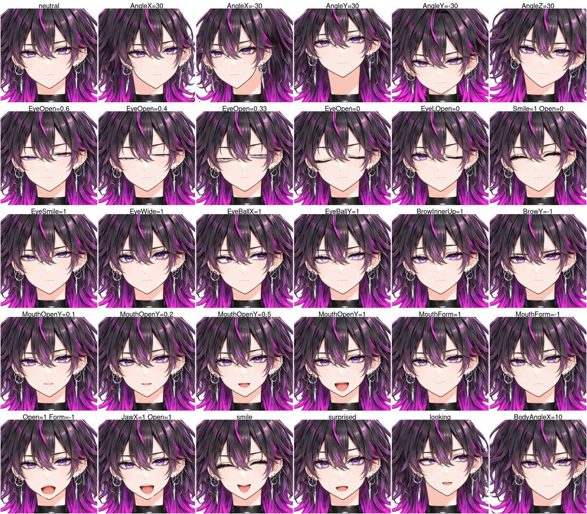
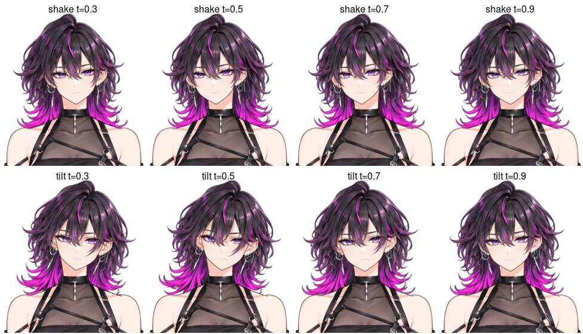
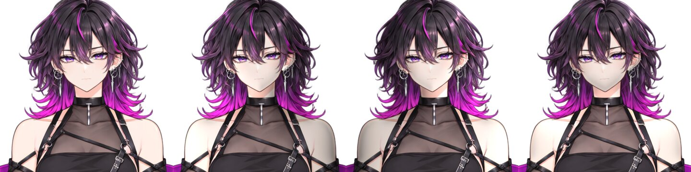
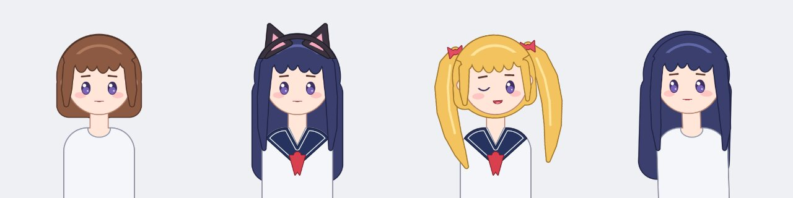

# 見本のモデル

アプリやビューアで読み込んで動きを確かめるための、完成したモデル (`.ugoe`) を置きます。

| ファイル | 内容 | 大きさ | 出所 / ライセンス |
| --- | --- | --- | --- |
| `avatar.ugoe` | アバタープロファイル ([docs/spec/avatar-profile.md](../../docs/spec/avatar-profile.md)) のレベル 3 に準拠した胸から上のモデル。キャンバス 1024x1024、パラメータ 27、メッシュ 24、デフォーマ 12、動的物理のリグ 5 (前髪・後ろ髪・耳飾りの揺れ)、モーション 4・表情 4 ([下](#モーションと表情))、パラメータのグループ 5・ポーズ (耳飾りの有無。[下](#パラメータのグループとポーズ)) | 約 1.3MB | `assets/fixtures/psd-real/comfyui-see-through-bustup-parts.psd` (AI 生成、MIT) から `ugoe sample avatar` で生成 / MIT |
| `avatar-params.jpg` | `avatar.ugoe` を各パラメータの端と途中の値 (と表情の組み合わせ) で `ugoe render` した顔の拡大の一覧 | 約 270KB | 同上 |
| `avatar-smooth.jpg` | 頭の向き (`AngleX` = `AngleY` = 15) の顔の拡大を、深度からの回転のワープ (`FaceWarp`・`BackHairWarp`) を線形で補間した場合 (T0314 より前の見本)・曲線補間 (今の見本)・キーを 7.5 度ごとに足して作り直した正解で並べ、下の段に正解との差を示したもの。頂点のずれの最大は線形 5.88px、曲線 0.52px ([evaluation.md#曲線補間](../../docs/spec/evaluation.md#曲線補間)) | 約 130KB | 同上 |
| `avatar-lit.ugoe` | `avatar.ugoe` のすべてのテクスチャに法線マップ (テクスチャの半分の解像度) を付け、ライティングを有効にした版 ([下](#avatar-litugoe))。リグ・物理・メタデータは `avatar.ugoe` と同じ | 約 1.5MB (法線マップは合わせて約 180KB) | `ugoe sample avatar --lit` で生成 / MIT |
| `avatar-lit.jpg` | 左から `avatar.ugoe` (ライティングなし)、`avatar-lit.ugoe` に左・右・上から光を当てたもの (環境光 0.55、平行光源 0.6、高さ 45°) | 約 110KB | 同上 |
| `dress-up/` | 着せ替えの見本 ([下](#dress-up))。スロットを持つ本体 `dress-up.ugoe` (モーション 5・表情 3、パラメータのグループ 5・ポーズ (手を振る)) と、衣装のモジュール `long-hair`・`twin-tails`・`cat-ears`・`sailor` (`.ugoemod`) | 合わせて約 165KB | `ugoe sample dress-up` がコードで描いて生成 / MIT |
| `dress-up.jpg` | `dress-up/` を `ugoe render --module` で描いたもの (左から本体だけ、`LongHair`+`CatEars`+`Sailor`、`TwinTails`+`Sailor` (向き・片目・口)、`LongHair` (向き・体)) | 約 40KB | 同上 |
| `avatar-physics.jpg` | 頭を振る (`AngleX` 0→25→-25→0 を 0.8 秒) モーションと傾ける (`AngleZ` 0→30→0) モーションの途中を `ugoe render --motion --time` で描いたもの (上 4 つが振る、下 4 つが傾ける。0.3/0.5/0.7/0.9 秒) | 約 100KB | 同上 |

T0702 の全身の絵 (`comfyui-see-through-full-body-parts.psd`) から作った前の見本は、目・口が 1 枚ずつで表情が不自然だったので、
T0704 でこのバストアップの PSD から作ったものに置き換えました (全身の見本は残していません。要るなら T0702 のコミットのジェネレータで作れます)。

## モーションと表情

見本のモデル (`avatar.ugoe`・`avatar-lit.ugoe`・`dress-up/dress-up.ugoe`) は、モーションと表情を持ちます (T0719)。
npm パッケージの `<ugoe-avatar motion="nod" expression="smile">` (`bindings/web/examples/basic` の選択欄) や
`ugoe render --motion nod --time 0.3`・`--expression smile` でそのまま試せます (ビューアでは右のパネルの「モーションと表情」で再生できます)。中身は `crates/ugoe-cli/src/sample/animations/` の JSON (手で書いたもの。MIT) で、`ugoe sample` が
バンドルに入れます (見本のアバターはエディタと同じ `Command::AddMotion`・`AddExpression` で)。

| モーション | 長さ | 動かすもの |
| --- | --- | --- |
| `idle` | 4 秒・ループ | `AngleX` ±8・`BodyAngleZ` 0→3 (待機) |
| `nod` | 1.2 秒 | `AngleY` 0→−25→5→−20→0 (うなずく)。終わりにイベント `nod-end` |
| `shake` | 1.6 秒 | `AngleX` 0→25→−25→25→0 (首を振る) |
| `tilt` | 1.5 秒 | `AngleZ` 0→25 (ベジェで入る)→25→0 と `EyeBallX` 0.5 (首をかしげて横を見る) |
| `wave` (`dress-up.ugoe` だけ) | 2.5 秒 | ポーズの要素 `Wave` を 2 秒表示し (パーツの不透明度のカーブ。ポーズへの表示の要求)、`HandsDown` に戻す。`AngleZ` −12・`MouthForm` 1 (手を振って笑う)。終わりにイベント `wave-end` ([下](#パラメータのグループとポーズ)) |

`idle`・`nod`・`shake`・`tilt` は標準パラメータの頭と体の向き・目玉だけを動かすので、2 つのモデルで同じものを使います。
`wave` は着せ替えの本体のポーズを切り替えるので、`dress-up.ugoe` だけに入れます (T0474)。
`dress-up.ugoe` は標準の呼吸 (`AngleX/Y/Z` の小さな揺れを含む) を持つので、モーションの値にそれが足されます。

| 表情 | `avatar.ugoe` | `dress-up.ugoe` |
| --- | --- | --- |
| `smile` | 笑い目 (`EyeLSmile`・`EyeRSmile` 1)・口角 (`MouthForm` 1) | 眉を少し上げ、口角を上げる |
| `surprised` | 目を見開き (`EyeLWide`・`EyeRWide` 1)・眉を上げ、口を開ける (`MouthOpenY` +0.5 の加算) | 眉を上げ、口を開ける (+0.6) |
| `sad` | 困り眉 (`BrowInnerUp` 1・外側を下げる)・目を細め (`EyeLOpen` ×0.75)・口角を下げる | 眉と口角を下げ、目を細める |
| `angry` | 眉を下げて外側を上げ (`BrowLAngle` 1)・口を結ぶ (`MouthPress` 0.7) | (なし) |

`dress-up.ugoe` の表情はレベル 2 のパラメータだけを使います (`EyeLSmile` などを持たないため)。
`sample::animations::check` が、モーションと表情がモデルに無いパラメータやパーツを動かさないことを確かめます。

## パラメータのグループとポーズ

見本のモデル (`avatar.ugoe`・`avatar-lit.ugoe`・`avatar-atlas.ugoe`・`dress-up/dress-up.ugoe`) は、パラメータのグループとポーズを持ちます (T0468)。
アプリ・npm パッケージの例・適合テスト (`queries`) で、グループとポーズを扱う画面や問い合わせ (`parameters_json` の `groups`・`pose_json`) を
見本のまま確かめるためです。

| グループ | パラメータ (モデルにあるものだけ) |
| --- | --- |
| `Head` | `AngleX/Y/Z` |
| `Body` | `BodyAngleX/Y/Z`・`Breath` |
| `Eyes` | `EyeLOpen`・`EyeROpen`・`EyeLSmile`・`EyeRSmile`・`EyeLWide`・`EyeRWide`・`EyeBallX/Y` |
| `Brows` | `BrowLY`・`BrowRY`・`BrowLAngle`・`BrowRAngle`・`BrowInnerUp` |
| `Mouth` | `MouthOpenY`・`MouthForm`・`MouthX`・`JawX`・`MouthPucker`・`MouthPress`・`MouthShrug` |

グループはエディタ・ビューアのスライダーの区切りで、評価には効きません。2 つのモデルで同じ表 (`crates/ugoe-cli/src/sample.rs` の
`PARAMETER_GROUPS`) を使います。

| モデル | ポーズのグループ (先頭が最初に表示される) |
| --- | --- |
| `avatar.ugoe` | `earwear` (耳飾り `earwear-l`・`earwear-r` を耳のパーツから移したもの) / `no_earwear` (中身の無いパーツ。耳飾りを外した姿) |
| `dress-up.ugoe` | `HandsDown` (中身の無いパーツ。手は絵の外) / `Wave` (顔の横で手を振る `HandWave`。`links` の `WaveSleeve` (既定の服の色の袖 `SleeveWave`) も一緒に表示する) |

どちらも先頭の要素が既定の姿なので、ポーズを効かせても効かせなくても既定の見た目は前と同じです (`avatar-*.jpg`・`dress-up.jpg` は
作り直していません)。`Wave` と `WaveSleeve` はパーツの不透明度を 0 にしてあるので、ポーズの段を通らない描画 (`ugoe render` の時間を進めない描画、
エディタの編集中のビューポート) でも見えません。ポーズで表示すると、不透明度を上書き (重み 1) して見せます。
切り替えはエディタの「Pose」の節 (プレビューモード) や「Poses」タブの「Show the pose in the viewport」、ランタイムの `show_pose`
(`Puppet::pose_mut().show`)、見本のモーション `wave` (T0474。ビューア・npm パッケージの例の選択欄でも再生できる) で試せます。
`ugoe render` では `--motion wave` の途中の時刻を描きます (ポーズのフェードは 0.5 秒なので、0.7〜2 秒なら手が上がりきっている):

```sh
just cli render assets/samples/dress-up/dress-up.ugoe -o wave.png --motion wave --time 1.2
# セーラー服を付けると、袖もセーラー服のもの (紺の袖口) に切り替わる (モジュールのポーズの追従)
just cli render assets/samples/dress-up/dress-up.ugoe --module assets/samples/dress-up/sailor.ugoemod \
  -o wave-sailor.png --motion wave --time 1.2
```

着せ替えのスロット `Outfit` は `Wave` を `pose_parts` で公開し、`Sailor` は自分の袖のパーツ `WaveSleeve` を `pose.links` で `Wave` に
追従させます ([docs/spec/modules.md#ポーズ](../../docs/spec/modules.md#ポーズ))。既定の袖のパーツ `WaveSleeve` は既定の服 `Clothes` の子なので、
`Sailor` が `Clothes` を置き換えると一緒に隠れます。手 (`HandWave`、描画順 700) は髪より手前ですが、袖は服と同じく髪より奥
(既定の袖は 255、`Sailor` の袖はスロットの範囲に写した 280) に描くので、前腕は袖の上の端で切ってあります。

## avatar.ugoe

作り直し (リポジトリのルートで):

```sh
just cli sample avatar -o assets/samples/avatar.ugoe
just cli validate --profile avatar assets/samples/avatar.ugoe   # "claims level 3, satisfies level 3"
```

ジェネレータ (`crates/ugoe-cli/src/sample.rs`) を変えたら作り直してコミットします。
`cargo test -p ugoe-cli` の `committed_sample_is_up_to_date` が、コミットしたものと今の出力が同じ形 (と同じ物理の設定) か確かめます。

### 組み立て方

PSD を取り込み、エディタと同じ `ugoe_editor_core::Command` の列でリグを組みます。部位はレイヤーの名前
(`face`・`eyewhite-l`・`irides-l`・`eyelash-l`・`eyeclose-l`・`eyebrow-l`・`mouth-open`・`mouth-close`・`front hair`・`back hair` など) で見つけ、
変形の量はその部位の外接矩形の大きさに対する割合で決めます。キャンバスは PSD のまま (切り詰めない) です。

| 部位 | デフォーマ / 要素 | パラメータ | 作り方 |
| --- | --- | --- | --- |
| 体 | 回転 `BodyRotation`・ワープ `BodyWarp` | `BodyAngleX/Y/Z`・`Breath` | 上ほど大きく動かす。斜めのセルは加算合成 |
| 頭 | 回転 `HeadRotation` (あごが中心) | `AngleZ` | ±30 で ±10 度。首 (`neck`) と体は動かない |
| 顔 | ワープ `FaceWarp` (6x6) | `AngleX/Y` | ドームの深度から **深度からの回転** (角度の倍率 0.7) |
| 後ろ髪 | ワープ `BackHairWarp` | `AngleX/Y` | 奥の平面 (負の一様な深度) を、顔と同じ中心で深度からの回転 |
| 開いた目 | ワープ `EyeLWarp` / `EyeRWarp` (白目・黒目・まつげ) | `EyeLOpen`・`EyeLSmile`・`EyeLWide` (右も) | 閉じるにつれ、目の下寄り (高さの 70%) の線へ縦につぶす (0.35 で 22%、0 で 4%)。笑い目は下まぶたを押し上げる (控えめ)。つぶれた目と笑い目の組み合わせのセルは書いた (加算合成では裏返るため) |
| 閉じた目 | ワープ `EyeLCloseWarp` / `EyeRCloseWarp` (`eyeclose-*`) | `EyeLSmile` (右も) | 絵は上向きの弧 (笑った閉じ目)。笑い目 0〜0.5 は中ほどを下げて平らにしたふつうの閉じ目、1 で絵のまま |
| 目の切り替え | メッシュの不透明度 | `EyeLOpen` (右も) | 閉じた目は 0.36→0.3 で現れ、開いた目は 0.3→0.22 で消える。どの値でもどちらかが不透明 (消えない・半透明の 2 枚が重ならない) |
| 黒目 | メッシュ `irides-l/r` (白目でマスク) | `EyeBallX/Y` | 白目の幅の 22%・高さの 12% だけ平行移動 |
| 眉 | メッシュ `eyebrow-l/r` (PSD のとおり前髪の奥) | `BrowLY`・`BrowLAngle`・`BrowInnerUp` (右も) | 上下・外側の上げ下げ・内側の持ち上げ。前髪の手前に描くと髪の上に線が浮いて見えるので奥のまま |
| 口の切り替え | メッシュ `mouth-open` / `mouth-close` の不透明度と形 | `MouthOpenY` | 開いた口は閉じた口の幅・半分の高さの細い隙間から開く (0→0.12 で現れ、0.12→1 で広がる)。閉じた口は 0.12→0.3 で消える |
| 口の形 | 両方の口のメッシュ | `MouthForm` | 口角を閉じた口の高さの 45% だけ上げ下げする (開いた口も同じ量。開きとの組み合わせのセルはすべて書いた) |
| 口のまわり | ワープ `MouthWarp` | `MouthX`・`JawX`・`MouthPucker`・`MouthPress`・`MouthShrug` | 左右・あご (下ほど横)・すぼめ・押し付け・口元の持ち上げ |
| 耳飾りのポーズ | パーツ `earwear` (顔のパーツの子)・`no_earwear` | なし | 耳飾りを耳のパーツ (`ear-l`・`ear-r`) から `earwear` へ移し (`SetMeshProperties`)、`no_earwear` と 1 つのポーズのグループにする (`SetPose`) |
| 揺れもの (動的物理) | ワープ `FrontHairSwayWarp` (顔のワープの子)・`BackHairSwayWarp` (後ろ髪のワープの子)・メッシュ `earwear-l/r` | なし (物理の入力は `AngleX`) | 振り子の先の粒子の横の変位を、制御点・頂点に重み付きで足す (`vertices`)。根元は頭の回転デフォーマ (`frame`) に付くので、`AngleZ` と体の動きでも揺れる。前髪は毛先だけ (上 40% は 0、下端で 0.5) を小さく、後ろ髪は顔の中ほどから 2 区間で大きくゆっくり (下端で 0.8)、耳飾りは金具 (上 35%) を動かさず飾りを速く (加速度 4)。衝突体は使わない |

`Model.avatar` (メタデータ・許諾・`Head` / `Body` の当たり判定) は、設定するコマンドがまだないので組み終えたモデルに直接書いています。
パラメータのグループは `AddParameterGroup` で足し、パラメータの割り当ては `SetParameterGroup` で行います。





## avatar-lit.ugoe

ライティング ([docs/manual/lighting.md](../../docs/manual/lighting.md)) を試すための、`avatar.ugoe` に法線マップを付けた版 (T0707)。
ビューアの「サンプル」→「アバター (ライティング)」で開ける。

作り直し (リポジトリのルートで):

```sh
just cli sample avatar --lit -o assets/samples/avatar-lit.ugoe
just cli render assets/samples/avatar-lit.ugoe -o lit.png --ambient 0.55 --light directional:1,0,-1:0.6
```

ジェネレータ (`crates/ugoe-cli/src/sample/lit.rs`) か `avatar.ugoe` を変えたら作り直してコミットします。
`cargo test -p ugoe-cli` の `sample::lit::tests::committed_lit_sample_is_up_to_date` が、モデルが `avatar.ugoe` に法線マップの名前と
ライティングを足しただけであることと、法線マップが今の出力と (丸めの誤差を除いて) 同じことを確かめます。

法線マップはアルファの形のふくらみ (T0506、`ugoe_rigging::bulge_height`) から作りますが、テクスチャ (PSD のレイヤー) ごとに
ふくらませると、顔の上の目・口が平らに浮いたり、首と体・肩の上の腕の境目に段差が出たりします。そこで部位をまとまりに分け、
まとまりの形 (メンバーのアルファを基準の姿のキャンバスに並べたもの) を 1 つのふくらみにして、その高さを各テクスチャに写してから法線にします。
ふくらみはエディタの生成と同じ `ugoe_rigging::group_bulge_normal_maps` (T0518、[docs/ai-integration.md#まとまりでふくらませる](../../docs/ai-integration.md#まとまりでふくらませる)) で作ります。

| まとまり | 部位 | ふくらみ |
| --- | --- | --- |
| 顔 | `face` と、目・眉・鼻・口のすべて | 強さ 0.35、縁から 48px だけ丸める (中ほどは正面を向く)。目・口は顔と同じ向きを受ける |
| 体 | `neck`・`topwear`・`handwear-l/r` (形には `face` も加える) | 強さ 0.3、形全体。顔を形に加えるのは、首を形の上端にしない (あごの下が明るくならない) ため |
| 前髪・後ろ髪 | `front hair`・`back hair` (別々) | 強さ 0.5 |
| 耳・耳飾り | `ears-l/r`・`earwear-l/r` (別々) | 強さ 0.5・0.6 |

形の外の画素には隣の法線を広げます (縮小や描画の補間で輪郭に正面向きの法線が混ざり、重なった部位の輪郭に線が見えるため)。
法線はなだらかなので、テクスチャの半分の解像度で持ちます。



## avatar-atlas.ugoe

`avatar.ugoe` のテクスチャ (PSD のレイヤーごとの 24 枚) を、`ugoe build --atlas` と同じ既定の設定 (1 辺 2048 まで・余白 2) で
1 枚のアトラス (994x1698) にまとめた版です ([docs/spec/file-formats.md#テクスチャのアトラス化](../../docs/spec/file-formats.md#テクスチャのアトラス化))。
見た目と動きは `avatar.ugoe` と同じで、描画順で隣り合うメッシュが同じテクスチャを使うので、描画をまとめるエンジンでは描画の呼び出しが
減ります (Unity のパッケージでは 24 回 → 1 回。bindings/unity/README.md#描画のしかた)。Unity のパッケージの見本 (`Samples~/Basic/Models/`) に入ります。

作り直し (リポジトリのルートで。`avatar.ugoe` を作り直したら一緒に):

```sh
just cli sample avatar --atlas -o assets/samples/avatar-atlas.ugoe
```

`cargo test -p ugoe-cli` の `committed_atlas_sample_is_up_to_date` が、コミットしたものが `avatar.ugoe` をアトラスにまとめたものと
同じか (モデルとアトラスの PNG のバイト列) を確かめます。法線マップのある `avatar-lit.ugoe` はアトラスにまとめられません
(法線マップを同じ配置で詰める必要があり、まだ対応していません)。

## dress-up

着せ替え ([docs/manual/dress-up.md](../../docs/manual/dress-up.md)・[docs/spec/modules.md](../../docs/spec/modules.md)) を試すための見本 (T0710)。
ビューアの「サンプル」→「着せ替え」で、本体と 4 つのモジュールをまとめて開ける。
エディタで開くプロジェクトは `--project` で書き出す ([下](#エディタで開くプロジェクト))。

作り直し (リポジトリのルートで):

```sh
just cli sample dress-up -o assets/samples/dress-up
just cli validate --profile avatar assets/samples/dress-up/dress-up.ugoe   # "claims level 2, satisfies level 2"
just cli render assets/samples/dress-up/dress-up.ugoe -o dressed.png \
  --module assets/samples/dress-up/long-hair.ugoemod --module assets/samples/dress-up/sailor.ugoemod
```

ジェネレータ (`crates/ugoe-cli/src/sample/dress_up.rs`) を変えたら作り直してコミットします。
`cargo test -p ugoe-cli` の `sample::dress_up::tests::committed_sample_is_up_to_date` が、コミットしたファイルと今の出力がバイト列で同じか確かめます
(絵は四則と平方根だけで描くので、どこで生成しても同じバイト列になります)。



### 本体 (`dress-up.ugoe`)

胸から上のデフォルメした人物 (キャンバス 512x512)。モデルも絵も PSD を使わずにコードで作る (要素を直接並べる。見本のアバターのような推定は使わない)。

| 要素 | 内容 |
| --- | --- |
| パラメータ | アバタープロファイルのレベル 2 の分 (T0715): `AngleX/Y/Z`・`BodyAngleX/Y/Z`・`Breath`・`EyeLOpen`・`EyeROpen`・`EyeBallX/Y`・`BrowLY`・`BrowRY`・`MouthOpenY`・`MouthForm` (標準の値域)。目パチ・呼吸・リップシンクは標準の設定。グループは [上](#パラメータのグループとポーズ) |
| パーツ | `Body` → `Head` → `Hair` (既定の髪)、`Body` → `Clothes` (既定のシャツ) → `WaveSleeve` (振る手の袖)、`Body` → `HandsDown`・`Wave` (ポーズ) |
| ポーズ | `HandsDown` (中身なし) / `Wave` (`links`: `WaveSleeve`) の 1 グループ。`Wave` の手 `HandWave` は体のワープの子で、描画順 700 (髪のスロットより手前、頭の飾りのスロットより奥)。袖 `SleeveWave` は描画順 255。パーツの不透明度はどちらも 0 ([上](#パラメータのグループとポーズ)) |
| `BodyWarp` (ワープ 2x2) | 上ほど `BodyAngleX` で横に、`Breath` で上に、`BodyAngleY` で上下 (±4px) に動き、`BodyAngleZ` ±10 で腰の下を軸に上の辺が ±5 度傾く (下の辺は動かない) |
| `HeadRotation` (回転) | 首の付け根が中心。`AngleZ` ±30 で ±10 度、`BodyAngleZ` ±10 で ±5 度を足す。`BodyAngleX/Y/Z` で中心が体と一緒に動く |
| `HeadWarp` (ワープ 8x8、`HeadRotation` の子) | 顔の中ほどを頂点にした丸みの分だけ `AngleX` で横 (最大 16px)、`AngleY` で縦 (最大 12px) に動かす。目・口は大きく、輪郭と後ろ髪は小さく動く |
| 目・眉・口 | 開いた目は `EyeLOpen` で下寄りの線へつぶれて消え、閉じた目の線が現れる。瞳 (`EyeLIris`・`EyeRIris`) は `EyeBallX/Y` で横 ±4px・縦 ±3px 動き、目の形をマスクにしてくり抜く。眉 (`BrowL`・`BrowR`) は `BrowLY`・`BrowRY` で ±5px 上下する。口は `MouthOpenY` で上の辺へつぶし、`MouthForm` で口角を ±4px 上げ下げする (正で笑顔) |
| 物理 | 既定の後ろ髪 (`HairBack`) が頭の中心を軸にした回転デフォーマ `HairSway` に付き、リグ `HairSway` (長さ 120px の振り子) で揺れる。重力などはエディタの既定の設定。肩の衝突体 `Shoulders` (体のワープ `BodyWarp` に付けた、胴の上の辺に沿う半径 34px のカプセル) を持ち、スロット `Hair` で公開する (T0660。`TwinTails` の房のリグが当たる (T0662)。見本の本体の後ろ髪と `LongHair` の後ろ髪は、頭の中心から真下に垂れる振り子で静止姿勢の区間が肩を横切り、当てると最初の更新で横へ押しのけられるので当てない。物理を渡さずにモデルだけで作った Puppet でも、スロット `Hair` にモジュールを付けられる) |
| 当たり判定 | `Head` (顔 `Face`)・`Body` (肌 `Skin`) |
| アバタープロファイル | レベル 2 (メタデータ・許諾は `avatar.ugoe` と同じく MIT で自由に使える形)。`slots` に 3 つのスロットをすべて書き、アプリに公開する (T0712) |

| スロット | 取り付け先 | 描画順 | 置き換える | その他 |
| --- | --- | --- | --- | --- |
| `Hair` | `HeadWarp` | 420〜680 (顔 500・目 530・眉 540 を挟む) | `Hair` | マスクに本体の肌 `Skin` を公開 (長い後ろ髪を体の奥に見せる) |
| `Headwear` | `HeadWarp` | 900〜1000 | なし | |
| `Outfit` | `BodyWarp` | 260〜340 (肌 200 と顔の間) | `Clothes` | ポーズの要素 `Wave` を公開 (`pose_parts`。モジュールの袖を振る手に追従させる) |

### モジュール

| ファイル | モジュール | スロット | 内容 |
| --- | --- | --- | --- |
| `long-hair.ugoemod` | `LongHair` | `Hair` | 紺の長い髪。後ろ髪は頭の中心を軸にした回転デフォーマ `Sway` に付き、動的物理 (`deformer_angle`、長さ 250px の振り子) で揺れる。本体の肌を反転マスクにして体の奥に見せる。顔の横の房は胸の前に垂れる |
| `twin-tails.ugoemod` | `TwinTails` | `Hair` | 金のツインテール。房とリボンは結び目を軸にした回転デフォーマ `TailL`・`TailR` に付き、それぞれ物理で揺れる。房は肩のすぐ外に垂れ、内側へ振れると本体の肩の衝突体 `Shoulders` に当たって止まる (T0662。静止姿勢では当たらないので、垂れ方は変わらない) |
| `cat-ears.ugoemod` | `CatEars` | `Headwear` | 猫耳のカチューシャ |
| `sailor.ugoemod` | `Sailor` | `Outfit` | セーラー服 (上着・襟・スカーフ)。体のワープと一緒に動く。振る手の袖 (パーツ `WaveSleeve`、紺の袖口) を本体のポーズの要素 `Wave` に追従させる (`pose.links`。T0474) |

`LongHair` と `TwinTails` は同じスロット `Hair` なので、付けると差し替わります。どのモジュールも `requires` は持たず、
本体のパラメータは標準パラメータだけを使います。

### エディタで開くプロジェクト

`--project <DIR>` を付けると、同じ本体とモジュールを、エディタで開けるプロジェクトとしても書き出します (T0712)。
プロジェクトはリポジトリにコミットしていません (`.ugoe`・`.ugoemod` と同じ中身で、いつでも作り直せるため)。

```sh
just cli sample dress-up -o /tmp/dress-up --project /tmp/dress-up/projects
```

| プロジェクト | 種類 | 内容 |
| --- | --- | --- |
| `dress-up.ugoeproj` | 本体 | `dress-up.ugoe` と同じモデルと物理 (スロットとアバタープロファイルの見本) |
| `long-hair.ugoeproj`・`twin-tails.ugoeproj`・`cat-ears.ugoeproj`・`sailor.ugoeproj` | モジュール | 本体 `../dress-up.ugoeproj` のスロットを参照する。「Export Module…」で書き出すと、コミットした `.ugoemod` と同じ中身になる。物理のタブには本体のリグ `HairSway` も (動かせない行として) 並ぶ |

プロジェクトは `ugoe_editor_core::Project` で書きます (本体を保存して読み直し、エディタの「New Module…」と同じ
`Project::new_module` で作ったモジュールのプロジェクトに、見本のモジュールを入れる)。
`sample::dress_up::tests::projects_open_in_the_editor_core` が、書いたプロジェクトを開けて、書き出すと見本と同じになることを確かめます。
