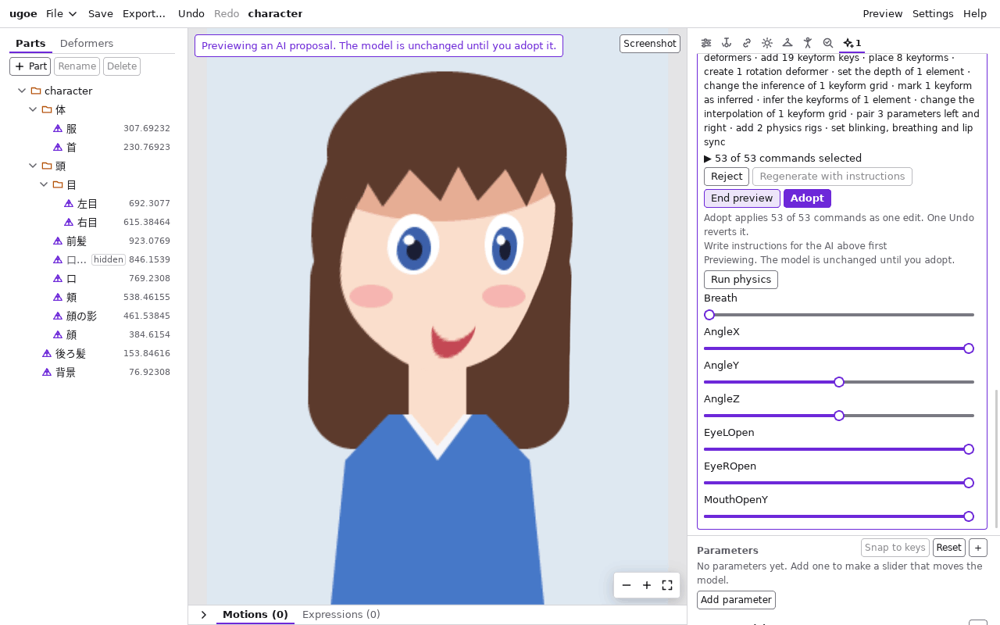
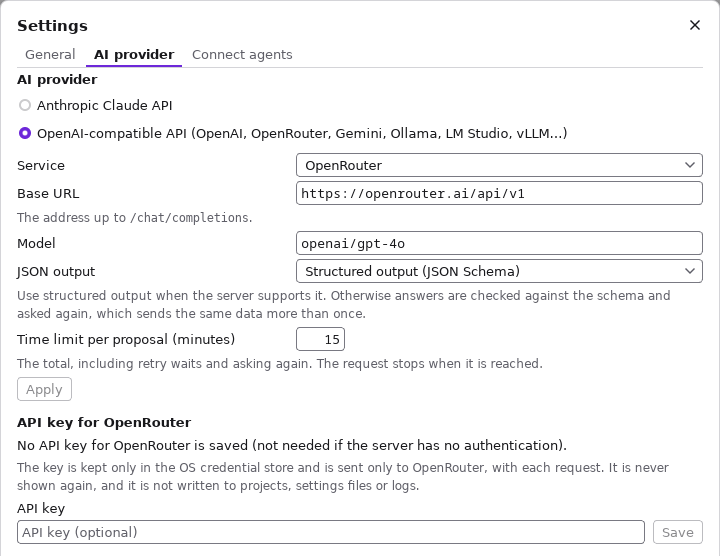
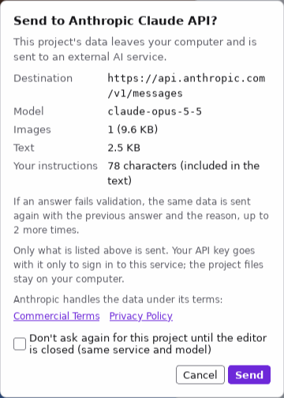
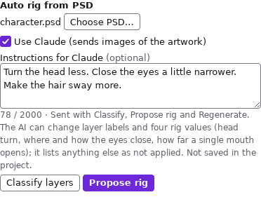
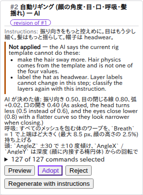
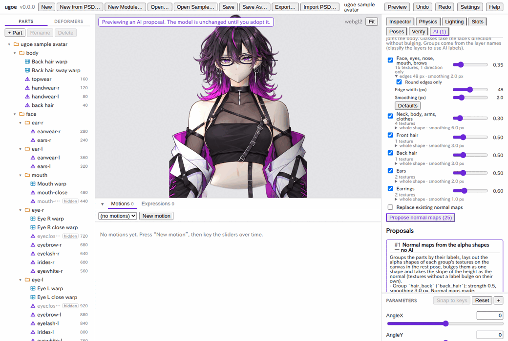

# AI でリギングを提案する

PSD のレイヤーを **分類** し (顔・白目・まつ毛・口など)、その結果から **顔の角度・目・口のリグ** を組んだ提案を作って、
プレビューで確かめてから採用する機能です。仕組みは [docs/editor.md#ai-の提案](../editor.md#ai-の提案) と
[AI 連携](../ai-integration.md) (開発者向け) にあります。

- 提案は **採用するまでモデルを変えません。** 採用は 1 回の「Undo」で取り消せます。
- AI (Claude API や OpenAI 互換の API) を使わなくても使えます。そのときはレイヤーの名前で分類し、リグの値はテンプレートの既定値になります。
  何も外部に送らず、API キーも要りません。
- AI を使うと、分類とリグの値 (振り向きの大きさ・目の閉じる線・口の開き) を絵を見て決めます。**絵の画像を外部に送る** ので、
  外部のサービスに送る前には毎回確認が出ます。手元の計算機で動かすサーバ (Ollama・LM Studio など) なら外部に出ないので、
  確認は出ません。

## 準備: AI を使うとき

AI を使わないなら、この節は飛ばしてかまいません。

1. ヘッダーの「Settings」を押し、「AI provider」でプロバイダを選ぶ。既定は「Anthropic Claude API」です。
   - OpenAI・OpenRouter・Google Gemini、手元の Ollama・LM Studio などを使うなら「OpenAI-compatible API」を選び、「Service」で
     送り先を選ぶ (ほかの送り先は「Base URL」に `/chat/completions` の手前までの URL を入れる)。「Model」には **画像を読める**
     モデルの名前を入れる。「Apply」で保存します (エディタ全体の設定で、プロジェクトには残りません)。
   - 送り先が構造化出力 (JSON Schema) に対応しないときは、「JSON output」を「JSON mode…」か「Schema in the prompt only…」にします。
     答えを確かめて、合わなければ問い直します (同じ内容を送り直すことがあります)。
2. 選んだプロバイダの API キーを保存する。キーはプロバイダ (OpenAI 互換は送り先) ごとに OS の資格情報の保存先に置かれます。
   Claude は環境変数 `ANTHROPIC_API_KEY`、OpenAI は `OPENAI_API_KEY` でもかまいません (エディタを起動する前に設定する)。
   手元のサーバなど、認証のない送り先ならキーは要りません。
3. 「Settings」の「This project」の「Don't send this project's data to external AI services」に印が **付いていない** ことを確かめる
   (プロジェクトごとの設定です。印を付けると、そのプロジェクトからは外部に何も送りません。手元のサーバには送れます)。
4. 「Test connection」で、選んだプロバイダにつながるかを確かめられます (画像は送りません)。

キーの要るプロバイダでキーがないか、外部の送り先でプロジェクトが「送らない」になっていると、AI のパネルの「Use …」は選べず、
その理由と「Settings…」への案内が出ます。

## 提案を作る

1. 「File」の「New from PSD…」で PSD から新しいプロジェクトを作る (または「Import PSD…」で今のプロジェクトに取り込む)。
   取り込んだ PSD が、分類の元になります。
2. 右の列の上の「AI」タブを押す。「Auto rig from PSD」に取り込んだ PSD の名前が出ます。別の PSD を使うときは
   「Choose PSD…」で選びます。
3. AI を使うなら「Use Claude (sends images of the artwork)」(選んだプロバイダの名前が出ます) に印を付ける。
4. 「Propose rig」を押す。まだ分類していなければ、先にレイヤーを分類します。パネルに今の段階
   (「Classifying the layers…」「Asking Claude for the rig values…」など) が出ます。
5. 外部の AI に送るときは、送る前に確認が出ます (分類で 1 回、リグの値で 1 回)。送り先・モデル・画像の枚数と大きさ、
   送り先の規約を確かめて「Send」を押します。「Cancel」なら何も送りません。

- 分類だけを先に行うときは「Classify layers」を押します。分類の結果は「24 layers classified by AI · 1 to review」のように出て、
  「Labels」を開くとラベルごとの数と、**確からしさが低いレイヤー** が出ます。確からしさが低いレイヤーは提案の理由の末尾にも出るので、
  採用する前にそのレイヤーの動きを確かめてください。
- リグの値の答えが範囲の外か、組んだリグが検証を通らないときは、AI に理由を添えて問い直します (最大 3 回)。
  問い直したときは、提案の理由にその旨が出ます。
- 顔の振り向きは、顔の形に合わせた丸い起伏 (楕円体) で作ります。深度を推定する機能はまだありません。

## AI に注文を添える・作り直す

AI を使うときは、「Instructions for Claude」(選んだプロバイダの名前が出ます) の欄に、AI への注文を自由に書けます。
例: 「目はもう少し細く閉じる」「振り向きは控えめに」「帽子は headwear」。日本語でも英語でもかまいません (2000 文字まで)。

- 注文は「Classify layers」「Propose rig」「Regenerate with instructions」に添えて送ります。「Use …」の印がないときは送りません。
- 送る前の確認に「Your instructions: 35 characters」のように、注文の文字数が出ます。
- **AI が変えられるのは、レイヤーのラベル (分類) と、リグの 4 つの値 (振り向きの大きさ・目の閉じる線と弧・1 枚の口の開き) だけです。**
  リグの形はテンプレートで決まるので、「髪をもっと揺らす」「眉も動かす」などはできません。AI はできない注文を
  **「Not applied」** として答え、提案の理由の上に出ます。黙って無視はしません。
- 注文は AI への「お願い」として送られ、ugoe が AI に与える指示 (答えの形や値の範囲) は変えられません。
- 注文の欄の中身は、プロジェクトに **保存されません** (エディタを開いている間だけ残ります)。提案には、そのとき添えた注文が出ます。

### 作り直す

1. 注文の欄を書き直す (例: 「振り向きをもっと控えめに」)。
2. 直したい提案の「Regenerate with instructions」を押す。前の提案の値と理由、今の注文を AI に送ります (確認が出ます)。
3. 新しい提案が一覧の後ろに「revision of #1」の印付きで並びます。**前の提案は残ります。** 両方を「Preview」で見比べて、
   良い方を「Adopt」し、要らない方を「Reject」します。

- 作り直しはいつも AI を使います。「Use …」に印がないか、注文が空のときは押せません。
- 作り直しは、今の分類をそのまま使います。「帽子は headwear」のようにラベルも直したいときは、「When regenerating, also reclassify
  the layers with these instructions」に印を付けてから押します。先にレイヤーを分類し直すので、レイヤーの画像をもう一度送ります
  (確認は 2 回)。

## 提案を確かめる

「Proposals」に、提案の題名 (AI を使ったものは「— AI」、使わなかったものは「— rules」)・理由 (決めた値と、組んだもの)・
コマンドの一覧が出ます。

1. 「Preview」を押す。ビューポートに、提案を適用した姿が出ます (上に「Previewing an AI proposal…」と出ます)。
2. 提案の下に出るスライダー (AngleX・EyeLOpen・MouthOpenY など、提案が作ったパラメータ) を動かして、振り向き・目の閉じ方・
   口の開き方を確かめる。
3. 揺れ (髪の物理など) を確かめるには「Run physics」を押す。物理が動き、スライダーを動かすと揺れます。「Stop physics」で止まります。
4. 「End preview」でプレビューをやめる (物理も止まります)。

- プレビュー中は、ビューポートの編集のツール (選択・ギズモ) は使えません。モデルを編集したり「Undo」を押したりすると、
  プレビューは終わります。
- 提案を作った後にモデルを変えると、提案に「outdated」と出て、プレビューも採用もできなくなります。「Undo」で提案を作ったときの
  状態に戻せば、また使えます。戻せないときは、提案を「Reject」して作り直してください。

## 採用する・却下する

- 「Adopt」を押すと、提案をモデルに適用します。**1 回の「Undo」で全部が取り消せます。** 採用した提案は一覧から消えますが、
  すぐに「Undo」すると一覧に戻るので、選び直して採用し直せます (AI にもう一度尋ねずに済みます)。
- 「Reject」を押すと、提案を捨てます。
- 採用した後は、ほかの編集と同じようにキーフォームを手で直せます。手で直したセルは `A` (手で作った) になり、推定のやり直しで
  上書きされません ([推定・ミラー・深度](inference.md))。

## 一部だけ採用する

提案の「117 of 117 commands selected」を開くと、提案の中身 (コマンド) の一覧が出ます。同じ対象 (デフォーマやメッシュ) への
続いたコマンドは 1 行にまとまっていて、▶ を押すと 1 つずつ出ます。

1. 採用しないコマンド (またはまとまり) の印を外す。例: 口のリグだけ要らないなら `MouthOpenY` と `mouth_open`・`mouth_close` の行。
2. 「Preview」で確かめる (プレビュー中なら、印を変えるたびに作り直されます)。
3. 「Adopt 105」のように、選んだ数の付いた「Adopt」を押す。

- 印を外すと、**それに頼るコマンドも一緒に外れます** (例: パラメータ `AngleX` を外すと、`AngleX` のキーを足すコマンドも外れる)。
  印を戻すと、それが頼るコマンドも一緒に戻ります。
- それでも適用できない選び方のときは、プレビューも採用もせず、理由がパネルに出ます。

## 法線マップを提案する

AI タブの「Normal maps from the shapes」で、**すべてのテクスチャの法線マップ** をまとめて提案できます。
法線マップはライティング ([ライティング](lighting.md)) で陰影を付けるための画像で、テクスチャの不透明な形を手前にふくらんだ形とみなして作ります。
**AI は使わず、何も外部に送りません。** Lighting タブの「Generate」と同じ作り方を、全部のパーツに一度に行うものです。

1. 「Normal maps from the shapes」に、部位のまとまり (「Face, eyes, nose, mouth, brows」「Neck, body, arms, clothes」「Front hair」など) が並びます。
   まとまりのパーツは 1 つの形としてふくらむので、目は顔の上で平らに浮かず、首と肩の境目に段差が出ません。
   行の下に、テクスチャの数・すでに法線マップを持つ数 (「mapped」)・向きだけを受ける数 (「direction only」。眼鏡) が出ます。
2. 要らないまとまりの印を外す。強さはまとまりに合った値から始まります (顔と体は弱め、髪などは強め)。変えるなら行の右のスライダーで選ぶ (0 で平ら)。
   縁の丸みとならしは、行の下の「edges 48 px · smoothing 2.0 px」のような所を開いて選びます (「Round edges only」・「Edge width (px)」・「Smoothing (px)」。
   幅はキャンバスの px。「Defaults」でまとまりの値に戻ります)。
3. すでにある法線マップも作り直すなら「Replace existing normal maps」に印を付ける (付けなければ、法線マップを持つパーツは飛ばします)。
4. 「Propose normal maps (25)」(作る枚数が出ます) を押す。「Proposals」に「— no AI」の付いた提案が出ます。
5. 「Preview」を押すと、法線マップを付けた姿が、Lighting タブの光源 (Preview lights) で照らされて出ます。光の向きを変えて確かめるときは、
   Lighting タブで光源を動かしてから AI タブに戻ります (プレビューは続きます)。
6. 「Adopt」で採用します。**1 回の「Undo」で全部が戻ります。** 一部のまとまりだけを採用するときは、提案のコマンドの一覧 (「26 of 26 commands selected」) で、
   そのまとまりの行の印を外します (一覧はまとまりごとの行になっています)。

- まとまりはパーツの意味 (顔・目・前髪など) から決めます。意味はレイヤーの名前から読み、上の「Classify layers」で分類していれば、その結果を使います
  (分類し直すと、まとまりの一覧も変わります)。意味が分からないパーツは「Unlabeled parts (each on its own)」の行で、1 枚ずつふくらみます。
- **眼鏡** (`eyewear` のパーツ) は顔のまとまりに入りますが、ふくらまず、顔の面の向きだけを受けます。顔の外に出るつるは、顔の輪郭の向きのまま続きます。
- パーツ 1 枚ずつ作り直したいときは、採用した後に Lighting タブの「Generate」を使えます。
- モジュールのプロジェクトでは出ません (本体のテクスチャは変えられません)。

## 着せ替えのモジュールのプロジェクトでは

モジュールのプロジェクトでは、同じ「Propose rig」が衣装向けの提案 (本体の変形への追従、揺れる衣装の物理と本体の衝突体、
衣装の差分 A / B のポーズ) を作ります。組み方は「How to rig」の欄で選べます。採用した後に衣装のメッシュの形を編集すると、
提案し直すよう知らせます。
パラメータは足しません。AI が決めるのは揺れの大きさと振り子の長さの 2 つです。詳しくは
[着せ替え: AI に衣装のリグを提案させる](dress-up.md#ai-に衣装のリグを提案させる)。

## 制限

- リグで提案できるのは、顔の角度 (`AngleX`・`AngleY`・`AngleZ`)・目の開閉 (`EyeLOpen`・`EyeROpen`)・口の開き (`MouthOpenY`) までです。
  視線・眉・口の形・体・呼吸・髪の揺れ (物理) は、手で作るか、物理のテンプレート ([物理: 髪を揺らす](physics.md)) を使います。
- 分類の結果を画面で 1 枚ずつ直すことはできません。分類が違うときは、AI に注文を添えて分類し直す (「帽子は headwear」など)、
  PSD のレイヤーの名前を直して取り込み直す、または採用した後に手で直します。
- AI への注文で変えられるのは、分類とリグの 4 つの値 (モジュールのプロジェクトでは 2 つの値) だけです (上の「AI に注文を添える・作り直す」)。
- 分類と提案は、プロジェクトを開いている間だけ残ります (保存しても残りません)。
- AI の答えは同じ絵でも毎回少し違うことがあります。
