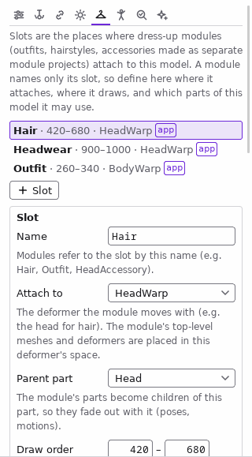
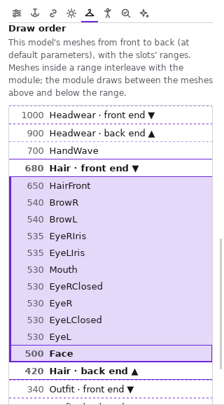
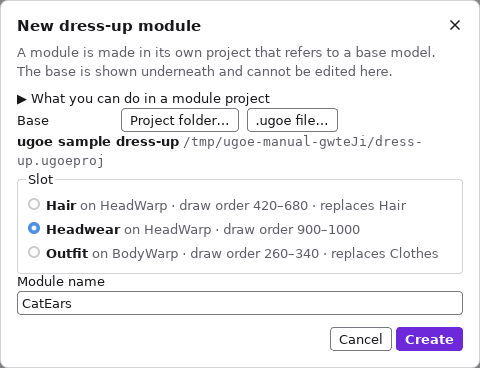
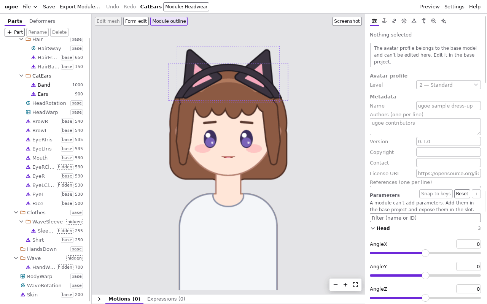
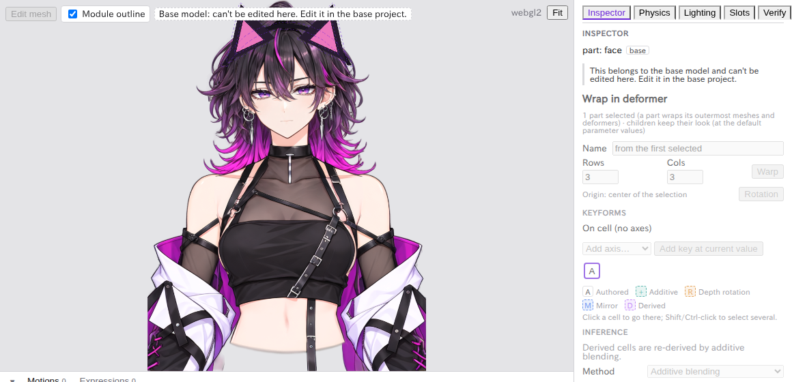
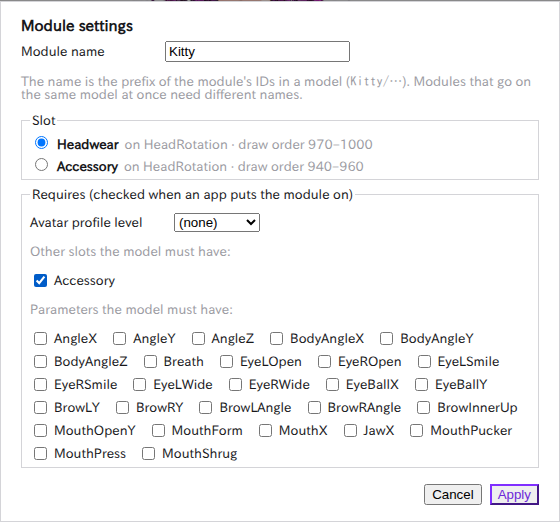
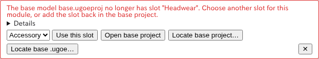
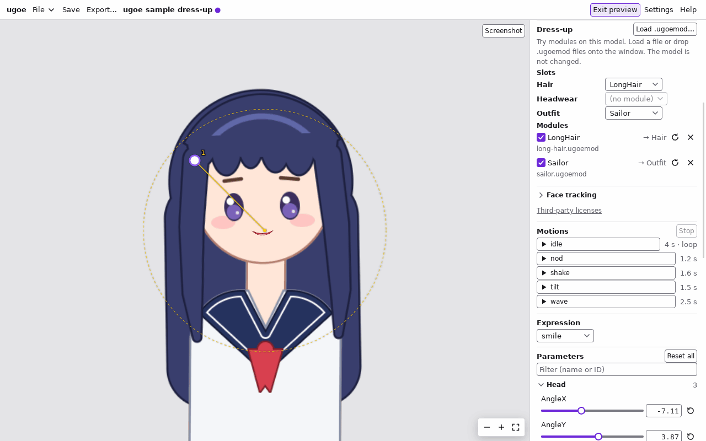
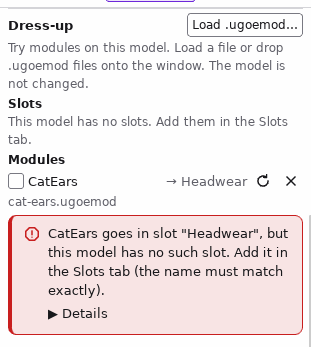
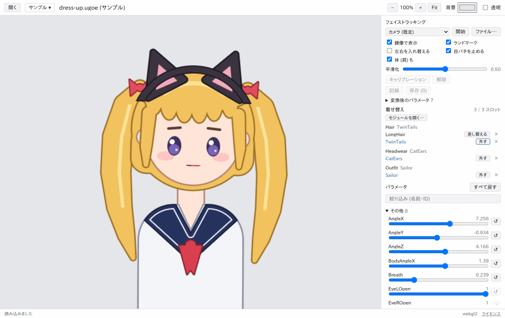

# 着せ替え

着せ替えは、衣装・髪型・アクセサリーを **モジュール** として本体のモデルとは別に作り、アプリの中で付け外しする仕組みです。
1 つのモデルに衣装を全部入れる代わりに、衣装ごとに別のファイル (`.ugoemod`) にして、あとから増やしたり配ったりできます。
仕組みの詳しい約束は [着せ替えモジュール仕様](../spec/modules.md)、設計の判断は [ADR 0024](../adr/0024-module-authoring.md) にあります。

## 全体の流れ

| 段階 | どこで | 内容 | 状態 |
| --- | --- | --- | --- |
| 1. 本体にスロットを作る | 本体のプロジェクトの「Slots」タブ | 衣装を付ける場所 (取り付け先・描画順の範囲・隠す部分・使ってよいパラメータ) を決める | [使える](#スロットを作る) |
| 2. 衣装を作る | モジュールのプロジェクト | 本体を下敷きにして、衣装の PSD を取り込み、メッシュとリギングを作り、`.ugoemod` に書き出す | [使える](#衣装を作る) |
| 3. 試す | 本体のプロジェクトのプレビュー | `.ugoemod` を読み込んで付け外しし、動きと前後関係を確かめる | [使える](#プレビューで試す) |
| 4. 使う | ビューア | `.ugoe` に `.ugoemod` を付け外しする | [使える](#ビューアで付け外しする) |

すぐに試すには、ビューアの「サンプル」→「着せ替え」で見本の本体と衣装を開きます ([見本で試す](#見本で試す))。

モジュールはスロットの **名前** だけで取り付け先を指定します。本体のスロットの名前を後から変えると、その名前を指していた
モジュールは付けられなくなるので、配った後は名前を変えないでください。

## スロットを作る

スロットは、モジュールを取り付ける場所です。髪なら `Hair`、衣装なら `Outfit`、帽子なら `HeadAccessory` のように、
取り付けるものの種類ごとに 1 つ作ります。1 つのスロットには、同時に 1 つのモジュールが付きます。

1. 右の列の上の「Slots」タブを押す。
2. 「+ Slot」を押す。空いている描画順の範囲 (手前の方) に、`Slot` という名前のスロットができて選ばれる。
3. 「Name」をスロットの名前 (例: `Hair`) に変えて、Tab キーで離れる。使える文字は英数字と `_` だけ。
4. 下の表のとおりに各項目を決める。欄を離れるか、チェックを変えるたびに反映される。1 回の変更が、1 回の Ctrl+Z で戻る。

| 項目 | 内容 |
| --- | --- |
| 「Attach to」 | モジュールが一緒に動くデフォーマ (髪なら頭の回転、衣装なら体のワープ)。モジュールの最上位のメッシュとデフォーマは、このデフォーマの中に置かれる。「Canvas」ならどれにも付かない |
| 「Parent part」 | モジュールのパーツの親にする本体のパーツ。このパーツをポーズやモーションで隠すと、モジュールも一緒に隠れる。「None」なら親なし |
| 「Draw order」 | モジュールのメッシュを描く描画順の範囲 (下の [描画順の範囲を決める](#描画順の範囲を決める))。ほかのスロットの範囲と重ねられない |
| 「Replaces」 | モジュールを付けている間、隠す本体のパーツ (例: 最初から描いてある髪) |
| 「Parameters」 | モジュールが動きに使ってよい、本体の独自のパラメータ。`AngleX` や `EyeLOpen` などの標準パラメータは、選ばなくても使える |
| 「Mask sources」 | モジュールがマスク (クリッピング) に使ってよい本体のメッシュ (例: 前髪を顔の中に収めるための顔) |
| 「Colliders」 | モジュールの物理が当たってよい本体の衝突体 (例: 長い髪が首に掛かるように首の衝突体)。衝突体は「Physics」タブで作る ([物理](physics.md)) |
| 「Pose parts」 | モジュールのパーツが追従してよい、本体のポーズのパーツ (例: 腕の差分 A / B に合わせて袖の差分 A / B を切り替える) |
| 「Show to apps」 | アバタープロファイルの「アプリに見せるスロット」に入れる。入れていないスロットは作者用で、アプリは利用者に見せない。アバタープロファイルがないと選べない ([アバタープロファイル](avatar.md)) |

各項目の下に、何のための設定かの短い説明が出ます。「Replaces」などの一覧の項目は、見出しを押すと開きます。
見出しの右に、選んでいるものが出ます (何もなければ `none`)。

一覧の行の右に `app` と出ているスロットはアプリに見せるもの、`overlap` と出ているスロットはほかのスロットと
描画順の範囲が重なっているもの (古いファイルなど) です。重なりは範囲を狭めて直してください。

「Remove slot」でスロットを消します。アプリに見せるスロットからも外れます (Ctrl+Z で戻せます)。

### 描画順の範囲を決める

モジュールのメッシュの描画順 (0〜1000) は、スロットの「Draw order」の範囲に縮めて写されます。
そのため、モジュールは **範囲より上 (手前) の本体のメッシュより奥、範囲より下 (奥) の本体のメッシュより手前** に描かれます。
範囲の中に描画順がある本体のメッシュとは、モジュールのメッシュと前後が入り組みます。

パネルの下の「Draw order」に、本体のメッシュが手前から奥の順 (パラメータが既定値のとき) に並び、スロットの範囲の手前の端
(`front end ▼`) と奥の端 (`back end ▲`) の行が差し込まれます。選んでいるスロットの範囲の中のメッシュは色が付きます。
行を押すと、そのメッシュが選ばれてビューポートで枠が出ます。

範囲の決め方の例:

- 前髪のモジュールを顔より手前・横の髪より奥に描くなら、範囲を顔の描画順と横の髪の描画順の間に取る。
- 本体の既定の髪と入れ替えるなら、既定の髪のパーツを「Replaces」に入れ、範囲を既定の髪のメッシュの前後に取る。
- 範囲の端が接するだけ (`300〜400` と `400〜500`) は重なりとみなしません。

「Select meshes in range」を押すと、選んでいるスロットの範囲に入る本体のメッシュがまとめて選ばれ、ビューポートで確かめられます。

### うまくいかないとき

| 出るメッセージ | 理由と対処 |
| --- | --- |
| `` slot `Outfit`: draw order 140..950 overlaps slot `Hair` (940..980) `` | 範囲がほかのスロットと重なる。重ならない範囲にする |
| `Slot names may use only letters, digits and _` | 名前に英数字と `_` 以外の文字がある |
| `` slot `Hair` already exists `` | 同じ名前のスロットがある |
| `` deformer `HeadRotation` still has children: …, slot `Hair` `` | スロットの取り付け先のデフォーマは消せない。先にスロットの「Attach to」を変える (「Parent part」のパーツも同じ) |

パラメータ・メッシュ・パーツ・衝突体を消すと、スロットの一覧の項目 (「Parameters」「Mask sources」「Replaces」など) からも外れます。

## 衣装を作る

衣装は、本体を参照する **モジュールのプロジェクト** で作ります。本体は下敷きとして表示され、衣装と重ねた姿を見ながら作れます。
本体はこのプロジェクトの中では変えられません (本体を直すときは本体のプロジェクトを開きます)。

### 新しいモジュールを作る

1. 本体のプロジェクトにスロットを作って保存しておく ([スロットを作る](#スロットを作る))。`.ugoe` に書き出したものも本体に使えます。
2. ファイルメニューの「New Module…」を押す。
3. 「Project folder…」で本体の `.ugoeproj` フォルダーを、または「.ugoe file…」で本体の `.ugoe` を選ぶ。本体のスロットが一覧に出る。
4. 衣装を付けるスロットを選び、「Module name」を決めて (最初はスロットの名前)「Create」を押す。

「What you can do in a module project」を開くと、モジュールのプロジェクトでできること (衣装の要素・PSD の取り込み・メッシュ・
キーフォーム・衣装の物理) と、本体のプロジェクトで直すこと (本体の要素・パラメータ・アバタープロファイル・スロット・エフェクト・
ライティングと物理の全体の設定、パラメータを足すこと、モーションと表情) が出ます。

モジュールの名前は、本体に付けたときの要素の名前の頭に付きます (`CatEars/band` のように)。`/` を含む名前と `#` で始まる名前は使えません。
同じ本体に同時に付けるモジュールどうしは、名前を変えておきます。

### 衣装を組む

作ったモジュールのプロジェクトでは、ファイルメニューの名前の横に `Module: <スロット>` と出ます。印に指を置くと本体の場所と、
できること・できないことが出ます。印を押すと [モジュールの設定](#モジュールの設定を変える) が開きます。

1. 「Import PSD…」で衣装の PSD を取り込む。本体と同じ大きさのキャンバスで描いた PSD なら、描いた位置に重なります。
   取り込んだメッシュは、見た目を保ったままスロットの取り付け先 (「Attach to」のデフォーマ) の中に入り、描画順はスロットの範囲に収まります。
2. 本体のパラメータのスライダーを動かして、衣装が一緒に動くか確かめる。取り付け先のデフォーマの動きには自動で付いてきます。
3. 衣装だけの動き (揺れ・変形) は、本体のプロジェクトと同じ方法で作る: 自動メッシュとメッシュの編集、デフォーマ、キーフォーム、推定とミラー、物理。

左のツリーでは、本体の要素に `base` の印が付いて薄く表示されます。本体の要素は選んで確かめられますが、編集はできません。

- 本体の要素を選ぶと、インスペクタの欄が薄くなって押せなくなり、「This belongs to the base model and can't be edited here. Edit it in the
  base project.」と出ます。ビューポートでは選択の枠が灰色の破線になり、形を変えるツール (フォームの編集・ギズモ・「Edit mesh」) は出ません。
- ビューポートの上の「Module outline」を入れておくと (最初から入っています)、衣装のメッシュすべての輪郭が点線で重なり、本体と見分けられます。
- 本体のものは、ほかの画面でも変えられません: パラメータの「+」と定義の編集、アバタープロファイル、「Slots」タブ、「Physics」の World と
  本体のリグ・衝突体、「Lighting」のモデル全体の設定と本体のテクスチャの法線マップ。パラメータのスライダーは動かせます。
- 要素の名前やテクスチャの名前には、本体に付けたときに付く `<モジュールの名前>/` を出しません。

それでも本体を変える操作をすると、`… belongs to the base model and can't be edited here. Edit it in the base project` と出て、何も変わりません。

キーフォームに使えるパラメータは、`AngleX` などの標準パラメータと、スロットの「Parameters」で本体が公開したものだけです。
それ以外の本体のパラメータもスライダーで動かせますが、キーフォームに使うと書き出しのときにエラーになります。

### モジュールの設定を変える

ファイルメニューの `Module: <スロット>` の印を押すと「Module settings」が開きます。「Apply」で反映し、Ctrl+Z で戻せます。

| 欄 | 内容 |
| --- | --- |
| 「Module name」 | モジュールの名前。本体に付けたときの要素の ID の頭 (`<名前>/…`) になる。同じ本体に同時に付けるモジュールどうしは違う名前にする |
| 「Slot」 | 付けるスロット。描画順はそのスロットの範囲に写し直される。取り付け先 (「on …」) の違うスロットに移すと、衣装の位置は取り付け先からの位置のままなので、見た目の場所が変わることがある (画面に注意が出る) |
| 「Requires」 | アプリがモジュールを付けるときに本体に求める条件: アバタープロファイルのレベル、ほかのスロット、パラメータ。本体が持つものから選ぶ |

本体がそのスロットや条件を満たさないとき (移したスロットがマスクや使っているパラメータを公開していないなど) は、理由が出て何も変わりません。

### 本体を変えたとき

モジュールのプロジェクトを開いている間に本体のファイルが変わると (本体のプロジェクトを別のウィンドウで保存したなど)、
「The base model changed」と出ます。

- 「Reload the base」で新しい本体を下敷きにします。衣装の編集は、保存していないものも残ります (Undo の履歴は消えます)。
- 「Later」でそのまま続けます (同じ変更についてはもう尋ねません)。
- 新しい本体に衣装が合わなくなったとき (スロットを消した・名前を変えたなど) は、何も変わらず、下の「本体の問題」の枠が出ます。

### 保存と書き出し

- 「Save」「Save As…」で `.ugoeproj` に保存します。保存するのは衣装の部分 (`module.json` と衣装の画像) だけで、本体は保存しません。
  本体の場所は、プロジェクトからの相対パスで覚えます。本体とモジュールのプロジェクトは、同じ親のフォルダーの中に置いておくと動かしやすくなります。
- 「Export Module…」で `.ugoemod` に書き出します。書き出す前に、モジュールだけでの検査と、本体に付けたときの検査を行います。
  描画順がスロットの範囲からはみ出したメッシュがあれば、書き出した後に警告が出ます。

### うまくいかないとき

本体の問題で開けないとき (または本体を読み直せないとき) は、画面の上に何が起きたかと直し方の枠が出ます。

| 枠の説明 | 理由と直し方 |
| --- | --- |
| `The base model … is not where this module expects it` | 本体が見つからない (動かした・名前を変えた)。「Locate base project…」か「Locate base .ugoe…」で本体を選び直し、保存する |
| `The base model … can't be read` | 本体が壊れている、またはモジュールのプロジェクトを選んだ。本体を選び直す |
| `The base model … no longer has slot "…"` | 本体からスロットがなくなった (名前を変えた)。一覧からスロットを選んで「Use this slot」で開き (保存すると覚える)、または「Open base project」で本体を開いてスロットを戻す |
| `This module no longer fits the base model …` | 本体はあるが衣装が合わない (公開していたパラメータ・マスクを外したなど)。「Open base project」で本体を直すか、本体を選び直す。「Details」に元のメッセージが出る |

本体を選び直してもスロットがないときは、その本体についての説明に替わり、続けてスロットを選べます。
本体を読み直せなかったときの選び直しは、保存していない変更があると使えません (先に保存します)。

| 出るメッセージ | 理由と対処 |
| --- | --- |
| `… belongs to the base model and can't be edited here. Edit it in the base project` | 本体の要素を変えようとした。本体のプロジェクトを開いて直す |
| `` mesh `…` refers to the base part `…` `` など | 衣装の要素を本体のパーツ・デフォーマ・テクスチャにつなごうとした。衣装の要素は衣装のパーツに入れ、スロットの取り付け先の中に置く |
| `` parts `Hat/Brim` and `Brim` would both be `Brim` in the module; rename one `` | 読み込んだ要素と新しい要素の名前が、頭の `<モジュールの名前>/` を除くと同じになる。新しい要素の名前を変える |
| `` module `…`: parameter `…` is not exposed by slot `…` `` (書き出し) | 本体が公開していないパラメータをキーフォームに使った。本体のスロットの「Parameters」に入れるか、キーフォームから外す |
| `` module `…`: mesh `…` masks with `…`, which is not available `` (書き出し) | 本体がスロットの「Mask sources」で公開していないメッシュでマスクした |

本体を変えたときは、[本体を変えたとき](#本体を変えたとき) のとおり、読み直すと新しい本体が下敷きになります。

## プレビューで試す

本体のプロジェクトのプレビューで `.ugoemod` を読み込み、付けたり外したりして、動き・前後関係・隠れる部分を確かめます。
**モデルは変わりません** (Undo の履歴にも残りません)。

1. ヘッダーの「Preview」を押してプレビューに入る ([プレビュー](preview.md))。右のパネルに「Dress-up」の節が出ます。
2. 「Load .ugoemod…」を押してモジュールのファイルを選ぶ。または、`.ugoemod` のファイルをエディタのウィンドウにドロップする
   (いくつでもまとめて入れられます)。
   読み込むとすぐに付きます。同じスロットにほかのモジュールが付いていれば、差し替わります。
3. 付け替えるときは、「Slots」のスロットの欄でモジュールを選ぶ。「(none)」で外します。
   「Modules」の行のチェックボックスでも付け外しできます。
4. スライダー・フェイストラッキング・モーション・表情で動かして確かめる。付け外ししても、スライダーの値やトラッキングは
   そのまま続きます (物理の揺れだけ止まり、今の姿から始まり直します)。

| 欄 | 内容 |
| --- | --- |
| 「Slots」 | 本体のスロットと、いま付いているモジュール。欄には、そのスロットに付けるモジュールのうち読み込んだものが出る。読み込んだものが無ければ「(no module)」 |
| 「Modules」 | 読み込んだモジュール。右にそのモジュールの付くスロット (`→ Hair`) が出る |
| 「↻」 | ファイルから読み直す。モジュールを書き出し直したら押す (付いていれば新しい版に付け替わる) |
| 「✕」 | 外して一覧から除く |

- 読み込んだモジュールの一覧 (と、付けていたか) はプロジェクトに残り、次に開いたときも同じものを読み込みます
  (ヘッダーの保存の印が付くので、残すなら保存します)。プレビューに入るたびにファイルから読み直すので、書き出し直した
  モジュールはそのまま新しい版で試せます。本体の `.ugoeproj` と同じフォルダに置いたモジュールは、フォルダごと移しても読めます。
- プレビューを出ると、編集の画面は本体だけに戻ります。次に入るとまた付きます。
- スロットの設定 (範囲・Replaces など) を変えたいときは、プレビューを出て「Slots」タブで直し、また入って確かめます。
- モジュールのプロジェクトのプレビューでも、ほかのスロットの `.ugoemod` を付けて、ほかの衣装と重ねた見た目を確かめられます。
  そのモジュールのスロットは、作っている衣装がもう付いているので「Slots」に出ず、そのスロットのモジュールを読み込むと
  「This project is the module for slot …」と出て付きません。

### プレビューで付けられないとき

付けられないモジュールは、その行の下に理由が赤い字で出ます。「Details」を開くと元のメッセージが出ます。

| 出るメッセージ | 理由と対処 |
| --- | --- |
| `Hat goes in slot "Hat", but this model has no such slot.` | モジュールが付くスロットが本体に無い。「Slots」タブで同じ名前のスロットを作る (大文字小文字も同じに) |
| `Dress needs this model to have slot "Hair".` | モジュールが、ほかのスロット (`Hair`) があることを条件にしている。そのスロットを作る |
| `Cape uses parameter "TailSwing", which this model does not have.` | モジュールが使うパラメータが本体に無い |
| `… uses parameter "Secret", but slot "Outfit" does not allow it.` | 本体にはあるパラメータだが、スロットの「Parameters」で選んでいない。選ぶ |
| `… masks mesh … with a mesh this model does not offer.` | マスクに使う本体のメッシュを、スロットの「Mask sources」で選んでいない |
| `…'s physics collides with a collider this model does not offer.` | 物理が当たる本体の衝突体を、スロットの「Colliders」で選んでいない |
| `… follows a pose part that slot … does not offer.` | 追従するポーズのパーツを、スロットの「Pose parts」で選んでいない |
| `… needs a higher avatar profile level than this model declares.` | モジュールが求めるアバタープロファイルのレベルを、本体が名乗っていない ([アバタープロファイル](avatar.md)) |
| `This is not a .ugoemod file, or it is damaged or from a newer version of ugoe.` | ファイルが `.ugoemod` でない・壊れている・新しい版の ugoe で書き出された |
| `Only .ugoemod files can be loaded here.` | `.ugoemod` 以外のファイルをドロップした |

- 「… was taken off: 理由」という枠が出たら、付けていたモジュールが自動で外れています。プレビューの外でスロットを消したり
  名前を変えたりした後などです。理由を読んでスロットを直し、もう一度付けてください。枠は「✕」で閉じます。
- ファイルが見つからない (移した・消した) ときは、その行にファイルの場所のエラーが出ます。「✕」で除いて読み込み直してください。

## ビューアで付け外しする

ビューア (`ugoe-viewer`) で、スロットのある `.ugoe` を開いてから `.ugoemod` を読み込むと、右のパネルの「着せ替え」で付け外しできます。
細かい振る舞いは [ビューアの README](../../apps/viewer/README.md#着せ替え-t0706) にあります。

1. 本体の `.ugoe` を開く (「開く」かウィンドウへのドロップ)。スロットがあれば「着せ替え」のパネルが出る。
2. `.ugoemod` を読み込む。パネルの「モジュールを開く…」(いくつでも選べる)、ツールバーの「開く」、ウィンドウへのドロップのどれでもよい。
   読み込んだモジュールはそのまま付き、同じスロットに付いていたモジュールとは入れ替わる。
3. パネルはスロットごとに、いま付いているモジュールと、読み込んだモジュールを並べる。

| ボタン | すること |
| --- | --- |
| 付ける | 空いているスロットに付ける |
| 差し替える | そのスロットに付いている別のモジュールと入れ替える |
| 外す | 外して本体の姿に戻す (スロットが置き換えていた本体の髪なども、また見える) |
| × | 読み込んだモジュールを一覧から除く (付いていれば外す) |

- 付け外ししても、パラメータ・フェイストラッキング・ライティングはそのまま続く。物理の揺れだけは止まって、静かな姿から揺れ直す。
- モデルに無いスロットのモジュールには「モデルに無い」と出て、付けられない。
- 読み込んだモジュールは、別のモデルを開いても残る。開き直すと付けていたものを付け直し、合わないものは外してステータスバーに
  「このモデルに合わないため、着せ替えの「Dress」を外しました」のように知らせる。

### 見本で試す

ビューアのツールバーの「サンプル」を押し、「着せ替え」を選ぶと、見本の本体 (スロット `Hair`・`Headwear`・`Outfit` を持つ)
と 4 つのモジュールを読み込みます。長い髪 (`LongHair`)・猫耳 (`CatEars`)・セーラー服 (`Sailor`) が付いた姿で開き、
パネルの `Hair` の「差し替える」でツインテール (`TwinTails`) に替えられます。「外す」で本体の既定の髪やシャツに戻ります。
髪の房は物理で揺れるので、`AngleX` のスライダーやフェイストラッキングで頭を振ってみてください。

見本のファイルはリポジトリの [assets/samples/dress-up/](../../assets/samples/README.md#dress-up) にあり、
ほかのファイルと同じように「開く」やドロップでも開けます。スロットの範囲や置き換えの設定の例としても使えます。

### 付けられないとき

付けられないときは何も変わらず、パネルに理由が出ます。

| 出るメッセージ | 理由と対処 |
| --- | --- |
| 「Hat」を付けるスロット「Hat」が、このモデルにありません | モジュールが指すスロットが本体に無い。本体にその名前のスロットを作るか、モジュールの取り付け先を直す |
| 「Cape」に必要なパラメータ「Tail」が、このモデルにありません | モジュールの `requires` のパラメータが本体に無い |
| 「X」が使うパラメータ「P」を、スロット「S」が公開していません | 本体のスロットの「Parameters」に、そのパラメータを足す |
| 「X」が求めるアバタープロファイルのレベルを、このモデルが満たしていません | 本体のアバタープロファイルのレベルを上げるか、モジュールの要件を下げる |
| 着せ替えのモジュール (.ugoemod) として読めません (…) | ファイルが壊れているか、`.ugoemod` ではない |
| 先にモデル (.ugoe か .json) を開いてください | モデルを開く前に付けようとした |
