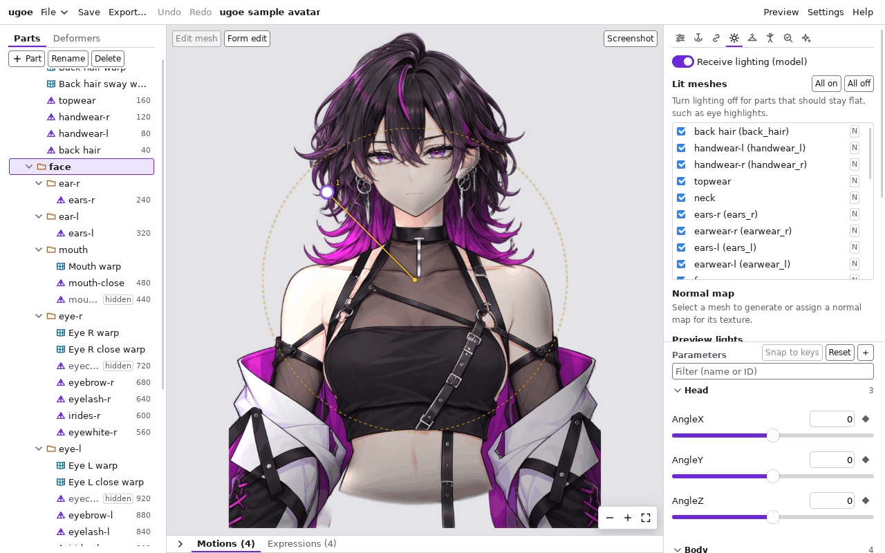
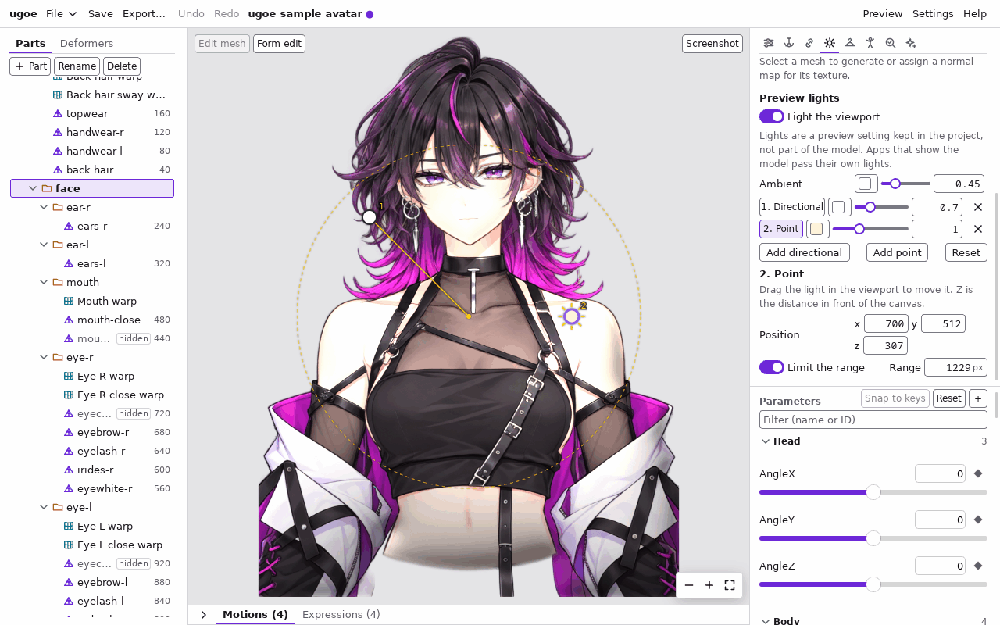

# ライティング: 光を当てて立体感を出す

モデルに光源の陰影を付ける機能です。パーツのテクスチャに **法線マップ** (表面の向きを色で表した画像) を付けると、
光の向きに合わせてパーツの明るい側と暗い側ができ、平らな絵に立体感が出ます。
仕組みは [editor.md#ライティングの画面](../editor.md#ライティングの画面) と [spec/rendering.md#ライティング](../spec/rendering.md#ライティング) (開発者向け) にあります。

大事なこと:

- **光源はモデルに入りません。** モデルに入るのは「光を受けるかどうか」と法線マップだけです。光の向きや色は、モデルを表示するアプリやゲームが決めます。
  エディタの光源は確かめるためのもので、プロジェクトに残りますが、書き出した `.ugoe` には入りません。
- 光を受けるのは、モデルの「Receive lighting」と、メッシュの「Lit」の **両方** が入っているメッシュだけです。
- 法線マップの無いメッシュも光を受けます (表面が正面を向いた平らな板として扱う)。明るさが全体に変わるだけで、立体感は出ません。

## 見本で試す

法線マップを付けた見本のモデル ([assets/samples/avatar-lit.ugoe](../../assets/samples/README.md#avatar-litugoe)) があります。
ビューアのツールバーの「サンプル」→「アバター (ライティング)」で開くと、右のパネルにライティングのパネルが出て、光の向きを変えて陰影を確かめられます。
エディタで開くときは、`just cli sample avatar --lit -o avatar-lit.ugoe --project avatar-lit.ugoeproj` でプロジェクトを作ります。

## パネルを開く

1. 右の列の上の「Lighting」タブを押す。
   右にライティングのパネルが出て、ビューポートに光源の取っ手が重なります (ほかのタブに切り替えると取っ手は消えます)。

モデルが光を受けない状態のときは、パネルの上に理由が出ます (「Lighting is off for this model…」「No mesh receives lighting…」)。
この状態では光源を動かしても見た目は変わりません。

## モデルとメッシュの設定

| 欄 | 内容 |
| --- | --- |
| 「Receive lighting (model)」 | モデル全体で光を受けるか。最初は切ってある。法線マップを作ると自動で入る |
| 「Lit meshes」の一覧 | メッシュごとに光を受けるか (チェック)。名前を押すとそのメッシュを選ぶ。法線マップのあるテクスチャのメッシュには「N」が付く |
| 「All on」「All off」 | すべてのメッシュの「Lit」をまとめて入れる・切る。メッシュを選んでいるときは「Light selected」「Unlight selected」になり、選んだメッシュだけを変える |

- 目のハイライトや光る飾りなど、陰を付けたくない部分は「Lit」を切ります。
- どの操作も「Undo」で戻せます。
- マスク専用のメッシュは描かれないので、一覧に出ません。

## 法線マップ

一覧かビューポート・ツリーでメッシュを選ぶと、そのメッシュのテクスチャの法線マップの節が出ます。左がテクスチャ、右が法線マップの画像です
(青紫が正面向き、赤が右向き、緑が上向き)。

### 形から作る (Generate)

テクスチャの不透明な形を、手前にふくらんだ形とみなして法線マップを作ります (AI は使いません。画像を外に送りません)。

1. メッシュを選ぶ。
2. 「Strength」で強さを選ぶ。0 で平ら、1 で断面が半円のふくらみ、2 でさらに強い。顔や体のような大きなパーツは 0.3〜0.6 くらい、髪の房などは強めが目安です。
3. 縁だけを丸めて中を平らにしたいときは「Round edges only」を入れ、「Edge width (px)」で丸める幅 (テクスチャの画素) を選ぶ。
4. 「Generate」を押す (もう法線マップがあれば「Regenerate」。今の画像を置き換えます)。

- モデルの「Receive lighting」が切れていれば、同時に入ります。
- 作った画像と「Receive lighting」の変更は、1 回の「Undo」でまとめて戻ります。
- パーツはテクスチャ (PSD のレイヤー) ごとに別々にふくらむので、重なったパーツの境目 (首と顎など) に段差が見えることがあります。強さを弱めるか、境目のパーツの「Lit」を切ってください。

### 画像を割り当てる (Assign PNG…)

ほかのツールで作った法線マップの PNG を使います。

1. メッシュを選ぶ。
2. 画像の G (緑) が下向きの形式 (DirectX 形式) なら「Flip green (DirectX)」を入れる。ugoe は G が上向きの形式 (OpenGL 形式) を使います。
   陰が上下逆に付いたら、この欄を切り替えて割り当て直してください。
3. 「Assign PNG…」を押して PNG を選ぶ。

- 画像の大きさはテクスチャと違ってもかまいません (同じ範囲に引き伸ばして使います)。
- 同じ法線マップをほかのテクスチャと共有しているときは、そのテクスチャを変えないように、別の画像として付けます。

### 外す

「Remove normal map」を押します。「Undo」で戻せます。

## 光源 (Preview lights)

ビューポートとプレビューで使う光源です。エディタでは、編集中もプレビュー中もいつもこの光源で描きます。

| 欄 | 内容 |
| --- | --- |
| 「Light the viewport」 | 光源を当てるか。切ると光源なし (光を受けるメッシュも、受けないときと同じ色) になる |
| 「Ambient」 | 環境光 (どこからでも当たる光) の色と強さ。強さを下げると陰が濃くなる |
| 光源の行 (「1. Directional」など) | 押すとその光源を選ぶ。色・強さ (0〜3)・「×」(消す) |
| 「Add directional」「Add point」 | 平行光源・点光源を足す (8 個まで) |
| 「Reset」 | 最初の設定 (弱い環境光と左上からの光 1 つ) に戻す |

最初は、弱い環境光と、左上の手前から当たる白い平行光源が 1 つあります。

### 平行光源 (Directional)

太陽のように、どこでも同じ向きから当たる光です。

- ビューポートの中央の黄色い破線の円の上に、光源の取っ手 (番号付きの丸) が出ます。**取っ手のある方向から光が来ます。**
  円の中心は正面 (見ている人の側) から、円の縁は真横から当たることを表します。
- 取っ手をドラッグして向きを変えます。離したときに設定が残ります。
- 選んだ光源の下の「Elevation」は光の高さ (90° が真正面から、0° が真横から) です。
- 「From behind the canvas」を入れると、絵の裏側から当たる光になります (縁だけが光る逆光。取っ手は白抜きで出ます)。
- 「Direction」の欄に、光が **進む** 向きを数値で書くこともできます (x が右、y が下、z が手前向き。例: 左上の手前から当てるなら `1, 1, -1`)。

### 点光源 (Point)

電球のように、ある位置から周りに広がる光です。

- ビューポートの上の光源の位置に、放射線の付いた取っ手が出ます。ドラッグで動かします。
- 「Position」の z は絵からの距離 (手前向き、ピクセル) です。小さいほど近くを強く照らします。
- 「Range (px)」は光が届く距離です。遠くなるほど暗くなり、この距離で 0 になります。ビューポートには、絵の上で光が届く範囲が破線の円で出ます。
  チェックを切ると減衰しない (どこまでも同じ強さで届く) 光になります。

### プロジェクトに残る

光源の設定はプロジェクト (`project.json`) に残り、次に開いたときも同じ光源で描きます。変えると未保存の印が付きます。
光源の変更は「Undo」では戻りません (モデルの変更ではないため)。

## プレビューで確かめる

ヘッダーの「Preview」でプレビューに入ると、モデルが光を受けるときは右のパネルに同じ「Preview lights」の節が出て、ビューポートにも取っ手が出ます。
物理や目パチを動かしながら光源を変えて確かめられます ([プレビュー](preview.md))。

## 制限

- 影 (ほかのパーツが落とす影) と、つや (鏡のような反射) はありません。
- 深度推定からの法線マップ (AI) は、まだエディタの画面から作れません。
- 光源はエディタごとの確かめ用です。書き出した `.ugoe` を表示するアプリの光源は、アプリの側で決めます (`ugoe render` の `--light`、ビューアの光源など)。
