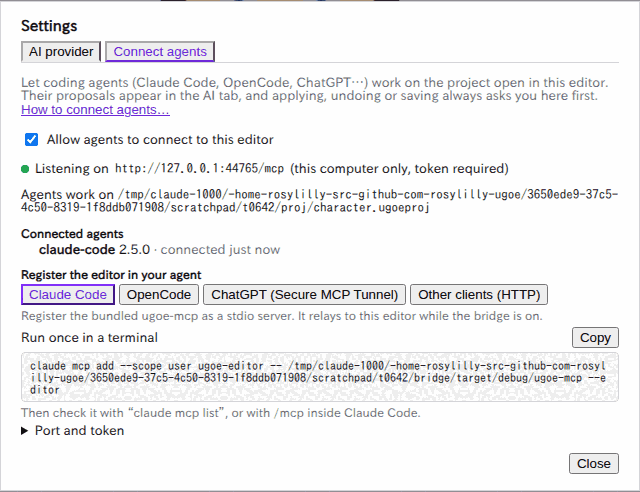
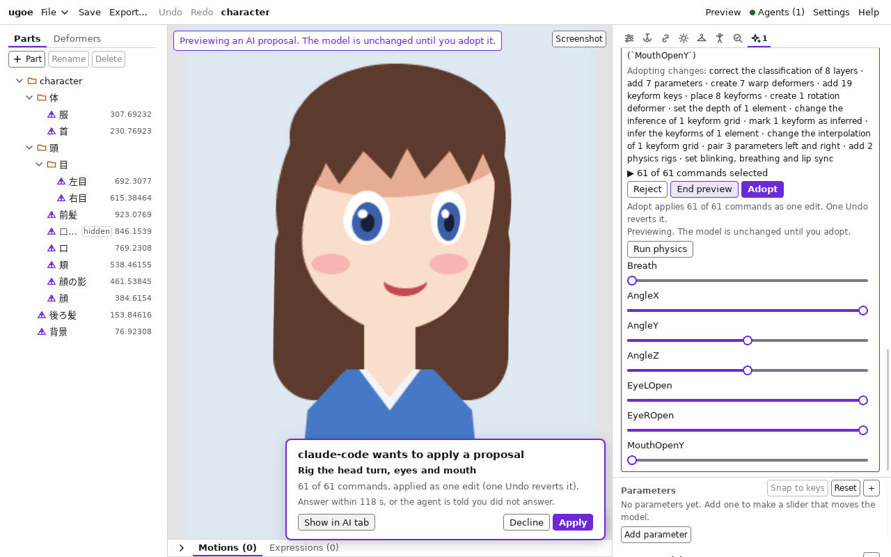
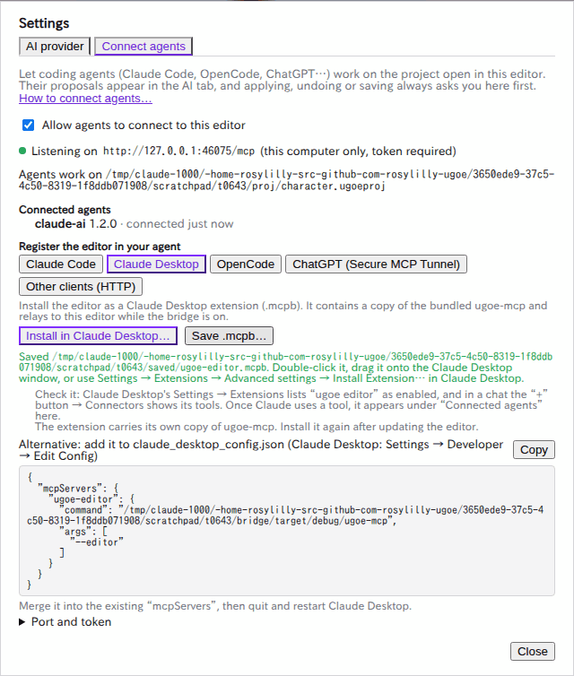

# エージェントに頼む (MCP)

Claude Code・Claude Desktop・OpenCode・ChatGPT などのエージェントに、モデルの編集を頼む方法です。エージェントは
MCP (Model Context Protocol) で ugoe のツールを使い、パラメータやデフォーマの追加・キーの設定・PSD からの自動リギングなどを
**提案** します。提案はモデルを変えず、採用するかはあなたが決めます。
仕組みは [ADR 0023](../adr/0023-editor-mcp-bridge.md)・[docs/editor.md#エージェントをつなぐ](../editor.md#エージェントをつなぐ)・
[crates/ugoe-mcp/README.md](../../crates/ugoe-mcp/README.md) (開発者向け) にあります。

## 2 つの使い方

| | エディタにつなぐ (勧める) | ファイルを直接扱う |
| --- | --- | --- |
| 登録するもの | `ugoe-mcp --editor` (エディタに同梱) | `ugoe-mcp` (`--root` でフォルダを限る) |
| エージェントが触るもの | **エディタで開いているプロジェクト** (未保存の変更を含む) | ディスクの `.ugoeproj` (エージェントが自分で開く) |
| 提案 | エディタの「AI」タブに「from <エージェント>」と出る。画面でプレビュー・一部だけの採用ができる | エージェントの返事で差分を見る |
| 適用・Undo・保存 | エディタに確認が出て、あなたが承認したときだけ | エージェント (と、その許可の設定) 次第 |
| エディタが要るか | 起動して「Connect agents」を有効にしておく | 要らない |
| 同時の編集 | 同じ文書を編集するので、ぶつからない | エディタで同じプロジェクトを開いていると、エディタが外での書き換えに気づいて尋ねる ([画面とパネル](screen.md#外でプロジェクトが書き換えられたとき)) |

エディタで作業しながら頼むなら「エディタにつなぐ」を使います。エディタを使わずにエージェントだけで作る (CI やスクリプト) なら
「ファイルを直接扱う」を使います ([ファイルを直接扱う](#ファイルを直接扱う))。

## エディタにつなぐ

### 1. エディタで有効にする

1. ヘッダーの「Settings」を押し、「Connect agents」タブを開く。
2. 「Allow agents to connect to this editor」に印を付ける。「Listening on http://127.0.0.1:…/mcp」と出れば待ち受けています
   (既定は無効です。設定はエディタに残り、次に起動したときも有効のままです)。
3. プロジェクトを保存していなければ、「File」の「Save As…」で保存する。エージェントはプロジェクトを **パス** で指すので、
   一度も保存していないプロジェクトは使えません (「Agents work on …」にパスが出ていれば使えます)。



有効にしている間、ヘッダーに「● Agents」と出ます (つながったエージェントの数付き)。押すとこの画面が開きます。

### 2. エージェントに登録する

「Register the editor in your agent」でエージェントを選び、「Copy」で写したものを使います。コマンドには、エディタに同梱の
`ugoe-mcp` のパスが入っています。登録は一度だけで、エディタを起動し直しても (ポートやトークンが変わっても) そのまま使えます。

**Claude Code**

```sh
claude mcp add --scope user ugoe-editor -- <同梱の ugoe-mcp のパス> --editor
```

`claude mcp list` で `ugoe-editor` が `Connected` になるか、Claude Code の中の `/mcp` で確かめます。

**Claude Desktop**

「Claude Desktop」のタブから拡張機能として入れます。手順は [Claude Desktop](#claude-desktop) にあります。

**OpenCode**

`opencode.json` (プロジェクトのフォルダか `~/.config/opencode/`) に、画面の「OpenCode」の JSON を足します。
`permission` の `ask` で、OpenCode も適用と保存の前に確かめます (エディタはどちらにしても確かめます)。

**ChatGPT (Secure MCP Tunnel)**

ChatGPT は OpenAI のサーバからつなぐので、手元のエディタには直接届きません。OpenAI の `tunnel-client` を手元で動かすと、
`tunnel-client` が中継 (`ugoe-mcp --editor`) を起動し、外向きの接続だけで ChatGPT とつなぎます (インターネットに公開の URL を
作りません)。ChatGPT の開発者モードと、OpenAI の Platform で作るトンネルの ID が要ります。

1. 画面の「ChatGPT (Secure MCP Tunnel)」の 2 つのコマンドを、`<tunnel_id>` を自分の ID に替えて実行する。
2. ChatGPT の開発者モードでアプリを作り、接続にそのトンネルを選ぶ。

ChatGPT は、書き込みのツール (適用・保存) を呼ぶ前に ChatGPT の画面でも確かめます。手順の詳細は
[OpenAI の文書](https://developers.openai.com/api/docs/guides/secure-mcp-tunnels) を見てください。

**そのほかのクライアント (HTTP)**

Streamable HTTP で直接つなぐクライアントには、「Other clients (HTTP)」の URL と、「Port and token」の「Copy token」で写した
トークン (`Authorization: Bearer <token>`) を渡します。エディタを起動するたびにポートが変わるので、「Port」で決めたポートに
してください。できるなら、トークンの要らない中継 (`--editor`) を使うほうが簡単で安全です。

### 3. 頼む

エージェントには、エディタにつながっていることと、開いているプロジェクトのパスが伝わります。例:

> エディタで開いているモデルに、パラメータ `AngleX` (-30〜30、既定 0) を作って、頭のワープに -30 と 30 のキーを足す提案を出して。
> 適用はしないで。

> `render_png` で `AngleX` を 30 にした姿を描いて見せて。首が伸びて見えたら、ワープの下の段を直す提案を出して。

> このプロジェクトは `character.psd` から作ったもの。`get_psd_layers` に `psd` でその PSD を渡して、レイヤーの画像を見て分類し、
> `propose_rig` で顔の角度・目・口のリグを提案して。

- 提案は「AI」タブに「from claude-code」のようにエージェントの名前付きで出ます。タブを開いていなければ、タブに「•」が付きます。
  プレビュー・一部だけの採用・「Adopt」・「Reject」は、エディタの AI の提案と同じです ([AI でリギングを提案する](ai.md#提案を確かめる))。
  **画面で「Adopt」したときは確認は出ません** (あなた自身の操作なので)。
- 新しいプロジェクトを PSD から作る (`import_psd`)・ほかのプロジェクトを開く・閉じるは、エージェントからはできません。
  エディタの「File」で行ってから、エージェントに頼みます。
- レイヤーを分類するとき、エージェントは同じ部品の別の絵 (一度に 1 つだけ見せる袖 A / B・同じ所にかぶる帽子とキャップ) の組も
  `set_layer_labels` の `variant_sets` で渡せます。組はエージェントとの間の分類に残り、エディタの「AI」タブの分類には入りません。
- 着せ替えのモジュールのプロジェクト ([着せ替え](dress-up.md#衣装を作る)) を開いているときは、エージェントは `get_module_rig_guide` と
  `propose_module_rig` でリグを提案します (パラメータを足さず、衣装を本体に追従させて揺らし、`variant_sets` の組や名前の A / B の差分を
  ポーズにする)。例:

  > このモジュールは `ribbon.psd` から作ったもの。`get_psd_layers` に `psd` でその PSD を渡して分類し、帽子とキャップを差分の組にして、
  > `propose_module_rig` でリグを提案して。

### 4. 確認に答える

エージェントが提案の適用 (`apply_proposal`)・Undo・Redo・保存 (`save_project`) を求めると、画面の下に確認が出ます。



1. 何をしようとしているか (提案の題名と、適用するコマンドの数・外すコマンド、保存なら書き出し先) を読む。
2. 適用なら「Show in AI tab」で、エージェントが選んだコマンドのままプレビューできる (確認は出たままなので、見てから決められます)。
3. 「Apply」(Undo・Redo・Save) で承認する。「Decline」で断る。

- 断ると、エージェントには「断られた」というエラーが返ります。**120 秒** 答えなければ、「時間内に答えがなかった」というエラーが
  返り、確認は消えます。
- エージェントが待つのをやめると (時間切れや、エージェントの画面で止めたとき)、確認は消え、断ったのと同じになります。
- 承認して適用した提案は、ほかの編集と同じく **1 回の「Undo」** で取り消せます。Undo すると、提案は一覧に戻ります。
- エージェントの「Undo」は、エディタの **直前の編集** を取り消します (誰がした編集かに関わらない)。確認の文にもそう出ます。
- 確認を待つ間にモデルを編集すると、承認しても適用されず、エージェントには「提案が古い」というエラーが返ります
  (承認した内容と違う結果にしないため)。
- 保存は「File」の「Save」と同じです。エディタの外でプロジェクトのファイルが書き換えられていたら、エージェントの保存は断られます
  (エディタで開き直すか上書きするかを決めてください)。

### 止める

「Allow agents to connect to this editor」の印を外すか、エディタを終えると止まります。待っていた確認はすべて断ったことになり、
エージェントには「エディタが動いていないか、つなぐのが無効」というエラーが返ります。中継は動き続けるので、もう一度有効にすれば
エージェントを起動し直さずにつながります。

## Claude Desktop

Claude Desktop (デスクトップのアプリ) からも、実行中のエディタのモデルを扱えます。エディタが、同梱の `ugoe-mcp` を包んだ
**拡張機能** (MCP Bundle、`.mcpb` のファイル) を作り、Claude Desktop に入れます。コマンドを打つ必要はありません。
Claude Desktop は macOS・Windows と、Linux (ベータ。Ubuntu 22.04 以降・Debian 12 以降、x64・arm64。拡張機能も入れられます。
[Install Claude Desktop](https://support.claude.com/en/articles/10065433-install-claude-desktop)) で動きます。



### 入れる

1. エディタで [「Connect agents」を有効にし、プロジェクトを保存する](#1-エディタで有効にする) (有効にする前に入れてもかまいませんが、
   Claude Desktop がつながるのは有効にしている間だけです)。
2. 「Register the editor in your agent」の「**Claude Desktop**」のタブを開き、「**Install in Claude Desktop…**」を押す。
   エディタが拡張機能を作り (数秒かかります)、Claude Desktop に渡します。
3. Claude Desktop にインストールの画面が出るので、内容 (「ugoe editor」とツールの一覧) を確かめて「Install」を押し、有効にする。

Claude Desktop が開かない・ほかのアプリ (zip を開くアプリなど) が開いたときは、次のどれかで入れます:

- 「**Save .mcpb…**」でファイル (`ugoe-editor.mcpb`) を保存し、ダブルクリックするか、Claude Desktop のウィンドウに落とす。
- Claude Desktop の「Settings」→「Extensions」→「Advanced settings」→「Install Extension…」で、保存したファイルを選ぶ
  (「Install in Claude Desktop…」の後に画面に出るパスのファイルでもかまいません)。

### 確かめる

- Claude Desktop の「Settings」→「Extensions」に「ugoe editor」があり、有効になっている。
- Claude Desktop のチャットの入力欄の「+」→「Connectors」に「ugoe editor」とツール (`propose_edit` など) が出る。
- Claude がツールを使うと、エディタの「Connected agents」に Claude Desktop の名前が出る。

頼み方と確認への答え方は、Claude Code などと同じです ([3. 頼む](#3-頼む)・[4. 確認に答える](#4-確認に答える))。提案は「AI」タブに
Claude Desktop の名前付きで出て、適用・Undo・Redo・保存はエディタで承認したときだけ行われます。

### 気をつけること

- **エディタを更新したら、拡張機能を入れ直してください。** 拡張機能は、入れたときの `ugoe-mcp` の複製を持っています。
  ツールそのものはエディタが出すのでたいていは動き続けますが、Claude Desktop に出るツールの一覧が古いままになり、
  エディタとのつなぎ方が変わった版では「版が合わない」というエラーが返ります ([困ったとき](#困ったとき))。
- 拡張機能はエディタと同じ OS 向けです。**Windows のエディタなら Windows の Claude Desktop**、macOS なら macOS のものに入れます。
  エディタを WSL の中で動かしているときは、Windows の Claude Desktop からは届きません (Windows 版のエディタを使ってください。
  画面にもそう出ます)。
- **署名について:** 拡張機能 (`.mcpb`) には署名をしていません。MCPB には束に署名する仕組み (`mcpb sign`。証明書の署名を
  ファイルの後ろに足す) がありますが、ugoe は使っていません。中の `ugoe-mcp` は、エディタに同梱のものをそのまま写したもので、
  エディタのインストーラと同じく **コード署名もしていません** ([apps/editor/README.md の配布物の署名](../../apps/editor/README.md#配布物の署名))。
  - エディタが手元で作ったファイルには、ダウンロードの印 (macOS の隔離属性 `com.apple.quarantine`・Windows の Mark of the Web) が
    付かないので、普通はそのまま入れられます。ただし、束を人に渡したりダウンロードしたりすると印が付き、次のことが起こりえます
    (実際の Claude Desktop では確かめていません):
  - **macOS:** Gatekeeper が署名の無い `ugoe-mcp` の起動を止め、拡張機能がエラーになることがあります。その束は使わず、
    自分のエディタの「Install in Claude Desktop…」で作り直してください。
  - **Windows:** SmartScreen やウイルス対策のソフトが、署名の無い `ugoe-mcp.exe` を止めたり、隔離したりすることがあります。
    そのときも、自分のエディタで作り直すか、ウイルス対策のソフトで許可してください。
  - Claude Desktop のインストールの画面で、署名が無い旨が出ることがあります。
- 拡張機能の代わりに、Claude Desktop の設定のファイル (`claude_desktop_config.json`。「Settings」→「Developer」→「Edit Config」)
  に登録することもできます。「Claude Desktop」のタブの「Alternative」の JSON を写して `mcpServers` に足し、Claude Desktop を
  終えて起動し直します。こちらは同梱の `ugoe-mcp` をそのまま使うので、エディタを更新しても入れ直しは要りません
  (インストール先を移したときは直します)。

## Windows と WSL

エディタを Windows で動かし、エージェント (Claude Code・OpenCode) を WSL の中で動かすときの方法です。Windows でエディタを
起動すると、「Connect agents」に「Agents in WSL」が出ます。

**勧める方法: WSL から Windows 版の `ugoe-mcp.exe` を登録する。** WSL は Windows のプログラムを起動できるので、エディタに同梱の
`ugoe-mcp.exe` を WSL の中のエージェントに登録します。通信は Windows の中で完結し、WSL のネットワークの設定は要りません。

```sh
# WSL の中で (画面の「Agents in WSL」の 1 つ目を写す)
claude mcp add --scope user ugoe-editor -- /mnt/c/Users/<名前>/AppData/Local/ugoe/ugoe-mcp.exe --editor --wsl-distro "$WSL_DISTRO_NAME"
```

- パスは自動で変換されます。エージェントが WSL のパス (`/home/me/art/character.ugoeproj`・`/mnt/c/...`) を渡すと Windows のパス
  (`\\wsl.localhost\Ubuntu\home\me\...`・`C:\...`) にし、結果のパスは WSL のパスに戻します。
- `--wsl-distro` は、エージェントを `/mnt/c/...` の下で起動したときに要ります (`/home/...` のパスを変換するため)。付けておけば
  どこで起動しても使えます。OpenCode の JSON では `<distro>` を `echo $WSL_DISTRO_NAME` の出力に替えます。
- プロジェクトは WSL の中 (`\\wsl.localhost\...`) にあっても Windows のドライブにあってもかまいません。

**代わりの方法: WSL の中の Linux 版の `ugoe-mcp`。** Linux 版の `ugoe-mcp --editor` も、Windows のエディタの待ち受けを
見つけてつなぎます。ただし、Windows のループバック (`127.0.0.1`) に WSL から届くのは、WSL のネットワークが **ミラー**
(`%UserProfile%\.wslconfig` の `[wsl2]` に `networkingMode=mirrored`) のときだけです。既定の **NAT** ではつながらず、そう案内する
エラーが返ります。そのときは勧める方法を使うか、ミラーにして WSL を起動し直します (`wsl --shutdown`)。

**エディタを WSL の中で動かすとき** (Linux 版のエディタを WSLg で動かす) は、エディタもエージェントも Linux の中なので、
「Claude Code」「OpenCode」のコマンドをそのまま使います。

## 安全のために

- **待ち受けはこの計算機の中だけ** (`127.0.0.1`) で、すべての要求に **トークン** が要ります。中継 (`ugoe-mcp --editor`) は、
  エディタが起動中に書く発見用のファイル (あなただけが読める場所。Windows は `%LOCALAPPDATA%\app.ugoe.editor\editor-mcp.json`)
  からポートとトークンを読みます。「Port and token」の「Regenerate token」でトークンを作り直せます (中継は自動で新しいものを使います。
  HTTP で直接つないだクライアントは設定し直します)。トークンを人に見せたら作り直してください。
- **変える操作は必ず確認が出ます** (適用・Undo・Redo・保存)。確認なしにエージェントがモデルやファイルを変えることはありません。
  プロジェクトを開く・作る・閉じるはできません。
- エージェントは、提案と描画のために **あなたの権限でファイルを読める** ことがあります (PSD・モーションの JSON のパスを渡すツール)。
  エージェント自身も普通はあなたの権限でファイルを読めるので、エディタのブリッジではフォルダを限っていません。
- 使わないときは「Allow agents to connect to this editor」の印を外しておきます。

## ファイルを直接扱う

エディタを使わずに、エージェントに `.ugoeproj` を直接扱わせる形です。エディタに同梱の `ugoe-mcp` (パスは「Connect agents」の
コマンドと同じ) を `--editor` なしで登録します。

```sh
# ~/art の下だけを読み書きさせる
claude mcp add --scope user ugoe -- <同梱の ugoe-mcp のパス> --root ~/art
# 読むだけ (提案と描画だけ。適用・保存のツールを出さない)
claude mcp add --scope user ugoe-read -- <同梱の ugoe-mcp のパス> --read-only --root ~/art
```

- **`--root <フォルダ>` を付けることを勧めます。** ツールが読み書きするパスをそのフォルダの下に限ります (外を指すパス・
  シンボリックリンクは断る)。着せ替えのモジュールのプロジェクトが参照する本体も、そのフォルダの下に無ければ開けません
  (`base model ...: outside the root directory` のエラー)。本体とモジュールは同じフォルダの下に置きます。
- エージェントは `save_project` を呼ぶまでディスクに書きません。適用と保存の前に確かめるかは、エージェントの許可の設定で決めます
  (Claude Code では `mcp__ugoe__apply_proposal`・`mcp__ugoe__save_project` を許可の一覧に入れない)。
- 同じプロジェクトをエディタで開いていると、エージェントの保存にエディタが気づき、開き直すかを尋ねます。エディタで作業しながら
  頼むなら、「エディタにつなぐ」のほうが便利です。
- この形では、エージェントが PSD から新しいプロジェクトを作れます (`import_psd`)。本体とスロットを伝えれば、衣装の PSD から
  着せ替えのモジュールのプロジェクトを作り、`propose_module_rig` でリギングまで提案させられます。例:

  > `ribbon.psd` を `character.ugoeproj` のスロット `Hair` に付けるモジュール `ribbon.ugoeproj` にして、自動リギングを提案して。

  `--root` を付けたときは、本体もそのフォルダの下に置きます (外の本体を参照するモジュールは、開くときも断ります)。
- ChatGPT から使う・HTTP で待ち受ける方法は [crates/ugoe-mcp/README.md](../../crates/ugoe-mcp/README.md#http-で動かす-chatgpt-など) にあります。

## 困ったとき

| エージェントに返るエラー | 原因と対処 |
| --- | --- |
| `the ugoe editor is not running, or its MCP bridge is off` | エディタが起動していないか、「Connect agents」が無効。エディタで有効にする (エージェントは起動し直さなくてよい) |
| `could not connect to the ugoe editor … mirrored` | WSL の Linux 版の中継が、NAT のネットワークで Windows に届かない。Windows 版の `ugoe-mcp.exe` を登録する |
| `the project open in the ugoe editor has not been saved yet` | プロジェクトを一度も保存していない。「File」の「Save As…」で保存する |
| `the ugoe editor has … open; agents connected to the editor can only use that project` | エージェントが別のプロジェクトを指した。エディタで開いているパスを使うよう伝えるか、エディタでそのプロジェクトを開く |
| `the user declined this in the ugoe editor` | 確認で「Decline」を押した |
| `the user did not answer in time` | 120 秒のうちに確認に答えなかった |
| `the model changed after it was proposed` | 提案の後か確認の間にモデルが変わった。「Undo」で戻すか、提案を作り直してもらう |
| `the project files were changed outside the editor` | エディタの外でプロジェクトのファイルが変わった。エディタで開き直すか「Save」で上書きする |
| `... was written by ugoe … in discovery format …` | エディタと中継の版が合わない。エディタに同梱の `ugoe-mcp` を登録する |
| Claude Desktop にツールが出ない・「ugoe editor」がエラーになる | 「Settings」→「Extensions」で有効か確かめる。エディタを更新した後なら、「Install in Claude Desktop…」で入れ直す。エディタの「Connect agents」が有効か確かめる |

## 制限

- 複数のエージェントを同時につなぐと、提案と確認に出る名前は **最後につないだエージェント** のものになります
  (HTTP の要求からはどのエージェントか区別できないため)。
- 未保存のプロジェクトは使えません (先に保存する)。
- 「Connect agents」の登録のコマンドのパスは、インストールの場所から作ります。インストール先を移したら登録し直してください。
  Linux の AppImage は起動のたびに場所が変わるので、`.deb`・`.rpm` か、PATH の `ugoe-mcp` を使ってください。
