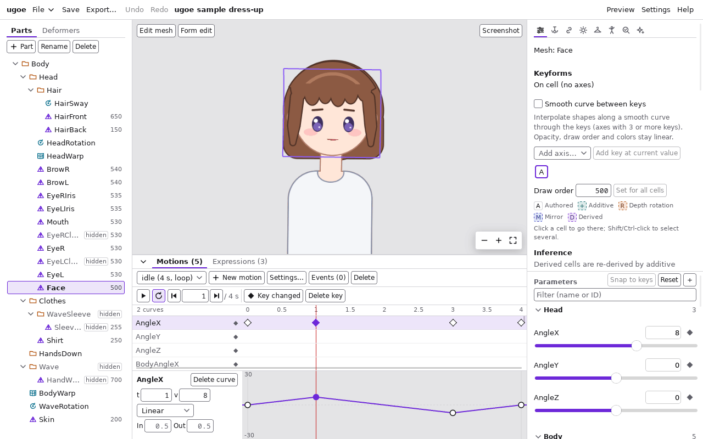
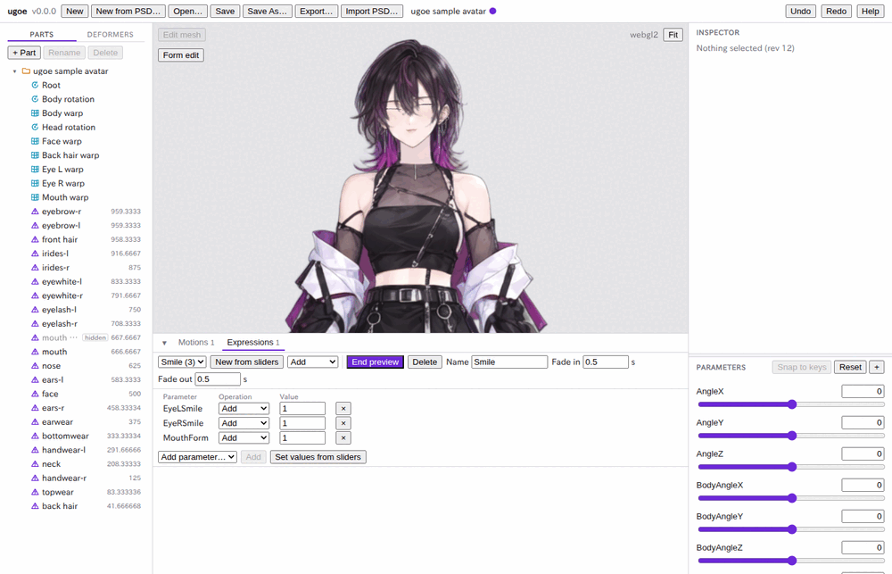
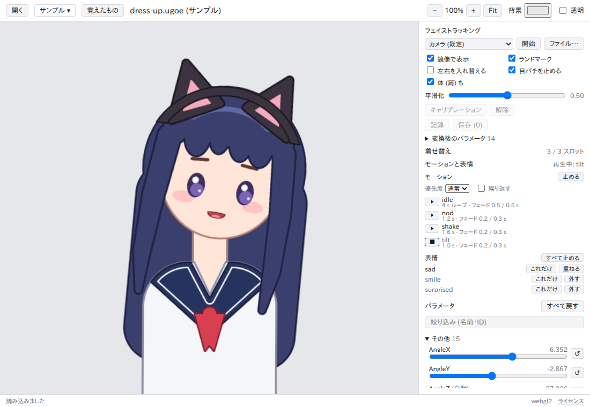

# モーションと表情

リギングが済んだモデルに、時間で動く **モーション** (うなずき・待機の揺れなど) と、顔つきを重ねる **表情** (笑顔・怒りなど) を付けます。
どちらもビューポートの下の **タイムライン** のパネルで作り、プロジェクトに保存され、「Export…」の `.ugoe` にも入ります。

内部の規則は [editor.md#タイムライン](../editor.md#タイムライン) と [spec/motion.md](../spec/motion.md) (開発者向け) にあります。

## タイムラインのパネル

ビューポートの下にあり、左上の「▾」で畳めます (次に開いたときも同じ)。「Motions」と「Expressions」のタブで切り替えます。タブの数字はモーション・表情の数です。

操作の誤り (名前の重複・キーが隣を越えるなど) は、タブの右か操作した欄の近くに赤い字で出ます。

## モーションを作る

1. 「New motion」を押す。長さ 2 秒の空のモーション `Motion` ができて選ばれる。
2. 「Name」に名前を入れて Enter。名前はファイル名になるので、英数字と `_` `-` `.` だけ (`.` で始まらない、128 文字まで) で、大文字小文字を区別せずに他と重ならないものにする (例: `Idle`・`Nod_01`)。
3. 「Duration」に長さ (秒) を入れる。「Loop」を付けると、再生で最後から最初に戻って繰り返すモーションになる。
4. 「Fade in」「Fade out」に、他のモーションから切り替わるときのフェードの秒数を入れる (プレビューでは掛からない。下の「制限」)。

モーションの選択欄で、編集するモーションを選びます。「Delete」で今のモーションを消します (Undo で戻せます)。

## キーを打つ

キーは「ある時刻に、あるパラメータがこの値」という印です。キーの間は曲線でつながります。
**スライダーで姿を作ってから、その時刻にキーを打つ** のが基本の流れです。

1. 再生位置を決める。目盛り (0・0.25… の並ぶ段) を押すかドラッグする。時刻の欄に数を入れて Enter でもよい。「◀」「▶」は 1 フレーム (1/30 秒) ずつ動かす。
2. 右の「Parameters」のスライダー (か値の欄) で、その時刻の姿にする。
3. 次のどちらかでキーを打つ。
   - 行の左の「◆」: そのパラメータだけ、今のスライダーの値でキーを打つ。
   - 「◆ Key changed」: スライダーを動かしたパラメータ (その時刻のカーブの値、カーブがなければ既定値と違うもの) すべてにキーを打つ (まとめて 1 回の Undo)。
4. 再生位置を変えて 2・3 を繰り返す。

- 同じ時刻にキーがあれば、その値を書き換えます。
- 再生位置は目盛りを押すと 1 フレームに揃います (Shift を押しながらだと揃えない)。
- 行は、モデルのすべてのパラメータです。キー (カーブ) のある行は名前が濃く出ます。パーツの不透明度などパラメータ以外のカーブ (読み込んだモーション) は最後の行に出ます。

## キーを動かす・消す

| 操作 | 内容 |
| --- | --- |
| 行のひし形 (キー) を押す | そのキーを選び、再生位置をその時刻にする。下にその行のカーブが出る |
| ひし形を左右にドラッグ | キーの時刻を変える (1 フレームに揃う)。隣のキーは越えられない |
| 「Delete key」、Delete / Backspace | 選んだキーを消す。前後の区間はつながる。最後の 1 つを消すとカーブがなくなる |
| Space | 再生・停止 |
| ← / → | 1 フレーム戻る・進む |

Delete・Space・矢印キーは、タイムラインの中を押した後 (入力欄の外) で効きます。

## カーブと取っ手

行を押すと、パネルの下にその行のカーブが出ます。横が時刻、縦が値 (パラメータの最小〜最大) です。赤い線が再生位置です。

| 操作 | 内容 |
| --- | --- |
| 円 (キー) をドラッグ | キーの時刻と値を変える (時刻は 1 フレームに揃う。Shift を押しながらだと時刻を変えずに値だけ) |
| 四角 (ベジェの取っ手) をドラッグ | 区間の曲がり方を変える。取っ手は区間の時刻の外へは出ない |
| 何もない所をダブルクリック | その時刻と値にキーを打つ |
| 左の「t」「v」 | 選んだキーの時刻と値を数で入れる |
| 「Linear」「Bezier」「Step」「Inv. step」 | 選んだキーに **入る** 区間 (前のキーからこのキーまで) の種類。最初のキーには区間がないので押せない |
| 「In」「Out」 | このカーブだけのフェード (秒)。空ならモーションの「Fade in」「Fade out」 |
| 「Delete curve」 | このカーブ (すべてのキー) を消す |

区間の種類:

| 種類 | 動き |
| --- | --- |
| Linear | 一定の速さで次の値へ |
| Bezier | 取っ手で曲がり方を決める。「Bezier」を押した直後は、ゆっくり動き出してゆっくり止まる形 |
| Step | 次のキーの時刻まで前の値のまま、そこで切り替わる |
| Inv. step | 前のキーの直後に次の値へ切り替わる |

- 新しいキーは、隣の区間と同じ種類でつながります (最初は Linear)。ベジェの区間の途中にキーを打つと、曲線の形を保ったまま 2 つに分かれます。
- 取っ手で値の範囲 (最小〜最大) を越える曲線にもできます。動かしたときの値は最小〜最大で止まります。

## 再生

「▶ Play」で再生し、「■ Stop」で止めます。「Repeat」を付けていると、最後まで行ったら最初から繰り返します (「Loop」のモーションは「Repeat」がなくても繰り返します)。

- 再生・シークは、その時刻のカーブの値をスライダーに書き込みます。止めた後もスライダーはその値のままです (「Reset」で既定値に戻る)。
- モーションを選んだり開いたりしただけでは、スライダーは動きません。再生位置を動かす・再生する・キーを押すと、その時刻の姿になります。
- キーを編集すると、今の再生位置の姿を書き込み直します。

## イベント

「Events」を開くと、モーションのイベント (再生がその時刻を通ると、アプリに知らせる文字列) の一覧が出ます。

- 「+ Event at …」で今の再生位置にイベントを足し、時刻と文字列を編集します。「×」で消します。
- イベントは目盛りの段に「▾」で出ます。

## 表情を作る

表情は、モーションの上に重ねるパラメータの差分です (笑顔にする、目を細める、など)。

1. 「Expressions」のタブを開く。
2. スライダーで表情を作る (既定値から動かしたパラメータが表情に入る)。
3. 「New from sliders」の右の選択欄で重ね方を選び、「New from sliders」を押す。
4. 「Name」に名前を入れて Enter (名前の規則はモーションと同じ)。

重ね方 (Operation):

| 重ね方 | 値の意味 | 「New from sliders」で入る値 |
| --- | --- | --- |
| Add | 今の値に足す | 今の値 − 既定値 |
| Multiply | 今の値に掛ける | 今の値 ÷ 既定値 (既定値が 0 のパラメータは Add で入る) |
| Overwrite | その値にする | 今の値 |

どれで作っても、既定値の姿に重ねるとスライダーで作った姿になります。モーションで顔の向きが変わっても表情を保ちたいパラメータ (目・口) は Add か Multiply、必ずその値にしたいものは Overwrite にします。

## 表情を編集する・確かめる

| 操作 | 内容 |
| --- | --- |
| 選択欄 | 編集する表情を選ぶ |
| 「Preview」 | 今のスライダーの値に表情を重ねて見せる。「End preview」で元の値に戻る |
| 表の「Operation」「Value」 | パラメータごとの重ね方と値 |
| 「×」 | そのパラメータを表情から外す |
| 「Add parameter…」→「Add」 | パラメータを足す (Add、値は今のスライダーと既定値の差) |
| 「Set values from sliders」 | 表のすべての値を、今のスライダーの値から作り直す (重ね方は保つ) |
| 「Fade in」「Fade out」 | 表情に切り替わるとき・外すときのフェード (秒) |
| 「Delete」 | 表情を消す |

- プレビュー中にスライダーを動かしてから「End preview」を押すと、プレビューの前の値に戻ります。

## 保存と書き出し

モーションと表情はプロジェクトの一部です。「Save」で `.ugoeproj` の `motions/<名前>.motion.json` と `expressions/<名前>.expression.json` に、「Export…」で `.ugoe` に入ります。
すべての編集は「Undo」「Redo」で取り消せます。

## ビューアで再生する

書き出した `.ugoe` のモーションと表情は、ビューア (`ugoe-viewer`) の右のパネルの「モーションと表情」で再生できます。
すぐに試すには、ビューアのツールバーの「サンプル」→「アバター」(「アバター (ライティング)」「着せ替え」も同じ) を開きます。
見本には、モーション `idle` (ループ)・`nod`・`shake`・`tilt` と、表情 `smile`・`surprised`・`sad`・`angry` (着せ替えは `angry` なし) が入っています。

1. 「優先度」で「待機」「通常」「強制」を選び、モーションの「▶」を押すと再生します。名前の下に長さ・ループ・フェード (入り / 抜け) が出ます。
   - 再生中のモーションより低い優先度では始まりません (理由がパネルに出ます)。ループする待機モーションは「待機」で始めると、ほかのモーションで置き換えられます。
   - 「繰り返す」を入れると、ループしないモーションが終わるたびに初めから再生し直します。
2. 「■」か「止める」で止めます (フェードアウト)。止めた後も最後の姿勢は残るので、もとに戻すにはパラメータの「すべて戻す」を押します。
3. 表情は「これだけ」でその表情だけに、「重ねる」で使っている表情に重ね、「外す」でその表情を、「すべて止める」ですべてを外します。

フェイストラッキングと同時に使うと、トラッキングが動かすパラメータ (頭・体の向き・目・眉・口など) ではトラッキングが勝ち、モーションは見えなくなります
(パネルに「トラッキングで隠れる」と出ます)。表情はトラッキングした顔の上に重なります。
細かい振る舞いは [ビューアの README](../../apps/viewer/README.md#モーションと表情-t0720) にあります。

## 制限

- プレビュー (再生・シーク) は **カーブの値だけ** です。フェード・目パチ・呼吸・物理は掛かりません。
  それらを掛けて再生するには、ヘッダーの「Preview」の [プレビュー](preview.md#モーション-motions) を使います。
  パーツの不透明度とエフェクトの強さのカーブは、画面では作れず、プレビューにも出ません (読み込んだモーションでは行と曲線は出ます)。
- パラメータを削除しても、モーションと表情のそのパラメータのカーブ・項目は残ります (行は `(missing)` と出る)。「Delete curve」や「×」で消してください。
- 表示の時間の範囲はモーションの長さ全体で、拡大・スクロールはできません。
