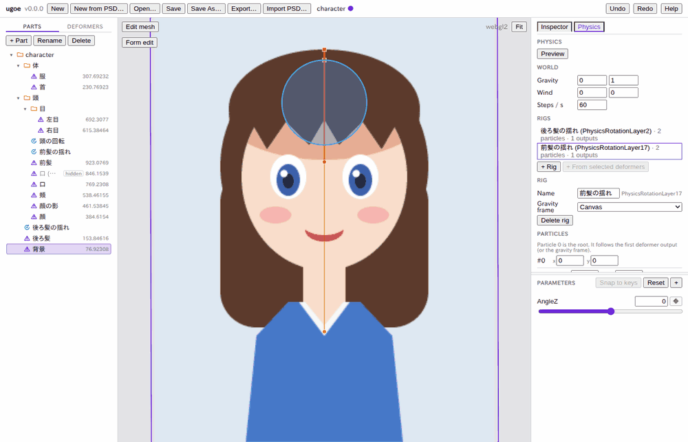
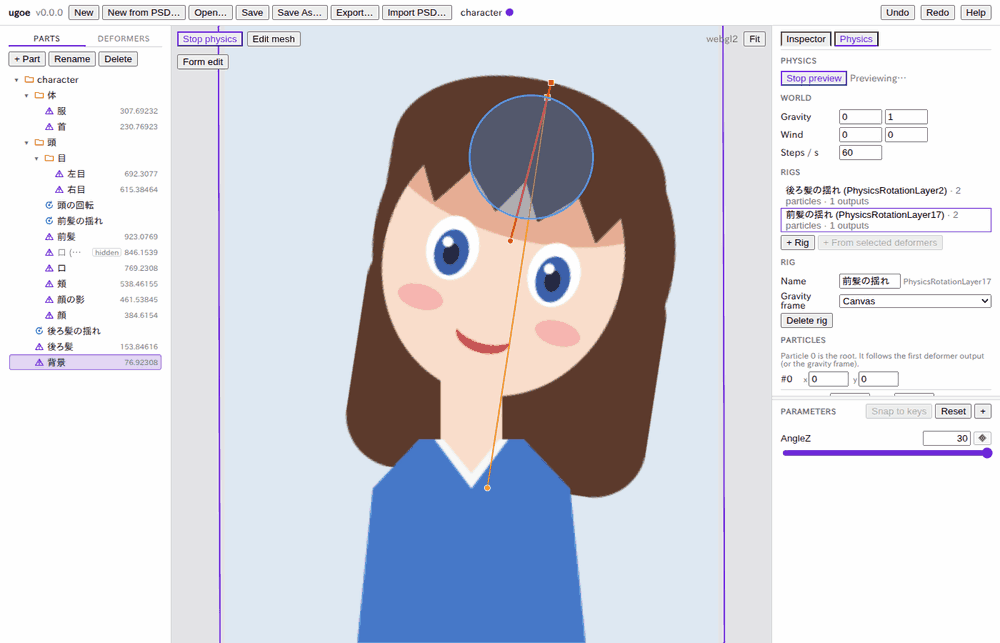

# 物理: 髪を揺らす

髪やアクセサリーを、頭の動きに合わせて揺らす設定です。[チュートリアル](tutorial.md) の続きとして、後ろ髪と前髪を揺らします。
物理の仕組み (式と係数の意味) は [docs/spec/physics.md](../spec/physics.md) (開発者向け) にあります。

ugoe の物理は、**粒子の鎖** (振り子) を重力と頭の動きで動かし、その揺れを **回転デフォーマの角度** などに書き込みます。
Live2D の物理と違って、揺れ用のパラメータ (`HairFront` など) とそのキーを作らなくても揺らせます。揺れ用のパラメータに
書き込む従来のやり方もできます ([出力](#出力))。

## 1. 髪を回転デフォーマで包む

揺らす部分を、付け根を中心にした回転デフォーマで包みます。

1. ツリーの「Parts」タブで **後ろ髪** を押す。
2. インスペクタの「Wrap in deformer」の「Name」に `後ろ髪の揺れ` と入力し、「Rotation」を押す。
3. ビューポートで、回転の中心の丸を髪の付け根 (頭のてっぺん) まで **Shift を押しながら** ドラッグする (絵は動かず、中心だけが動きます)。
4. 「Deformers」タブで **後ろ髪の揺れ** を **頭の回転** の行へドラッグする。頭を傾けると後ろ髪もついてくるようになります。
5. 同じように **前髪** を選び、「Name」`前髪の揺れ` で「Rotation」を押し、中心を前髪の付け根へ Shift + ドラッグする。
   前髪はもともと頭の中にあるので、付け替えは要りません。

- 長い髪を何か所かで曲げたいときは、回転デフォーマを親子に重ねて (付け根 → 毛先の順) 包みます。次の手順で鎖ごとまとめて選べます。

## 2. 物理のリグを作る

1. 右の列の上の「Physics」タブを押す。物理のパネルが開き、ビューポートに粒子と衝突体が重なります。
2. ツリーで **後ろ髪の揺れ** を押す。
3. 物理のパネルの「Rigs」の「+ From selected deformers (1)」を押す。`後ろ髪の揺れ` という **リグ** ができ、選ばれます。
4. ツリーで **前髪の揺れ** を押し、もう一度「+ From selected deformers (1)」を押す。

- 選んだ回転デフォーマの原点に粒子が置かれ、最後のデフォーマの原点から真下 (重力の向き) に、髪の先端の深さまでの粒子が足されます。
  ビューポートでは、根元が四角、ほかの粒子が丸、鎖がオレンジの線で出ます。選んでいるリグは濃い色です。鎖を押してもリグを選べます。
- 各粒子の揺れの角度が、対応する回転デフォーマの角度に足されます (出力の `Deformer angle`)。止まっているとき (真下に垂れているとき) は 0 なので、絵は変わりません。
- 複数の回転デフォーマ (親子) を Ctrl を押しながら選ぶと、親から子の順に並べて 1 本の鎖にします (ボタンに選んだ数が出ます)。
- 「+ Rig」は空のリグ (根元と粒子 1 つ、出力なし) を作ります。出力は後から足します。

## 3. 揺れを確かめる (プレビュー)

1. 物理のパネルの「Preview」を押す。ボタンが「Stop preview」になり、ビューポートの左上に「Stop physics」が出ます。
2. パラメータの `AngleZ` のスライダーを動かす (または値の欄に `30` と入力して Enter)。頭が傾き、髪が遅れて揺れてから真下に垂れます。
3. 「Stop preview」(またはビューポートの「Stop physics」) を押す。揺れが止まり、編集中の姿 (スライダーの値の姿) に戻ります。

- プレビュー中も、パネルの値を変えるとすぐに効きます (揺れは静止した姿からやり直します)。
- プレビュー中はビューポートの粒子が今の位置に動きます。止めているときは、設定の初期位置を出します。
- プレビューでは物理だけを動かします。目パチ・呼吸は動きません。

## 4. 揺れ方を調整する

「Rigs」でリグを押すと、その下にリグの設定が出ます。値は欄を確定 (Enter かフォーカスを外す) するたびに 1 回の操作として記録され、「Undo」で戻せます。

### Particles (粒子)

`#0` は根元で、ほかは根元から順に並びます。

| 欄 | 意味 | 目安 |
| --- | --- | --- |
| 「Length」 | 1 つ前の粒子からの長さ (振り子の長さ、ピクセル)。長いほどゆっくり揺れる | 髪の長さ |
| 「Sway」 | 揺れやすさ (0〜1)。1 に近いほど揺れが長く続く。1 を超えると揺れが大きくなり続けるので、0〜1 に制限している | 0.8〜0.95 |
| 「Speed」 | 反応の速さ。1 で等速、大きいほど機敏に速く揺れる | 0.5〜1.5 |
| 「Settle」 | 収束の速さ (重力の倍率)。大きいほど早く真下に戻る | 1〜3 |
| 「Hit r」 | 衝突の半径 (ピクセル)。衝突体からこの距離まで押し出す | 0〜10 |
| 「x」「y」 | 粒子の初期位置 (根元からの相対、ピクセル) | |

- 「+ Particle」で鎖の先に粒子を足します (最後の区間と同じ向き・長さ)。「×」で粒子を消します。

### Inputs (入力)

パラメータの値で根元を動かします。「+ Input」で足し、パラメータ・成分 (`x` / `y` / `angle`)・重み (%)・「Flip」(向きの反転) を選びます。

- 回転デフォーマに出力するリグは、根元がそのデフォーマ (頭の中なら頭) と一緒に動くので、入力がなくても頭の動きで揺れます。
- 入力の値の大きさは「Input range」(正規化の範囲) で決まります。

### Outputs (出力)

揺れをどこに書き込むかです。「+ Output」で足し、種類と書き込み先、粒子の番号 (「Particle」)、成分、倍率 (「×」)、重み (%) を選びます。

| 種類 | 書き込み先 |
| --- | --- |
| 「Deformer angle」 | 回転デフォーマの角度に、粒子の区間の角度を足す (髪・リボンなど) |
| 「Deformer offset」 | 回転デフォーマの原点を、粒子の変位だけずらす |
| 「Mesh vertices」「Warp points」 | メッシュの頂点・ワープの点を、粒子の変位に追従させる (スカートの裾など)。重みは作ったときすべて 1 で、パネルでは数だけが出る |
| 「Parameter」 | パラメータに書き込む (Live2D と同じやり方。揺れ用のパラメータとキーを自分で作る) |

- パラメータにだけ書き込むリグ (従来の物理) の粒子は、ピクセルの空間にないのでビューポートに出ません (パネルに注記が出ます)。

### 重力の基準と世界の設定

- 「Gravity frame」: 重力を、選んだデフォーマの向きで測ります。**頭の回転** にすると、頭を傾けたときに髪も一緒に傾いて垂れます。「Canvas」なら常に画面の下向きです。
- 「World」の「Gravity」「Wind」: 重力と風の向きと強さ (すべてのリグに共通)。「Steps / s」: 1 秒に何回計算するか (既定 60)。

## 5. 衝突体

髪が肩や頭にめり込まないように、円やカプセルの **衝突体** を置けます。

1. ツリーで衝突体を付けるデフォーマ (例: **頭の回転**) を押す。
2. 物理のパネルの「Colliders」の「+ Circle」か「+ Capsule」を押す。選んだデフォーマの原点に衝突体ができ、選ばれます
   (何も選んでいなければキャンバスの中央に、どこにも付けずにできます)。
3. ビューポートの青い衝突体をドラッグして置き場所へ動かす。カプセルは両端の白い丸をドラッグすると、端だけが動きます。
4. 「Radius」に半径 (ピクセル) を入力する。
5. 「Rigs」でぶつけたいリグ (例: `前髪の揺れ`) を押し、「Collides with」で衝突体に印を付ける。
6. 粒子の「Hit r」を必要に応じて大きくする。

- 衝突体は付けたデフォーマと一緒に動きます (頭を傾けると頭の衝突体も傾く)。位置の欄 (「Center」「End A」「End B」) は付けたデフォーマの座標で、ワープに付けたときは格子の中の位置 (0〜1) です。
- 「Attach to」で付け先を変えると、見た目の位置を保って付け替えます。「Shape」で円とカプセルを切り替えられます。
- 「Delete collider」で消すと、リグの「Collides with」からも外れます。

## 6. 保存と書き出し

物理の設定はプロジェクトの `physics.json` に保存され、「Export…」の `.ugoe` にも入ります。ランタイムとビューアは読み込んだファイルの物理で揺らします。

- 物理の設定の変更はすべて「Undo」「Redo」の対象です。
- パラメータ・デフォーマ・メッシュを消すと、それを使っていた入力・出力も消えます。付けていたデフォーマが消えた衝突体は、その場所のまま画面に固定されます。

## 今の制限

- 頂点への出力の重み (頂点ごとの値) は、パネルでは編集できません (作ったときすべて 1)。
- プレビューは物理だけです。モーション・目パチ・呼吸と一緒には確かめられません。
- 粒子の初期位置はビューポートでドラッグできません (パネルの「x」「y」で入力します)。
