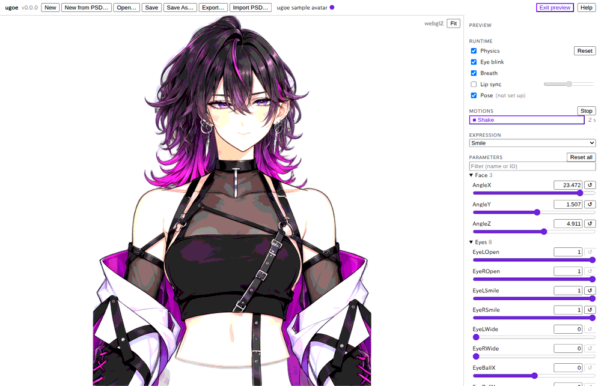
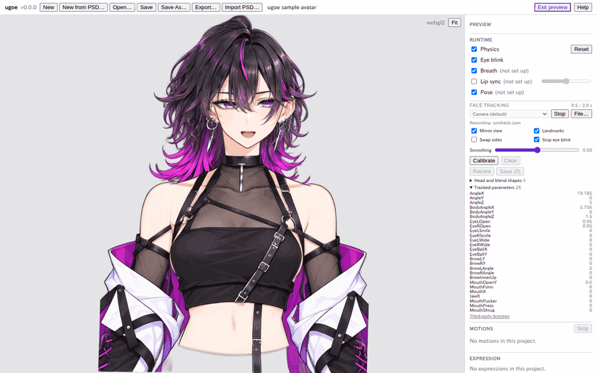

# プレビュー: 仕上がりを確かめる

組み上げたモデルを、アプリやゲームで動かすときと同じ仕組み (ランタイム) で動かして確かめるモードです。
物理・目パチ・呼吸・モーション・表情を掛けたまま、すべてのパラメータをスライダーで動かせます。
カメラのフェイストラッキングで、自分の表情と頭の向きをモデルに付けて確かめることもできます。
プレビューでは **モデルを変えません** (Undo の履歴にも残りません)。仕組みは [editor.md#プレビューモード](../editor.md#プレビューモード) (開発者向け) にあります。

## 入る・出る

1. ヘッダーの「Preview」を押す。
   左のツリー・下のタイムライン・右のインスペクタとパラメータ・ビューポートの編集のツール (選択の枠・ギズモ) が隠れ、ビューポートが広がり、右に「Preview」のパネルが出ます。
2. 確かめ終わったら、ヘッダーの「Exit preview」を押す。
   プレビューに入る前の姿 (編集のパネルのスライダーの値) に戻り、編集の画面に戻ります。

- プレビューの間は「Undo」「Redo」のボタンが隠れ、Ctrl + Z なども効きません。
- プレビューで動かしたスライダーの値は、編集のスライダーとは別です。出ると捨てられ、次に入るとまた編集中の姿から始まります。
- 物理のパネルの「Preview」(物理のプレビュー) やタイムラインの再生・表情のプレビューをしている途中でプレビューに入ると、それらは止まります。
- ビューポートのホイールでのズーム、中ボタン (か Alt + ドラッグ) でのパン、「Fit」は編集のときと同じです。
- 「Open…」などでモデルを替えると、プレビューを出ます。

## ランタイム (Runtime)

モデルを毎フレーム動かす仕組みを、1 つずつ入れたり切ったりできます。

| 欄 | 内容 |
| --- | --- |
| 「Physics」 | 物理 ([物理: 髪を揺らす](physics.md))。頭のスライダー (`AngleX` など) を動かすと髪が遅れて揺れる。「Reset」で揺れを止め、今の姿の静止した形に戻す |
| 「Eye blink」 | 自動のまばたき |
| 「Breath」 | 呼吸 (顔と体の小さな揺れ) |
| 「Lip sync」 | 口の開き。右のスライダーが声の大きさ (0〜1) の代わり。最初は切ってある (入れると口のパラメータのスライダーは効かなくなる) |
| 「Pose」 | 排他的なパーツの切り替え (腕の差分など) |

- モデルに設定の無いものには「(not set up)」と出ます。入れても何も起きません。
- 目パチ・呼吸・リップシンクの対象のパラメータは、今のエディタでは設定できません ([制限](#制限))。

## フェイストラッキング (Face tracking)

カメラに映った顔の表情と頭の向きで、モデルを動かします (ビューアのフェイストラッキングと同じ仕組み)。
どのパラメータが動くかは、モデルのアバタープロファイルの対応 (`AngleX`・`EyeLOpen`・`MouthOpenY` など) で決まります。
映像はこのコンピュータの中だけで処理し、どこにも送りません。

1. 「Face tracking」の見出しを押して開く (最初は閉じてあります)。
2. 左の選択欄でカメラを選び、「Start」を押す。初めてのときは OS やアプリがカメラの許可を求めます。
   映像と顔のランドマークが出て、モデルが顔に合わせて動きます。右上に検出の頻度 (fps) が出ます。顔が見つからないと
   「No face found」と出て、最後の値を保ちます。
3. 正面を向いて力を抜いた顔で「Calibrate」を押すと、その顔を中立にします (「Clear」で取り消す)。
4. 「Stop」で止めます。トラッキングが動かしていたパラメータは既定値に戻ります。

| 欄 | 内容 |
| --- | --- |
| 「File…」 | カメラの代わりに、動画・画像、または記録した値 (JSON) で動かす。カメラの無いときや、同じ動きで何度も確かめるときに使う |
| 「Mirror view」 | 映像を鏡のように表示する (表示だけで、モデルの動きは変わらない) |
| 「Landmarks」 | 顔の輪郭・目・眉・唇の線を映像に重ねる |
| 「Swap sides」 | 左右を入れ替える。既定では写った人の右目がキャラクターの右目を動かす。入れるとモデルが鏡に映った自分のように動く |
| 「Stop eye blink」 | トラッキングの間、自動のまばたきを止める (既定で入っている。止めないと、目の開閉にまばたきが重なる) |
| 「Smoothing」 | 揺れを抑える強さ。強いほど滑らかで、動きが遅れる |
| 「Record」「Save (n)」 | 検出した値を記録し、JSON に保存する。「File…」で読み込むと繰り返し再生する |
| 「Head and blend shapes」「Tracked parameters」 | 検出した頭の向きと表情の値 (0〜1)、それで動くパラメータの今の値 |
| 「Third-party licenses」 | 同梱している MediaPipe (顔の検出) のライセンス |

- 「Runtime」の「Eye blink」を切っているときは、トラッキングを止めてもまばたきはしません。
- トラッキングで動いているパラメータは、スライダーで動かしても上書きされます。
- プレビューを出ると、トラッキングも止まります。
- カメラの許可: macOS では初回に OS が許可を求めます (「システム設定」→「プライバシーとセキュリティ」→「カメラ」で
  後から変えられる)。Windows では「設定」→「プライバシーとセキュリティ」→「カメラ」で、デスクトップアプリのカメラの
  使用が許可されている必要があります。

## モーション (Motions)

プロジェクトのモーション ([モーションと表情](motions.md)) が並びます。保存する前のものも使えます。

1. 「▶ 名前」を押すと、そのモーションを初めから再生します。フェード・ループ・イベントも掛かります。
2. 再生中は「■ 名前」になり、押すか「Stop」で止まります (フェードアウトして止まる)。

- 発火したイベントは、下の「Events:」に新しい順に 5 つまで出ます。
- モーションで動いているパラメータは、スライダーで動かしても上書きされます。終わった後は最後の値が残ります。
- タイムラインの再生と違い、目パチ・呼吸・物理も同時に掛かります。

## 表情 (Expression)

選択欄で表情を 1 つ選ぶと、今の姿に重ねて (フェードして) 見せます。「(none)」で外します。

## パラメータ (Parameters)

すべてのパラメータのスライダーが、パラメータグループごとに並びます (グループの無いものは最後の「Other」)。

- スライダーをドラッグするか、値の欄に数を入れて Enter。値域の外の数は赤い字で断られます。
- 「↺」かスライダーのダブルクリックで、そのパラメータを既定値に戻します。「Reset all」ですべて戻します。
- 上の欄に名前か ID の一部を入れると、そのパラメータだけに絞ります。
- 値は、物理・呼吸・モーションなどを掛けた後の今の値を毎フレーム出します。呼吸などで動いているパラメータのスライダーは、手を離すと少しずつ動きます。

## 制限

- 目パチ・呼吸・リップシンクの設定 (対象のパラメータ・間隔など) を作る画面はまだありません。読み込んだモデルに設定があれば動きます。
- プレビューの中で見た姿は保存できません。気に入った姿を表情やモーションにするには、プレビューを出て編集のスライダーで作ります。
