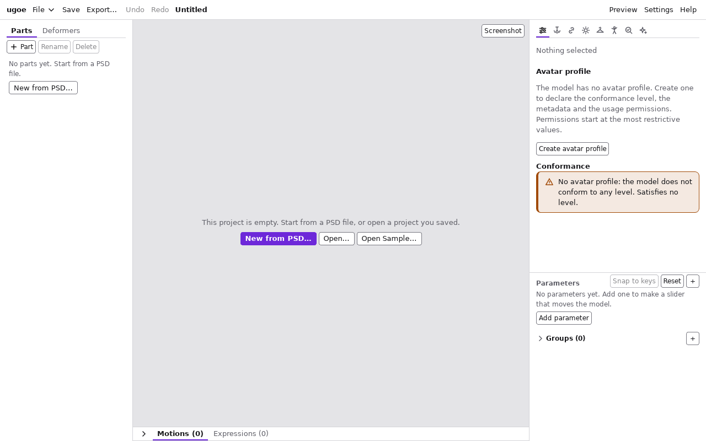
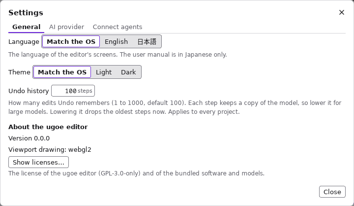

# 画面とパネル

エディタの画面は 6 つの領域に分かれています。

| 領域 | 内容 |
| --- | --- |
| [ヘッダー](#ヘッダー) | 「File」のメニュー・Save・Export・Undo / Redo・プロジェクト名・Preview・Settings・Help |
| [ツリー](#ツリー) (左) | パーツとデフォーマの階層 |
| [ビューポート](#ビューポート) (中央) | モデルの表示と編集 |
| [インスペクタ](#インスペクタ) (右上) | 選んだ要素の設定 |
| [パラメータ](#パラメータ) (右下) | パラメータのスライダーとキー |
| [タイムライン](motions.md#タイムラインのパネル) (中央の下) | モーションと表情の作成・編集・再生 ([モーションと表情](motions.md))。「▾」で畳める。空のプロジェクトと狭い窓 (幅 900px 未満) では畳んだ状態で始まる |

領域の間の線 (区切り) をドラッグすると、左右の列の幅・タイムラインの高さ・インスペクタとパラメータの配分を変えられます。
キーボードでは、Tab で区切りに移って矢印キー (列の間は ← / →、上下の間は ↑ / ↓)・Home (最小)・End (最大) で動かし、Enter (またはダブルクリック) で
元の大きさに戻します。変えた大きさはエディタが覚えます。

用語:

- **パーツ**: メッシュやデフォーマをまとめるフォルダ。PSD のグループから作られます。不透明度を持ちます。
- **メッシュ**: 画像 (テクスチャ) を貼った三角形の網。PSD のレイヤーから作られます。
- **デフォーマ**: 中のメッシュやデフォーマをまとめて変形させる枠。ワープ (格子) と回転があります。
- **パラメータ**: モデルを動かすつまみ (`AngleX` など)。
- **キー / セル / キーフォーム**: 要素がパラメータの決まった値 (キー) ごとに持つ形。キーの組み合わせ 1 つ分の形をセル (キーフォーム) と呼びます。

## ヘッダー

ウィンドウの幅が足りないときは、プロジェクト名を「…」で省略して 1 行に収めます。

| ボタン | 内容 |
| --- | --- |
| 「File」 | ファイルの操作のメニュー。下の表の操作が並ぶ。キーボードでは ↑ / ↓ で選び、Enter で実行する |
| 「Save」 | 開いた (前回保存した) 場所に上書き保存する。保存先がまだなければ「Save As…」と同じダイアログが開く。開いた後で外で書き換えられていたら、保存の前に尋ねる ([外でプロジェクトが書き換えられたとき](#外でプロジェクトが書き換えられたとき))。キーボードでは Ctrl + S (macOS は Cmd + S) |
| 「Export…」 | 書き出しの欄を開く。テクスチャのアトラス化 (「Pack textures into atlases」・「Max size」・「Padding」) を選び、「Export .ugoe…」で `.ugoe` ファイルに書き出す。名前の既定は `<プロジェクト名>.ugoe` で、`.ugoe` がなければ付く。書き出すと欄の下にテクスチャの枚数と描画の状態の切り替え回数の変化が出る。欄の設定はプロジェクトに残る |
| 「Export Module…」 | モジュールのプロジェクトで「Export…」の代わりに出る。`.ugoemod` に書き出す ([着せ替え](dress-up.md#保存と書き出し)) |
| 「Undo」「Redo」 | 1 操作ずつ取り消す・やり直す。ドラッグは離したときに 1 操作になる。キーボードでは Ctrl + Z / Ctrl + Shift + Z (Ctrl + Y)、macOS は Cmd + Z / Cmd + Shift + Z |
| プロジェクト名 | 横の「●」は保存していない変更がある印。長い名前は「…」で省略する。名前にマウスを載せると、名前の全体と保存先のパスが出る。モジュールのプロジェクトでは `Module: <スロット>` の印も出る。開く・保存・書き出し・取り込みの間は、後ろに「Saving…」などと出る |
| 「Preview」 | プレビューモードに入る (押すと「Exit preview」になり、もう一度押すと出る)。物理・目パチ・呼吸・モーションを掛けて、すべてのパラメータで仕上がりを確かめる ([プレビュー](preview.md)) |
| 「● Agents」 | エージェントをつなぐのを有効にしている間だけ出る (つながったエージェントの数付き)。押すと「Settings」の「Connect agents」が開く ([エージェントに頼む](mcp.md)) |
| 「Settings」 | 「General」(画面の言語・テーマ・Undo の履歴の数・エディタの版とライセンスの表示 (「Show licenses…」)。下の画像)、「AI provider」(AI のプロバイダと API キー。[AI でリギングを提案する](ai.md#準備-ai-を使うとき))、「Connect agents」(エディタにエージェントをつなぐ。[エージェントに頼む](mcp.md)) |
| 「Help」 | このマニュアルをブラウザで開く。開けなかったときは、理由と URL が出るので、URL を選んでブラウザに写す |

「File」のメニュー:

| 項目 | 内容 |
| --- | --- |
| 「New」 | 空のプロジェクトにする。保存していない変更があると確かめのダイアログが出るので、捨ててよければ「Discard and continue」を押す |
| 「New from PSD…」 | PSD ファイルを選び、そこから新しいプロジェクトを作る。キャンバスは PSD の大きさ、プロジェクト名はファイル名になる。未保存の変更があるときは「New」と同じ確認がある。作った直後に「Undo」を押すと空のプロジェクトに戻る |
| 「New Module…」 | 着せ替えの衣装 (モジュール) の新しいプロジェクトを作る。本体とスロットを選ぶ ([着せ替え](dress-up.md#衣装を作る))。未保存の変更があるときは「New」と同じ確認がある |
| 「Open…」 | `.ugoeproj` フォルダを選んで開く (ファイルではなくフォルダを選ぶ)。未保存の変更があるときは「New」と同じ確認がある。キーボードでは Ctrl + O (macOS は Cmd + O) |
| 「Open Sample…」 | 着せ替えの見本 (本体とモジュールのプロジェクト) を、選んだフォルダの中の新しいフォルダに書き出して、本体を開く |
| 「Save」 | ヘッダーの「Save」と同じ |
| 「Save As…」 | 保存先を選んで保存する。名前の既定は `<プロジェクト名>.ugoeproj` で、`.ugoeproj` がなければ付く。プロジェクト名はフォルダ名になる。キーボードでは Ctrl + Shift + S (macOS は Cmd + Shift + S) |
| 「Import PSD…」 | PSD ファイルを選び、今のプロジェクトに追加で取り込む ([PSD の取り込み](#psd-の取り込み)) |

- ファイルやフォルダは OS のダイアログで選びます。ダイアログを取り消すと何も起きません。ダイアログは、最後に選んだ場所 (なければプロジェクトの隣、ドキュメントのフォルダ) で開きます。
- 保存・書き出しが済むと、画面の下に `Saved to …` / `Exported to …` と書いた場所が少しの間出ます。エラーはヘッダーの下の帯に出ます (× で閉じる)。
- 新規作成・開く・取り込みの後は、ビューポートがキャンバス全体の表示に戻ります。
- 「New」「New from PSD…」「Open…」の後は、パラメータのスライダーが既定値に戻ります。「Import PSD…」では今の値のままです。
- 空のプロジェクトでは、ビューポートの中央に「New from PSD…」「Open…」「Open Sample…」のボタンが出ます。

  

### 外でプロジェクトが書き換えられたとき

エディタで開いている `.ugoeproj` を、別のプログラム (MCP サーバの `ugoe-mcp` を使う AI エージェント、別のエディタ、テキストエディタなど) が書き換えると、エディタが気づいてダイアログを出します。黙って上書きすることはありません。
エージェントを **エディタにつなぐ** 形 ([エージェントに頼む](mcp.md)) では、エージェントの編集はエディタの中の文書に入るので、このダイアログは出ません。

- **いつ気づくか:** エディタのウィンドウに戻ったとき、ウィンドウが見えている間は 5 秒ごと、そして「Save」を押したとき。
- **未保存の変更がない:** 「Reload」で開き直します (表示の位置とパラメータのスライダーはそのまま)。「Later」は今の内容のまま続けます (同じ変更についてはもう尋ねません。保存するときはまた尋ねます)。
  「Reload automatically when there are no unsaved changes」に印を付けると、次からは尋ねずに開き直し、画面の下に `Reloaded: the project was changed outside the editor` と出ます (この設定はエディタに残ります)。
  モジュールのプロジェクトでは、同じ設定で本体の変化も尋ねずに読み直します (保存していない衣装の編集も残るので、未保存の変更があっても読み直します。[着せ替え](dress-up.md#本体を変えたとき))。
- **未保存の変更がある (または「Save」を押した):** 次から選びます。
  - 「Reload and discard my changes」: 外の変更を読み込み、エディタでの未保存の変更を捨てる
  - 「Overwrite with my version」: エディタの内容で保存し、外の変更を捨てる
  - 「Save As…」: エディタの内容を別の場所に保存する (外の変更はそのまま残る)
  - 「Later」: 何もしない
- **プロジェクトのフォルダが移された・消された:** 「Save here again」で同じ場所に保存し直すか、「Save As…」で別の場所に保存します。
- ダイアログには、変わったファイル (`model.json` など) の名前が出ます。中身が同じまま日付だけが変わったファイルは、変更として扱いません。
- 開き直すと、Undo の履歴と AI の提案の一覧は消えます。

AI エージェントに `ugoe-mcp` でプロジェクトを直接編集させるときは、エディタでは未保存の変更を持たないようにし、自動で開き直す設定にしておくと、エージェントが保存するたびにエディタの表示が新しくなります。

### PSD の取り込み

- グループはパーツ、ラスタレイヤーはメッシュ (とテクスチャ) になります。レイヤーごとに自動でメッシュを作ります。
- 空のプロジェクトに取り込むと、キャンバスを PSD の大きさにします。空でないプロジェクトに取り込むと、キャンバスは変えず、レイヤーは PSD のピクセルの位置に置きます (大きさが違えば警告が出ます)。
- 非表示のレイヤーも取り込み、不透明度を 0 にします (閉じた目など、差分の絵を後で使えるように)。
- クリッピングされたレイヤーは、下のレイヤーをマスクにします ([マスク](masks.md))。
- 取り込めなかったものや、見た目が変わりうるものは、プロジェクト名の右に「N import warnings」と出ます。押すと一覧が開きます ([よくある警告](warnings.md#psd-の取り込みの警告))。
- 名前に英数字がないレイヤー (日本語だけの名前) の ID は `Layer8` のようになります。表示名は元の名前のままです。

## ツリー

画面の左です。上のタブで表示を切り替えます。

| タブ | 内容 |
| --- | --- |
| 「Parts」 | パーツの階層。各パーツの下に、子パーツ・所属するデフォーマ・メッシュを並べる |
| 「Deformers」 | デフォーマの階層。各デフォーマの下に、子デフォーマ・そのデフォーマで変形するメッシュを並べる |

行の表示:

- 印は種類を表します (フォルダ = パーツ、格子 = ワープデフォーマ、回転 = 回転デフォーマ、三角 = メッシュ)。
- メッシュは手前に描かれるものから順に並び、右端の数字は描画順 (大きいほど手前) です。
- `hidden`: パラメータが既定値のときに不透明度が 0 (見えない)。
- `mask`: マスク専用のメッシュ (色としては描かない)。

ボタン:

| ボタン | 内容 |
| --- | --- |
| 「+ Part」 | 選んでいるパーツの下に新しいパーツを作り、名前の入力に入る |
| 「Rename」 | 名前を変える (F2 と同じ)。変わるのは表示名だけで、ID は変わらない |
| 「Delete」 | 選んでいる要素を削除する。確認の「Delete」を押すと消える。子が残っているパーツやデフォーマは削除できない |

ドラッグ & ドロップ:

- パーツ・デフォーマ・メッシュを別の行に落とすと、親を付け替えます。何もない所に落とすと最上位になります。
- デフォーマの親の付け替えは、パラメータが既定値の姿での見た目を保ちます。
- 同じ親の中でメッシュの行の上半分・下半分に落とすと、その手前・奥へ並べ替えます。描画順の数字が違うメッシュどうしは並べ替えられません (インスペクタの「Draw order」で数字を変えます)。
- 落とせない所では、ツリーの下に理由が出ます。
- ポインタを乗せた行は薄く色が付き、ビューポートでその要素のメッシュが細い破線で囲まれます (パーツ・デフォーマの行なら、その中のメッシュすべて)。
  ビューポートでメッシュに乗せると、ツリーのその行に色が付きます。その行が畳んだ行の中にあるときは、畳んだ行に色と左端の縦線が付きます。
  主な選択 (インスペクタに出ているもの) の名前は太字です。
- 行が無いときは、何が無いかと次の操作のボタン (空のプロジェクトでは「New from PSD…」、パーツの無いモデルでは「Import PSD…」) が出ます。

キーボード操作は [ツールとキーボード操作](tools.md#ツリー) にあります。

## ビューポート

画面の中央です。モデルを今のパラメータの値で表示します。

| 場所 | 内容 |
| --- | --- |
| 左上 | 1 行目に道具のボタン: 「Edit mesh」(メッシュ編集モード)、「Form edit」(今のセルの形の編集。メッシュを選んでいるとき)。その下に今の道具の帯: デフォーマを選んでいるときはデフォーマの種類と ID と今のセル、フォーム編集・メッシュ編集では対象・選んだ数・操作の説明、キーの間にいるときは注意 |
| 右上 | 「Screenshot」(今の表示を PNG で保存) |
| 右下 | 「−」「+」(縮小・拡大)、「全体を表示」(キャンバス全体を表示) |

- ホイールで拡大・縮小、中ボタンか Alt + 左ドラッグ、または Alt + 矢印キーで表示を動かします。
- 選んだメッシュは紫の線で囲まれます (主な選択は太い線)。ポインタを乗せたメッシュは細い破線で囲まれます。線と点の色はライトとダークのテーマで変わりません (どちらの地とモデルの上でも見えるように)。
- 描画の方式 (`webgpu` / `webgl2`) は「Settings」の「General」の「About the ugoe editor」に出ます。
- 「Screenshot」は、モデルだけを今の姿 (プレビュー中は押したときのフレーム) で PNG に保存します。ギズモや選択の線などの
  重ねた表示は写りません。保存先を選ぶダイアログが開き、既定の名前は `<プロジェクト名>-<日付>-<時刻>.png` です。
- 何を選んでいるかで、出る道具が変わります ([ツールとキーボード操作](tools.md))。
  - メッシュ: 「Edit mesh」でメッシュ編集、「Form edit」でセルの形の編集。
  - デフォーマ: ギズモ (ワープの格子・回転の取っ手) が出て、今のセルの形を編集できます。

## インスペクタ

画面の右の列の上です。上に 8 つのアイコンのタブが並び、パネルを切り替えます。タブには名前の文字が無く、マウスを乗せるか、キーボードで
フォーカスすると名前と説明が出ます (タブにフォーカスがあるときは左右の矢印キー・Home・End で選べます)。このマニュアルでは、タブを名前で
「Physics」のタブのように呼びます。

| タブ (名前) | アイコン | パネル |
| --- | --- | --- |
| Inspector | 3 本のスライダー | 選んでいる要素の設定 (この節) |
| Physics | 揺れる振り子 | 物理のリグ ([物理: 髪を揺らす](physics.md)) |
| Glue | 鎖 | グルー ([グルーで継ぎ目をつなぐ](dress-up.md#グルーで継ぎ目をつなぐ)) |
| Lighting | 太陽 | ライティング ([ライティング](lighting.md)) |
| Slots | ハンガー | 着せ替えのスロット ([着せ替え](dress-up.md#スロットを作る)) |
| Poses | 片腕を上げた人 | ポーズのグループ ([ポーズを手で編集する](dress-up.md#ポーズを手で編集する)) |
| Verify | チェックの入った虫眼鏡 | はみ出しの検証 ([はみ出しの検証](verify.md)) |
| AI | きらめきの星 | AI の提案 ([AI でリギングを提案する](ai.md))。提案があるとアイコンの右に数、新しい提案や作り直しが要るリグがあると右上に点が出ます |

「Inspector」のタブの中の上に、選んでいる要素の種類・名前・ID (`mesh: 顔 (Layer8)` など。名前と ID が同じなら ID だけ) が出ます。何も選んでいなければ `Nothing selected` と出ます。
要素を選ぶ選択欄 (ミラーの相手・ミラー元・マスク・テクスチャ) も、名前と ID を並べて出します。
選んだ要素に応じて、次の節がこの順に並びます (よく触るキーフォームが上、作る操作とまれな設定が下)。

| 節 | 出るとき | 内容 |
| --- | --- | --- |
| 「Deformer」 | デフォーマを選んだとき | 名前・種類 (warp 3×3 など)・キーフォームの数・親 (名前と ID)。「Unwrap」でデフォーマを外す ([下](#デフォーマを外す)) |
| 「Keyforms」 | 形を持つ要素を選んだとき | 軸 (パラメータ) とキー、セルの格子 ([下](#keyforms-の節)) |
| 「Inference」 | 同上 | 推定の設定と実行、ミラー ([推定・ミラー・深度](inference.md)) |
| 「Mesh」 | メッシュを選んだとき | 名前・頂点と三角形の数、「Texture」(貼る画像)、「Blend」(合成: Normal / Additive / Multiply)、「Back-face culling」(裏面を描かない)、「Mask only」、「Masks」([マスク](masks.md)) |
| 「Wrap in deformer」 | メッシュ・デフォーマ・パーツを選んだとき (複数可) | 選んだものを包むデフォーマを作る。パーツを選ぶと、その中 (子のパーツも含む) のいちばん外側のメッシュとデフォーマをまとめて包む (デフォーマの中のメッシュはデフォーマごと移る)。「Name」(空なら最初に選んだものの名前から `顔のワープ` / `顔の回転` のように付く)、「Rows」「Cols」を決めて「Warp」、または「Rotation」(中心は選んだものの中心)。ID は名前 (英数字がなければ種類と包んだものの ID: `WarpGroup18`) から作る。作ったデフォーマが選ばれる |
| 「Draw clone」 | メッシュを選んだとき | 形を共有する複製を作る「Create draw clone」、複製と元の間の選択の移動、複製の今のセルの「Opacity」「Draw order」、ずれたときの「Resync」([前後関係が入れ替わる部分の作り方](masks.md#前後関係が入れ替わる部分の作り方)) |
| 「Depth」 | メッシュかワープを選んだとき | 深度の設定 ([推定・ミラー・深度](inference.md#深度)) |
| 「Avatar profile」 | 何も選んでいないとき | 対応レベル・メタデータ・利用許諾・標準の当たり判定と、対応の検査の結果 ([アバタープロファイル](avatar.md)) |

インスペクタの上には、自動のミラーのやり直しに失敗したときの通知が出ることがあります ([よくある警告](warnings.md#ミラーのやり直しの通知))。

### デフォーマを外す

「Deformer」の節の「Unwrap」は、包むのをやめます。デフォーマの子 (メッシュ・デフォーマ) を、見た目を保ったままデフォーマの親へ戻し、
デフォーマを削除します。元の子が選ばれます。1 回の「Undo」で元に戻ります。

- 見た目が保たれるのは、パラメータが既定値の姿です。外したデフォーマに付けた動き (キーの形) はなくなります。
- デフォーマの「Delete」(ツリー) は、子が残っていると削除できません。子ごと残したいときは「Unwrap」を使います。

### Keyforms の節

- 先頭に、今の値がどのセルの上にあるか (`On cell AngleX = 30, AngleY = 0`) が出ます。キーの間なら `Between keys.` と「Move to nearest key」が出ます。
- 軸ごとに、キーの値のボタンが並びます。押すとそのキーへ移動し、「×」でキーを削除します (最後のキーを消すと軸ごと消えます)。今の値がキーでなければ「+ 12.34」(今の値でキーを追加) が出ます。
- 「Add axis…」でまだ軸にないパラメータを選び、「Add key at current value」を押すと、今の値でキーを追加して軸を作ります。
- セルの格子は、1 軸なら 1 行、2 軸なら表です。3 軸目からは、今の値に最も近いキーの断面を出します。セルの記号の意味は [推定・ミラー・深度](inference.md#セルの記号) にあります。
  - セルを押すと、スライダーがそのセルへ動き、そのセルが選ばれます。
  - Shift か Ctrl を押しながら押すと、セルを選択に加えます (外します)。選んだセルは「Inference」の「Mark authored」「Mark derived」の対象になります。
  - 今のセルは紫の枠で示されます。
- メッシュでは「Draw order」に今のセルの描画順が出ます。値を変えて「Set for all cells」を押すと、すべてのセルの描画順を同じ値にします。

## パラメータ

画面の右の列の下です。インスペクタとパラメータは別々にスクロールし、間の区切りを上下にドラッグする (区切りを押して ↑ / ↓ / Home / End でも) と高さの配分を変えられます。配分は次に開いたときも同じです。

| 操作 | 内容 |
| --- | --- |
| 「+」 | パラメータを作る。「ID」(必須)・「Name」(空なら ID と同じ)・「Min」「Default」「Max」を入れて「Create」。最小 ≤ 既定 ≤ 最大でなければエラー |
| パラメータ名を押す | 「Name」「Min」「Default」「Max」の編集と「Apply」、「Delete」(削除)、「Group」(グループ)、「Mirror」(左右の対) が出る |
| 「Group」 | パラメータを入れるグループを選ぶ。選ぶとすぐに設定される。「(none)」で外す |
| 「Mirror」 | 左右の対のパラメータを選ぶ。選ぶとすぐに設定され、相手側にも対が張られる (前の相手との対は外れる)。「Itself (flip the sign)」は自分自身との対 (値の符号を反転して対応。`AngleX` など)、「(none)」は対なし。標準の名前なら「Pair with EyeROpen」のような提案のボタンが出る。ミラーに使う ([推定・ミラー・深度](inference.md#ミラー)) |
| スライダー | 値を変える。値は表示のためのもので、モデルには保存されない (保存されるのはキーと形) |
| 名前の右の値の欄 | 値を数で入力し、Enter で決める (欄から出ても決まる)。最小〜最大の外や数でないときは、理由が赤い字で出て値は変わらない |
| 行の右端の「◆」 | 選んでいる要素に、今の値でキーを追加する。今の値がすでにキーなら (◆ が色付き)、そのキーを削除する。途中の値 (0.5 など) のキーは、値の欄に入力してから押す |
| スライダーの下の小さな印 | 選んでいる要素のキー。押すとその値へ移動する |
| 「Snap to keys」 | 選んでいる要素のすべての軸を、最も近いキーへ動かす |
| 「Reset」 | すべてのパラメータを既定値に戻す |
| グループの見出し | グループに入ったパラメータがあると、一覧をグループの順に区切る (グループに入っていないものは最後の「Other」)。見出しを押すと畳む・開く。右の数はその区切りのパラメータの数 |
| 一覧の下の「Groups」 | グループを作る (「+」で ID と名前)・名前を押して名前の変更と削除 (パラメータは残る)・並べ替え。並べ替えは行のドラッグ、▲▼、名前のボタンで Alt + ↑ / ↓ のどれでもよく、ドラッグは Esc で取り消せる。並びはこの一覧・プレビュー・ビューアの区切りの順になる |

- パラメータを削除すると、そのパラメータを軸に持つ要素からは軸が取り除かれ、既定値 (に最も近いキー) の形が残ります。
- スライダーを押してから、矢印キーで少しずつ、Home / End キーで最小 / 最大に動かせます。
