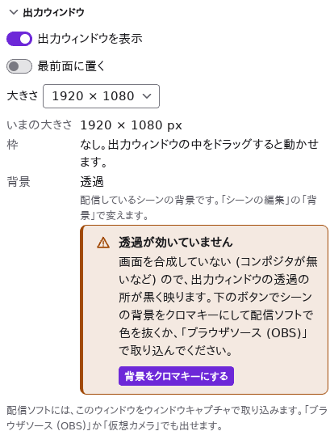
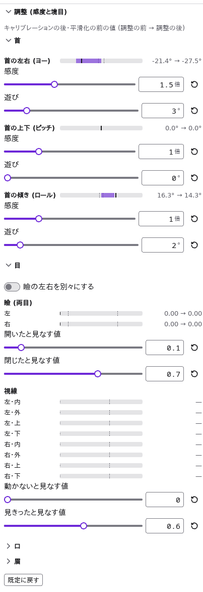
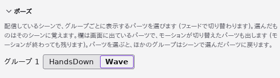
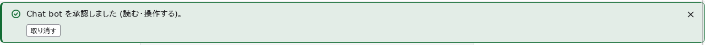

# スタジオ: 配信でアバターを動かす

スタジオ (ugoe studio) は、配信中にアバターを動かすためのアプリです。カメラの顔とマイクの声でモデルを動かし、
表情・モーション・シーンをボタンやホットキーで切り替えて、OBS などの配信ソフトや会議アプリに出します。
この章は配信者向けの手順書です。仕組みや設計の判断は [docs/studio.md](../studio.md) と [ADR 0028](../adr/0028-studio.md) (開発者向け) にあります。


スタジオには 2 つのウィンドウがあります。

| ウィンドウ | 役目 |
| --- | --- |
| 操作ウィンドウ | シーン・入力・表情とモーション・ホットキー・出力の設定を操作する。**モデルは描かない** (描く負荷を出力の分だけにするため)。動きの様子は「いまの状態」の数値で見る |
| 出力ウィンドウ | モデルだけを、枠なし・背景の透過で描く。配信ソフトはこのウィンドウを取り込む。何も重ねて表示しない |

この章では、画面のボタンや欄の名前を **日本語の画面** に出ている名前で「」に入れて書きます (エディタの章とは違います)。
画面の言語は [設定](#設定-言語テーマライセンス) で選べます。「押す」はマウスの左ボタンでのクリックです。

## 起動する

リポジトリの準備 (ルートの [README](../../README.md) の「始め方」) が済んでいれば、次のコマンドで起動します。

```sh
just studio   # スタジオを開発モードで起動する (wasm の用意も行う)
```

インストーラの作り方は [apps/studio/README.md](../../apps/studio/README.md#コマンド) にあります。Windows の仮想カメラは
インストーラが登録するので、仮想カメラを使うならインストーラで入れたスタジオを使います ([仮想カメラ](#仮想カメラ))。

起動すると、最後に開いたプロファイルを開き、最後に使ったシーンに切り替えます。初めてのときは、モデルの無いシーンが 1 つの
新しいプロファイルで始まります。

## 画面

ツールバー (いちばん上の行):

| 欄 | 内容 |
| --- | --- |
| 「プロファイル」 | プロファイルのメニュー ([シーンとプロファイル](#シーンとプロファイル)) |
| プロファイルの名前と「保存済み」/「未保存」 | 開いているプロファイルのファイル名と、保存したかどうか (一度も保存していなければ「未保存」)。見本のプロファイルは「見本」、保存できない場所のプロファイルは「読み取り専用」 ([書き換えないプロファイル](#書き換えないプロファイル)) |
| 「モデルを選ぶ…」 | 編集しているシーンのモデルを選び、そのシーンに切り替える |
| 「出力ウィンドウ」 | 出力ウィンドウを表示する・隠す (押し込まれていれば表示中) |
| 歯車 | [設定](#設定-言語テーマライセンス) (言語・テーマ・ライセンス) |

その下は 3 つの列です。

- **左「シーン」:** シーンの一覧。押すと切り替わります。配信しているシーンに「配信中」の印が付き、切り替えのホットキーを割り当てたシーンには
  そのキー (「Ctrl+Shift+1」など) が並びます。下に「追加」と、複製・上へ・下へ・削除のボタン (アイコン。ポインタを置くと名前が出る) があります。
- **中央「いまの状態」:** 上に状態の印が並びます (下の表)。その下に、配信しているシーン・モデル・再生中のモーション・使っている表情と、
  「表情とモーション」「ポーズ」(配信しているモデルにポーズがあるときだけ) のパネル。配信中に触るものはこの列にまとまっています。
- **右のパネル:** 上から「シーンの編集」「入力」「出力ウィンドウ」「ブラウザソース (OBS)」「仮想カメラ」(ここまでが
  [はじめての配信の準備](#はじめての配信の準備) の順)、「ホットキー」「モーションの設定」「操作 API」「フレームレートと負荷」「パラメータ」。
  見出しを押すと畳めます。

状態の印は、色に加えて印の形でも様子を示します (丸にチェック = 動いている、中の空いた丸 = 切、三角 = 注意が要る、八角 = 動かせない)。
印にポインタを置くかフォーカスすると、意味とどこで変えるかが出ます。印を押すと、その設定のパネル (トラッキングと口パクは「入力」、
ホットキーは「ホットキー」、出力は「出力ウィンドウ」、負荷は「フレームレートと負荷」、API は「操作 API」、ソースは「ブラウザソース (OBS)」) を開いて、
そこまで右の列を送ります (畳んでいても開きます)。

| 印 | 示すもの |
| --- | --- |
| トラッキング | カメラのフェイストラッキング ([入力](#入力-カメラとマイク))。「トラッキング 63 fps」(顔あり)・「顔なし」・「一時停止中」・「切」 |
| 口パク | マイクの口パク。入っている間は音量のメーターが付く |
| ホットキー | 登録したホットキーの数。登録できないものがあると三角の印になる ([ホットキー](#ホットキー)) |
| 出力 | 出力ウィンドウの大きさ (表示しているとき) か「非表示」。印にポインタを置くと、枠が無いことと背景 (透過など) が出る。OS が選んだ大きさより小さくすると三角の印になる |
| 負荷 | 1 刻みの時間と刻みの速さ ([フレームレートと負荷](#フレームレートと負荷))。負荷の注意があると三角の印になる |
| API | [操作 API](#操作-api-外のアプリから操作する) の入・切。承認を待つアプリがあると三角の印になる |
| ソース | [ブラウザソース](#ブラウザソース-obs) の入・切。印にポインタを置くと開いているページの数が出る |

幅が 960px 以下では、シーンと「いまの状態」の 2 列の下に右のパネルが並び、640px 以下では 1 列に積まれます。画面全体を送って見ます。

## はじめての配信の準備

1. ツールバーの「モデルを選ぶ…」(中央の「いまの状態」にも同じボタンがあります) を押し、モデル (`.ugoe`) を選ぶ。
   最初のシーンにモデルが入って配信中になり、中央の「いまの状態」にモデル名が出ます。右の「シーンの編集」の「モデルを選ぶ…」で選んでも同じです。
2. ツールバーの「出力ウィンドウ」を押す (右の「出力ウィンドウ」のパネルの「出力ウィンドウを表示」でも同じ)。
   枠の無いウィンドウにモデルが出ます。背景は透過です。
3. 右の「出力ウィンドウ」のパネルの「大きさ」を、配信の解像度 (1920 × 1080 など) にする。
   出力ウィンドウには枠が無く、中をドラッグすると動かせます。「最前面に置く」で、ほかのウィンドウより前に置けます。
   パネルの「いまの大きさ」「枠」「背景」に、出力ウィンドウの様子が出ます (出力ウィンドウには何も重ねて表示しないため)。
   透過のシーンなのに画面で透過が効かない (Linux でコンポジタが無いなど) ときは、「背景」の欄に「透過が効いていません」が出ます。
   知らせの「背景をクロマキーにする」を押すと、配信しているシーンの背景がクロマキーの緑になります ([困ったとき](#困ったとき))。
4. 黄色の知らせの「名前を付けて保存…」を押し、プロファイルを保存する。以後の変更は自動で保存されます。
5. [入力](#入力-カメラとマイク) でカメラとマイクを始め、[配信ソフトに出す](#配信ソフトに出す) の 3 つの方法のどれかで取り込む。
   右の列では「出力ウィンドウ」の下に「ブラウザソース (OBS)」「仮想カメラ」が並びます。




- 出力ウィンドウの「大きさ」は、配信ソフトが取り込む大きさ (物理ピクセル) です。画面の拡大率が 150% なら、画面の上では
  1280 × 720 に見えます。画面に収まらず OS が小さくしたときは、パネルに今の大きさと注意が出ます。
- 出力ウィンドウを閉じる操作 (Alt + F4 など) をしても、閉じずに隠れるだけです。「出力ウィンドウ」で戻せます。
- 操作ウィンドウを閉じると、スタジオが終わります (出力ウィンドウ・仮想カメラ・ブラウザソースも止まります)。

## 見本のプロファイル

見本のモデル (`assets/samples`) を使う 4 つのシーンとホットキーを持つプロファイルを、すぐに試せます。
見本のプロファイルは見本のモデルと同じフォルダ (`assets/samples`) にあり、モデルをプロファイルのフォルダからの相対パスで持つので、
そのまま開けます (フォルダごと別の場所へ写しても開けます)。

| ファイル | シーンの名前 |
| --- | --- |
| `assets/samples/ugoe-sample-profile.json` | 日本語 |
| `assets/samples/ugoe-sample-profile.en.json` | 英語 |

1. ツールバーの「プロファイル」→「プロファイルを開く…」を押す。
2. 上のファイル (日本語なら `ugoe-sample-profile.json`) を選ぶ。
   「雑談」のシーンが配信中になり、出力ウィンドウにモデルが出ます (出力ウィンドウを隠していれば、ツールバーの「出力ウィンドウ」で表示する)。

| シーン | モデル | 見どころ |
| --- | --- | --- |
| 雑談 | `avatar.ugoe` | 背景の透過 |
| 夕方 (ライティング) | `avatar-lit.ugoe` | ライティングの組「夕日」 |
| 着せ替え | `dress-up/dress-up.ugoe` + `long-hair`・`sailor` | 着せ替えのモジュールと、クロマキーの緑の背景 |
| ゲーム (右下) | `avatar.ugoe` | 位置と大きさで右下に小さく置く。「雑談」と同じモデルなので、切り替えてもトラッキングとモーションが途切れない |

| キー | 操作 |
| --- | --- |
| Ctrl + Shift + 1〜4 | シーンを上の順に切り替える |
| Ctrl + Alt + 1 / 2 | 表情 `smile` / `surprised` を重ねる・外す |
| Ctrl + Alt + 0 | 表情をすべて外す |
| Ctrl + Alt + N / M | モーション `nod` (うなずく) / `shake` (首を振る) を再生する |
| Ctrl + Alt + H / C | 髪をツインテールに替える / 猫耳を付ける (「着せ替え」のシーンでだけ効く) |
| Ctrl + Alt + W / D | ポーズを手を振る差分 (`Wave`) / 手を下ろした姿 (`HandsDown`) に切り替える (「着せ替え」のシーンでだけ効く) |
| Ctrl + Alt + P / K / L | トラッキングの一時停止・再開 / トラッキングのキャリブレーション / 口パクの一時停止・再開 |

見本のプロファイルは、開いて変えても元のファイルには保存しません (保存の印が「見本」になります)。変えると
「写しを保存…」のボタンの付いた黄色の知らせが出ます。変更を残したいときは写しを保存してください。写しを保存すると、
その後は写しに自動で保存します。見本のモデルを相対パスで指したまま使うには、写しを見本と同じフォルダ (`assets/samples`) に保存します。
見本のプロファイルを手で書き換えてしまったときは、リポジトリのルートで `pnpm --filter @ugoe/studio sample-profile` を実行すると
2 つのファイルを元の中身に書き直せます (中身の作り方は `apps/studio/scripts/sample-profile.mjs` にあります)。

## シーンとプロファイル

**シーン** は、配信の 1 つの場面の設定です。モデル・付ける着せ替えのモジュール・ライティング・位置と大きさと回転・背景・
選んだポーズの差分 ([ポーズ](#ポーズ)) を持ちます。
1 つのシーンに出せるアバターは 1 体です。**プロファイル** は、シーンの一覧・ホットキー・出力の大きさ・入力 (カメラとマイク) の設定を
まとめた 1 つのファイル (`.json`) です。配信の種類ごとにプロファイルを分けておけます。


### シーンを切り替える・並べる

- 左の一覧でシーンを押すと、そのシーンに切り替わり、右の「シーンの編集」の対象になります。
- 「追加」はモデルの無いシーンを足し、複製のボタンは選んだシーンのすぐ後ろに写しを作ります。上へ・下へのボタンで並べ替え、
  削除のボタン (ごみ箱) で消します (確かめのダイアログが出ます。配信中のシーンを消しても、別のシーンに切り替えるまで出力はそのままです)。
- 切り替えの瞬間は前の画を保ち、新しいモデルを読み終えてから替わります (途中の空の画は出ません)。
- 同じモデルのシーンどうしの切り替えでは、パラメータの値・トラッキング・再生中のモーションが続きます (着せ替え・ライティング・配置・
  ポーズの差分だけが変わる)。
  別のモデルに切り替えると、物理の揺れは初めからになります。
- モデルやモジュールのファイルを読めないときは、何も変えずに前のシーンを出し続け、エラーを出します。
  背景の画像だけが読めないときは、背景を透過にして切り替えます。

### シーンの編集

| 欄 | 内容 |
| --- | --- |
| 「名前」 | 一覧に出す名前 (空なら「シーン 1」などの番号) |
| 「モデル」の「モデルを選ぶ…」 | シーンのモデル (`.ugoe`)。別のモデルを選ぶと、このシーンの着せ替えのモジュールは外れます |
| 「着せ替えのモジュール」 | 「モジュールを追加…」で `.ugoemod` を付ける。上から順に付く (「上へ」「下へ」で並べ替え、「外す」で外す)。着せ替えの仕組みは [着せ替え](dress-up.md) |
| 「位置と大きさと回転」 | 「横」「縦」(出力の幅・高さに対する割合)・「大きさ」(倍)・「回転」(度)。出力の大きさを変えても構図は保たれる。「元に戻す」で中央・等倍に戻す |
| 「背景」 | 「透過」(配信ソフトで後ろに重ねたものが見える)・「単色」・「クロマキー」(「抜く色」で緑か青を選ぶ。配信ソフトでその色を抜く)・「画像」(「画像を選ぶ…」で PNG・JPEG・WebP。出力を覆うように拡大する) |
| 「ライティング」 | 法線マップを持つモデル ([ライティング](lighting.md)) だけ。「ライティングを使う」を入れ、「組」(「標準」「夕日」「夜のランプ」「カスタム」) か各光源を選ぶ |

- 配信中のシーンを変えると、すぐに出力に効きます。配信していないシーンを変えたときは、「このシーンに切り替える」を押すまで出力は変わりません。
- 配信中に出力ウィンドウで設定を確かめるときは、先に配信していないシーンで設定を作り、切り替えて確かめると安全です。

### プロファイルを保存する・開く

「プロファイル」のメニュー:

| 項目 | 内容 |
| --- | --- |
| 「新しいプロファイル」 | モデルの無いシーンが 1 つのプロファイルで始める |
| 「プロファイルを開く…」 | 保存したプロファイルを開く。出力ウィンドウの大きさもプロファイルの設定に合わせる |
| 「保存」(Ctrl + S、Mac では ⌘ + S) | 今のファイルに保存する |
| 「名前を付けて保存…」 | 別のファイルに保存する (以後はそのファイルに自動で保存する) |
| 「最近のプロファイル」 | 最近開いた・保存したプロファイル (10 個まで) |

- 保存先のあるプロファイルは、変えてから少し後 (約 0.8 秒) に自動で保存されます。保存先の無いプロファイルを変えると、
  保存を促す黄色の知らせが出ます。保存せずに別のプロファイルを開こうとすると、捨ててよいか確かめます。
- プロファイルと同じフォルダ (とその下) にあるモデル・モジュール・背景の画像は、プロファイルからの **相対パス** で保存します。
  プロファイルとモデルを 1 つのフォルダにまとめて保存すれば、フォルダごと別の場所や別の計算機へ写しても、そのまま開けます。
  フォルダの外のファイルは絶対パスで保存します。
- 別の計算機で作ったプロファイル (フォルダの外のファイルを使うもの) や、モデルを動かした後は、そのシーンを開いたときに
  「モデルが見つかりません」と出ます。知らせの「選び直す…」を押して、モデルを選び直してください。プロファイルを手で書き換えて、
  `..` でプロファイルのフォルダの外を指した相対パスも、読まずに「見つかりません」になります。
- 新しいスタジオで保存したプロファイルは、古いスタジオでは開けません (「新しいスタジオで保存されています」と出ます。スタジオを更新してください)。
- 操作 API のトークンと承認したアプリの鍵は、プロファイルに入りません。プロファイルを人に渡しても漏れません。
- 画面の言語とテーマは、プロファイルではなくスタジオの設定として覚えます。

#### 書き換えないプロファイル

次のプロファイルは、開いて変えても元のファイルに保存しません。

- **見本のプロファイル** ([見本のプロファイル](#見本のプロファイル))。保存の印は「見本」です。
- **保存できない場所のプロファイル** (読み取り専用のファイルや、書き込めないフォルダにあるもの)。保存の印は「読み取り専用」です。
  書き込めないフォルダは、自動の保存に失敗して分かります (エラーが 1 度だけ出て、その後は保存しようとしません)。

変えると「写しを保存…」のボタンの付いた黄色の知らせが出ます。「保存」(Ctrl + S、Mac では ⌘ + S) も保存先を選ぶダイアログを
開きます。写しを保存すると、その後は写しに自動で保存します。保存せずに別のプロファイルを開こうとすると、捨ててよいか確かめます。

ディスクが一杯・ネットワークのドライブが一時的に切れた・ほかのアプリがファイルを使っている、などの一時の失敗では、
読み取り専用にはしません。赤の知らせが 1 度だけ出て、変更を残したまま 30 秒ごとにもう一度自動で保存します
(同じ失敗が続く間は知らせ直しません)。空きができるなどして保存できると、知らせは消えます。すぐに残したいときは
「写しを保存…」で別の場所に保存してください。

## 入力: カメラとマイク

カメラの顔の動き (フェイストラッキング) とマイクの声の大きさ (口パク) でモデルを動かします。映像と音はこの計算機の中だけで処理し、
どこにも送りません。顔の検出に使う MediaPipe が持つ利用状況 (検出の回数や処理時間など。映像や顔の形は含まない) を Google へ送る
仕組みも、送らせないようにしています。選んだ機器と調整はプロファイルに保存されます。


### カメラ (フェイストラッキング)

1. 右の「入力」のパネルの「カメラ (フェイストラッキング)」で、選択欄からカメラを選び、「開始」を押す。
   初めてのときは OS がカメラの許可を求めます (macOS では「システム設定」→「プライバシーとセキュリティ」→「カメラ」)。
2. 正面を向き、力を抜いた顔と姿勢で「キャリブレーション」を押す。その顔を中立にします (「解除」で取り消す)。
   体の前後の傾きと肩の上下は、キャリブレーションの後だけ動きます。
3. 動きが揺れるときは「平滑化」を上げます (強いほど滑らかで、動きが遅れます)。
4. 首の振り・瞼・視線・口・眉の効き方が合わないときは、キャリブレーションの後に「調整 (感度と境目)」を開いて合わせます ([調整 (感度と境目)](#調整-感度と境目))。

| 欄 | 内容 |
| --- | --- |
| 「鏡像で表示」 | 映像を鏡のように表示する (表示だけで、モデルの動きは変わらない) |
| 「ランドマーク」 | 顔の輪郭・目・眉・唇の線を映像に重ねる |
| 「左右を入れ替える」 | モデルを鏡に映った自分のように動かす。入力の映像がすでに左右反転しているとき (反転済みの仮想カメラなど) にも使う |
| 「目パチを止める」 | トラッキングの間、モデルの自動のまばたきを止める (既定で入っている) |
| 「体 (肩) も」 | 体の向きと肩の上下も取り込む。切ると検出が軽くなる |
| 「ファイル…」 | カメラの代わりに、動画・画像、または記録した値 (JSON) で動かす (配信の前の確認に) |
| 「記録」「保存」 | 検出した値を記録して JSON に保存する |

- 「一時停止」を押すと、トラッキングを止めて、トラッキングが動かしていたパラメータを既定値に戻します (「再開」で戻る)。
  席を外すときや、画面に映したくない動きをするときに使います。ホットキーにも割り当てられます。
- 顔が見つからないと「顔が見つかりません」と出て、最後の値を保ちます。
- パネルの部品はエディタのプレビュー・ビューアと同じです。詳しくは [プレビューのフェイストラッキング](preview.md#フェイストラッキング-face-tracking) も参照してください。

#### 調整 (感度と境目)

「調整 (感度と境目)」を開くと、「首」「目」「口」「眉」の小見出しが並びます。小見出しを開くと、項目ごとのスライダーと、
今の値のメーター (「調整の前 → 調整の後」) が並びます。顔を動かしながらメーターを見て決めてください。メーターの帯が調整の後の値、縦の線が調整の前の値、点線が遊びと境目です。
値はプロファイルに保存され、どのアバターでも同じ値を使います。「既定に戻す」で、すべて初めの値 (調整しない) に戻ります。



| 項目 | 内容 |
| --- | --- |
| 首の左右・上下・傾きの「感度」 | 首の角度に掛ける倍率。上げると、少し首を振っただけでキャラクターが大きく振ります |
| 首の左右・上下・傾きの「遊び」 | 正面のまわりのこの角度の中では首を動かしません (小さな揺れを止める)。外では 0 から滑らかに動きます |
| 目: 瞼の「開いたと見なす値」「閉じたと見なす値」 | 目の閉じの値 (0 が開いた、1 が閉じた) がどこからどこまでで、開いた〜閉じたになるか。細目で目を閉じても閉じきらないときは「閉じたと見なす値」を下げ、開いても半目になるときは「開いたと見なす値」を上げます (既定では両目に同じ値を使います) |
| 目: 「瞼の左右を別々にする」 | 入れると、左目と右目の境目を別々に決められます (片目だけ閉じきらない・片目だけ眼鏡の反射で検出が弱いとき)。入れたときは今の値が両目に写ります。左右はキャラクターの目の左右 (メーターの「左」「右」) です。「左右を入れ替える」を切っていれば、あなたの目の左右と同じです |
| 目: 視線の「動かないと見なす値」「見きったと見なす値」 | 目を動かしても目玉が端まで動かないときは「見きったと見なす値」を下げます。正面を見ていても目玉が揺れるときは「動かないと見なす値」を上げます |
| 口: 口の開きの「閉じたと見なす値」「開ききったと見なす値」 | 少し口を開けただけで大きく開かせるには「開ききったと見なす値」を下げ、少しの開きを無視するには「閉じたと見なす値」を上げます |
| 口: 口の閉じの「閉じていないと見なす値」「閉じたと見なす値」 | 口を閉じたつもりでもキャラクターの口が少し開いたままのときは、口の閉じの「閉じたと見なす値」を下げます (口の開きから引く量が大きくなる) |
| 口: 口の形の「動かないと見なす値」「動ききったと見なす値」 | 笑っても口角が上がりにくいときは「動ききったと見なす値」を下げます (口角の下がりにも同じ値を使います) |
| 眉: 「動かないと見なす値」「動ききったと見なす値」 | 眉の動きが小さく、キャラクターの眉がほとんど動かないときは「動ききったと見なす値」を下げます (上げと下げに同じ値を使います) |

- キャリブレーションの前は、値が正面・無表情の顔を差し引いていないことが、パネルの文で分かります。先にキャリブレーションすると、
  正面からの動きで合わせられます。
- 記録した値 (「記録」「保存」) は調整の前の値です。記録を再生しながら調整し直せます。

### マイク (口パク)

1. 「マイク (口パク)」の「マイク」で機器を選び、「開始」を押す。初めてのときは OS がマイクの許可を求めます。
2. 黙ったまま、「口」のメーターが動かなくなるまで「ノイズの閾値」を上げる。
3. 話して、口の開き方がちょうどよくなるように「感度」を合わせる。

- 「音量」はマイクの音の大きさ、「口」はモデルの口を開く量です。開くときは速く、閉じるときはゆっくり追います (口がぱたぱたしないように)。
- 「一時停止」で口パクを止めます (口のパラメータは動かなくなる)。
- マイクの「停止」を押すと、口のパラメータに触らなくなります。

## 表情とモーション


**表情:**

- 表情の名前を押すと、**その表情だけ** にします (ほかの表情は外れる)。もう一度押すと外します。
- 「重ねる」は、ほかの表情の上に重ねます。「すべて外す」で全部外します。

**モーション:**

1. 「優先度」を選ぶ (「待機」「通常」「強制」)。
2. モーションの名前を押すと再生します。名前の横に長さ・ループ・フェードの時間が出ます。
3. 「止める」で再生中のモーションを止め、待機モーションに戻ります。

- 再生中のモーションより優先度の低いモーションは始まりません (「優先度の高いモーションを再生しているので、始まりませんでした。」と出ます)。
  「強制」は今のモーションを止めて始めます。
次の 2 つは、右の列の「モーションの設定」にあります (配信中には触らないので、表情とモーションの操作から分けています)。

- 「何も再生していないときに待機モーションを流す」を入れると、モーションが終わった後に待機モーションを流します。
  「待機モーション」で選べます (「名前で選ぶ (idle)」は、`idle` という名前か `idle` で始まる名前のものを使います)。
- 「トラッキング中もモーションを優先する」を入れると、トラッキング中に再生したモーション (待機を除く) は、自分の動かすパラメータを
  トラッキングの代わりに動かします (うなずくモーションで、頭がカメラの向きに逆らってうなずく)。
  「トラッキングのままにするもの」で選んだ部位 (「頭の向き」「体・肩」「目」「眉」「口」) は、モーション中もトラッキングで動きます。
  切っていると、トラッキングが動かしているパラメータではトラッキングが勝ち、一覧に「すべてトラッキングが上書きする」などと出ます。

## ポーズ

ポーズ (1 つだけを表示する差分の組。衣装や持ち物の差分など。[ポーズを手で編集する](dress-up.md#ポーズを手で編集する)) を持つモデルを
配信していると、中央の「表情とモーション」の下に「ポーズ」が出ます。グループごとに差分の名前 (パーツの ID) が並び、押すと出力の姿がその差分にフェードで
切り替わります。差分が 5 つ以上のグループは選択欄で選びます。

- 選んだ差分は **配信しているシーン** に覚えます (プロファイルを保存すると残ります)。シーンを切り替えると、そのシーンで選んだ差分になります。
  選んでいないグループは先頭の差分 (エディタの「first」) です。同じモデルで「通常」「上着なし」のようにシーンを分けておくと、
  シーンの切り替えやホットキーで差分を替えられます。別のモデル・着せ替えのシーンに切り替えたときは、フェードせずにそのシーンの差分から始まります。
- 着せ替えで付けたモジュールのグループも「Sailor のグループ 1」のように並びます (差分の名前はモジュールの名前を除いたもの)。


- モデルにもう無い差分 (モデルを作り直した・モジュールを外したなど) は無視します。そのシーンで次に差分を選ぶと、シーンの設定からも消えます。
- 同じグループの差分を切り替えるモーションを再生している間は、モーションが勝ちます。パネルの欄は出力に出ている差分を示すので、
  モーションが差分を切り替えると欄もそれに変わります。モーションが切り替えた差分は、モーションが終わっても残ります (シーンの設定は変わりません)。
- 差分を選ぶ・シーンを切り替える・シーンを編集すると、ほかのグループもシーンで選んだ差分に戻ります (モーションが切り替えた差分は戻ります)。
- 外のアプリは [操作 API](#操作-api-外のアプリから操作する) の `pose.changed` の通知で、差分が変わったこと (モーションの切り替えを含む) を受け取れます
  (Stream Deck のボタンの表示を合わせるなど)。
- ホットキーの「ポーズの切り替え」([ホットキー](#ホットキー)) や、外のアプリから [操作 API](#操作-api-外のアプリから操作する) でも替えられます。

## ホットキー

キーの組み合わせで、シーン・表情・モーション・着せ替えなどを切り替えます。ホットキーは **スタジオが前面に無くても** 効きます
(配信ソフトやゲームを操作している間にも使えます)。割り当てはプロファイルに保存されます。


1. 「ホットキー」のパネルの「ホットキーを足す」を押す。
2. 「キーを決める」を押してから、割り当てるキーの組み合わせを押す (Esc でやめる。Backspace でキーを消す)。
   キーを決めている間は、ほかのホットキーは働きません。
3. 「操作」を選び、操作に合わせて対象 (シーン・表情・モーションなど) を選ぶ。
4. 要らなくなったら「削除」を押す。パネルの上に「ホットキー「…」を削除しました」と出るので、間違えたら「元に戻す」を押すと、
   同じ位置に同じキーと操作で戻ります (戻せるのは最後に削除した 1 つだけです)。

| 操作 | 選ぶもの |
| --- | --- |
| 「シーンの切り替え」 | シーン |
| 「表情」 | 表情と「付け方」(「これだけにする」/「重ねる・外す」) |
| 「表情をすべて外す」 | — |
| 「モーションの再生」 | モーションと「優先度」 |
| 「モーションを止める」 | — (待機モーションに戻る) |
| 「着せ替え」 | 「モジュールを付ける」(「モジュールを選ぶ…」で `.ugoemod` を選ぶと、そのスロットのモジュールを替える) か「スロットを空ける」 |
| 「ポーズの切り替え」 | ポーズの差分 (そのグループの表示する差分にする。[ポーズ](#ポーズ)) |
| 「トラッキングの一時停止・再開」 | — (押すたびに切り替える) |
| 「トラッキングのキャリブレーション」 | — (今の顔を中立にする) |
| 「口パクの一時停止・再開」 | — (押すたびに切り替える) |

- 表情とモーションとポーズの差分の選択肢は、配信しているモデルのものです。別のモデルの名前を割り当てたものも残り、そのモデルを配信しているときに効きます
  (ポーズの差分がモデルに無ければ、パネルの上に知らせが出ます)。
- 着せ替えとポーズの切り替えのホットキーは、配信しているシーンのモジュール・差分を替えます (シーンの設定も書き換わります)。
- Ctrl・Alt・Shift などの修飾キーを付けてください。修飾キーの無いキー (F9 など) も使えますが、スタジオを動かしている間は
  ほかのアプリがそのキーを受け取れなくなります (注意が出ます)。Mac では、Ctrl は control キー (⌃) です。⌘ も修飾キーに使えます。
- 登録できない割り当てがあると、パネルの頭に「n 個のホットキーを登録できません」と出て、その行に左の線と三角の印と理由が付きます。
  「いまの状態」のホットキーの印も三角になります (印を押すと「ホットキー」のパネルへ移ります)。
- 同じキーを 2 つに割り当てると、前のものだけが効き、後のものに「「シーンの切り替え: 雑談」と同じキーです」のように、ぶつかる相手の操作が出ます。
- ほかのアプリや OS が使っているキーは登録できず、理由がパネルに出ます。別のキーにしてください。
- **Linux の Wayland** では、スタジオが前面にあるときだけホットキーが効きます (パネルに知らせが出ます)。ほかのアプリから操作するには、
  Stream Deck などの道具から [操作 API](#操作-api-外のアプリから操作する) を使ってください。

## 配信ソフトに出す

スタジオの出力を配信ソフトや会議アプリに出す方法は 3 つあります。どれも同時に使えます。

| 方法 | 透過 | 手軽さ | 向いている使い方 |
| --- | --- | --- | --- |
| [ブラウザソース](#ブラウザソース-obs) | できる | URL を貼るだけ。大きさや位置を OBS の中で変えやすい | OBS で配信する (いちばんのおすすめ) |
| [出力ウィンドウの取り込み](#出力ウィンドウを取り込む) | OS と取り込み方による | ウィンドウを選ぶ。OS ごとに設定が違う | OBS 以外の配信ソフトや、ブラウザソースを使えないとき |
| [仮想カメラ](#仮想カメラ) | できない (背景の色で埋める) | 会議アプリでカメラに「ugoe studio」を選ぶ | Zoom・Teams・Google Meet などの会議、カメラの入力しか取れないアプリ |

3 つとも、スタジオの「指揮役」が決めた同じ動きを描くので、どれを使っても同じ形になります。どれかを止めても、ほかは続きます。

### ブラウザソース (OBS)

OBS のブラウザソースに URL を入れるだけで、背景を透過したアバターを取り込めます。


1. スタジオの「ブラウザソース (OBS)」のパネルで「OBS のブラウザソース用のページを出す」を入れる。「いまの状態」の「ソース」の印が入になります。
2. 「URL をコピー」を押す。
3. OBS の「ソース」の「+」から「ブラウザ」を選び、新しいソースを作る。
4. 「URL」に、コピーした URL を貼る。
5. 「幅」と「高さ」を出力ウィンドウと同じ大きさ (1920 と 1080 など。パネルに今の値が出ます) にする。
   別の大きさにしても、モデルの位置と大きさはシーンの配置の割合のまま描くので、構図は保たれます。
6. 「カスタム CSS」は OBS の既定のままでかまいません (背景は透過で出ます。シーンの背景を単色や画像にしているときは、それも出ます)。
7. 「ソースが表示されていないときにシャットダウン」と「シーンがアクティブになったときブラウザの表示を更新」は **切ったまま** にする
   (ページを読み直すと、揺れものの動きが初めからになるため)。

- **URL は人に見せない:** URL には推測できないトークンが入っています。配信の画面に映したり、人に渡したりしないでください。
  漏れたときは「URL を作り直す」を押し、OBS に新しい URL を入れ直します (古い URL のページは表示されなくなります)。
- ページを開けるのは、この計算機のアプリだけです。ページからはスタジオを操作できません。
- 「開いているページ」に、URL を開いているページの数が出ます。[フレームレートと負荷](#フレームレートと負荷) には「ブラウザソース」の行が出ます。
- スタジオを起動し直しても、OBS のページは自動でつなぎ直します。
- ポートは [操作 API](#操作-api-外のアプリから操作する) と共有です (既定は 28451)。ほかのアプリとぶつかって出せないときは、「操作 API」のパネルでポートを変え、
  URL をコピーし直して OBS に入れ直します。
- ブラウザソースのページは WebGL2 で描きます。OBS のブラウザで WebGL2 を使えないと、何も描けません。

### 出力ウィンドウを取り込む

出力ウィンドウ (枠なし・背景の透過) を、配信ソフトでウィンドウとして取り込みます。下は OBS Studio (30 系、日本語の表示) の手順です。

共通の手順:

1. ツールバーの「出力ウィンドウ」で出力ウィンドウを表示し、「大きさ」を配信の解像度にする。
2. 出力ウィンドウは **表示したまま** ほかのウィンドウの裏に置く。最小化したり、「出力ウィンドウ」を切って隠したりしない
   (OS が描かなくなり、取り込めなくなります)。
3. OBS のソースの「+」から、下の OS ごとのソースを足し、ウィンドウの一覧から `ugoe studio output` を選ぶ。
4. ソースの大きさがキャンバスと違えば、ソースを右クリック →「変換」→「画面に合わせる」。

**Windows:**

1. ソースに「ウィンドウキャプチャ」を足し、「ウィンドウ」に `[ugoe-studio.exe]: ugoe studio output` を選ぶ。
2. 「キャプチャ方法」を「Windows 10 (1903 以降)」にする (「BitBlt」では黒く映ります)。
3. 背景が黒く出る (透過が効かない) ときは、次のどちらかにする。
   - ソースを「ゲームキャプチャ」にし、「モード」を「特定のウィンドウをキャプチャ」、「透過を許可」を入れる。
   - シーンの背景を「クロマキー」にし、OBS のソースに「クロマキー」フィルタを掛ける。

**macOS:**

1. 初めてのときは「システム設定」→「プライバシーとセキュリティ」→「画面収録」で OBS を許可する (許可した後で OBS を開き直す)。
2. ソースに「macOS 画面キャプチャ」を足し、「方法」を「ウィンドウキャプチャ」、「ウィンドウ」を `ugoe studio output` にする。
3. 「ウィンドウの影を表示」を切る。
4. Retina の画面では、出力ウィンドウは画面の上で選んだ大きさの半分に見えますが、取り込む大きさは選んだとおりです。

**Linux:**

- **X11:** ソースに「ウィンドウキャプチャ (Xcomposite)」を足し、「ウィンドウ」に `ugoe studio output` を選ぶ。透過にはコンポジタ
  (GNOME・KDE は標準。i3 などでは picom など) が要ります。コンポジタが無いと背景は黒くなります。そのときは、透過のシーンを出していれば
  「出力ウィンドウ」の「背景」の欄に「透過が効いていません」が出ます。
- **Wayland:** ソースに「画面キャプチャ (PipeWire)」を足し、デスクトップが出す選択の画面で出力ウィンドウを選ぶ。OBS を開き直すたびに
  選び直すことがあります。
- Linux では出力ウィンドウを **最小化しない** でください。最小化すると描かなくなります (裏に置くのはかまいません)。

透過がうまく効かない組み合わせでは、シーンの背景を「クロマキー」にして配信ソフトで抜くか、[ブラウザソース](#ブラウザソース-obs) を使ってください。

### 仮想カメラ

スタジオの出力を「ugoe studio」という名前のカメラとして出し、会議アプリや配信ソフトのカメラの入力で選べるようにします。


1. 「仮想カメラ」のパネルで「解像度」(1920 × 1080・1280 × 720) と「フレームレート」(30 fps・60 fps) を選ぶ。
2. 「背景」で、透過のところを埋める色を選ぶ (カメラは透過を出せません。既定は明るい灰色 `#f0f0f0`)。
   シーンの背景が単色・クロマキー・画像なら、それがそのまま出ます。
3. 「仮想カメラに出す」を入れる。「入: …」と出たら動いています。
4. 会議アプリや配信ソフトで、カメラに「ugoe studio」を選ぶ。

- 動いている間に解像度かフレームレートを変えると、仮想カメラを始め直します (アプリによってはカメラを選び直す必要があります)。背景の色はすぐに効きます。
- パネルに出る知らせ:

  | 知らせ | 意味と対処 |
  | --- | --- |
  | 「仮想カメラを使えません」 | この OS や設定では始められない。理由と入れ方の案内が一緒に出る (下の OS ごとの説明) |
  | 「仮想カメラが止まりました」 | 始められなかった・途中で失敗した (機器が無い・ほかのアプリが使っている・GPU が無いなど)。理由が一緒に出る |
  | 「カメラを使っているアプリがありません」 | Windows と macOS で、カメラを開いているアプリが無い。アプリでカメラに「ugoe studio」を選ぶと消える |
  | 「仮想カメラが遅れています」 | 描画がフレームレートに追いついていない。解像度かフレームレートを下げる |

**Windows:** Windows 11 で使えます。インストーラで入れたスタジオには、仮想カメラのドライバが登録されています (入れるときに管理者の権限を求めます)。
「仮想カメラのドライバが入っていません」と出たら、スタジオのインストーラをもう一度実行してください。
**Windows 10** では使えません (「仮想カメラには Windows 11 が要ります。」と出ます)。代わりに、OBS Studio で
[出力ウィンドウを取り込み](#出力ウィンドウを取り込む)、OBS の「コントロール」→「仮想カメラ開始」を押して、会議アプリでカメラに「OBS Virtual Camera」を選びます。

**Linux:** v4l2loopback (仮想のカメラの機器を作るカーネルモジュール) を入れて読み込んでおきます。スタジオは管理者の権限が要る操作をしないので、
自分で次を実行してください (「v4l2loopback の機器が見つかりません」と出たときも、パネルに同じ手順が出ます)。

```sh
# 入れる (ディストリビューションごと)
sudo apt install v4l2loopback-dkms        # Debian / Ubuntu
sudo dnf install v4l2loopback             # Fedora (RPM Fusion)
sudo pacman -S v4l2loopback-dkms          # Arch Linux
# 読み込む (/dev/video10 に「ugoe studio」という機器を作る)
sudo modprobe v4l2loopback devices=1 video_nr=10 card_label="ugoe studio" exclusive_caps=1
# 起動のたびに読み込む
echo v4l2loopback | sudo tee /etc/modules-load.d/v4l2loopback.conf
echo 'options v4l2loopback devices=1 video_nr=10 card_label="ugoe studio" exclusive_caps=1' | sudo tee /etc/modprobe.d/v4l2loopback.conf
```

- Secure Boot を使っていると、作ったモジュールに署名が要ることがあります (ディストリビューションの手順に従ってください)。
- 「v4l2loopback の機器は、どれもほかのアプリが使っています。」と出たら、ほかの仮想カメラ (OBS の仮想カメラなど) を止めます。
- Linux では、カメラを開いているアプリがあるかを知る方法が無いので、「カメラを使っているアプリがありません」は出ません。

**macOS:** macOS 12.3 以降で、カメラ機能拡張 (Camera Extension) を入れたスタジオで使えます。今の配布物には拡張が入っていないので、
「この OS ではまだ仮想カメラを出せません。」と出ます。そのときは、ブラウザソースか出力ウィンドウの取り込みを使ってください。
拡張を入れたスタジオでは、次のようになります。

1. スタジオを「アプリケーション」フォルダに入れ、そこから開く (ほかの場所から開くと「「アプリケーション」フォルダに移し…」と出ます)。
2. 初めて仮想カメラを入れると、「「システム設定」で ugoe studio のカメラ機能拡張を許可してから、もう一度仮想カメラを入れてください。」と出る。
   「システム設定」→「一般」→「ログイン項目と機能拡張」→「カメラ機能拡張」(macOS 14 までは「プライバシーとセキュリティ」) で許可する。
3. もう一度「仮想カメラに出す」を入れる。

拡張を入れたスタジオの作り方は [docs/release.md の macOS の仮想カメラ](../release.md#macos-の仮想カメラ) (開発者向け) にあります。

## フレームレートと負荷


- 「刻みの速さ」(30 fps・60 fps・120 fps。既定 60) が出力のフレームレートです。出力ウィンドウやブラウザソースは、これより速く新しい形を出せません。
  配信のフレームレートに合わせてください。
- 「描く解像度」(100%・75%・50%。既定 100%) は、出力ウィンドウとブラウザソースが描く画素の割合です。75% なら幅と高さをそれぞれ 75% にして描き
  (描く画素は約 56%)、出力の大きさに引き伸ばして出します。GPU の負荷 (特に光源や法線マップのある重いモデル、4K の出力) は下がりますが、
  画はぼやけます。100% と見比べて、気にならないところを選んでください。仮想カメラは「仮想カメラ」で選んだ解像度で描くので変わりません。
  選ぶと次のフレームから効き、プロファイルに保存されます。
- 「1 刻みの時間」「実際の刻みの速さ」と、出力ごと (「出力ウィンドウ」「ブラウザソース」「仮想カメラ」) の描画の回数・1 回の時間・捨てたフレームが出ます。
  出力は描き始めたものが並びます (画像は出力ウィンドウだけを出しているとき)。数値は計算機と描く大きさで変わります。
- 「トラッキングの待ち」は、カメラのトラッキングの値が届いてから、モデルの動きに使われるまでの時間です (直近の約 1 秒の平均と最大)。
  スタジオは値が刻みの少し前 (計算機に合わせて約 1〜4 ms 前) に届くように検出を始める時機を合わせます。平均が刻みの間隔 (60 fps で約 17 ms) よりずっと短ければ、
  合わせられています。「刻みに遅れた値」は、合わせた刻みに間に合わなかった値の割合です。スタジオは遅れが減るように時機を自分で
  合わせ直しますが、計算機が混んでいると増え、そのぶん動きが 1 刻み遅れることがあります。注意は出ません (目安です。画像の数値は、混んだ計算機で偽のカメラを使って撮ったものです)。
  「余裕」は、値を刻みのどれだけ前に届くように合わせているかです (1〜4 ms)。刻みに遅れる値が多いとスタジオが増やし、遅れが無くなると 1 ms へ戻します。
  ずっと 4 ms のままなら、この計算機ではスリープの時刻の揺れが大きく、余裕で吸収しきれていません (Windows では電源の設定を「高パフォーマンス」にすると減ることがあります)。
  トラッキングをしていない間は「—」です。値は届いているのに時機を合わせていないときは「余裕 —」です (ふつうは出ません)。
- 出力ウィンドウとブラウザソースの行は「描画 42 回/秒 (画面 144 回/秒)」のように、描いた回数と並べて描く機会の回数 (画面のリフレッシュレート。
  ブラウザソースは OBS のソースのフレームレート) を出します。出力ウィンドウとブラウザソースは形が変わったときだけ描くので、描いた回数は
  刻みの速さより少ないことがあります。描く機会の回数が刻みの速さに届いていれば、描画は遅れていません (届いていなければ注意が出ます)。
  画面のリフレッシュレートが刻みの速さより低いときは、刻みの速さを下げるか、リフレッシュレートの高い画面に出力ウィンドウを置いてください。
- 遅れや重さがあると注意が出ます。「刻みの速さを下げてください」「出力の大きさ・描く解像度・刻みの速さのどれかを下げてください」などの案内に従ってください。
  「描いていません (隠れているか最小化されています)」は、出力ウィンドウが隠れているか最小化されているときに出ます (配信ソフトが取り込めないことがあります)。
- 出力ごとの行の下に、描いている API (WebGPU・WebGL2・Direct3D 12・Vulkan・Metal など) と GPU の名前が出ます。
  ブラウザが GPU の名前を伏せると「GPU の名前は伏せられています」と出ます。
- 出力ウィンドウには、負荷の数値も含めて何も重ねて表示しません。

### 使う GPU

ノート PC など GPU を 2 つ持つ計算機で、内蔵の GPU と外付けの GPU のどちらで描くかを選びます。「フレームレートと負荷」の「使う GPU」で選びます。

| 選ぶもの | 使う GPU |
| --- | --- |
| 自動 (既定) | OS とブラウザに任せます (たいてい内蔵の GPU) |
| 省電力 | 内蔵の GPU を選びます (電池が長く持ちます) |
| 高性能 | 外付けの GPU を選びます (重いモデルや大きな出力でも遅れにくくなります) |

- 選んだものはこの計算機に覚えます (プロファイルには入りません。プロファイルをほかの計算機に持って行っても、その計算機の設定のままです)。
- **出力ウィンドウには、次にスタジオを起動したときから効きます。** 選び直すと「起動し直すと…」の知らせが出るので、スタジオを閉じて起動し直してください。
  **仮想カメラには、次に始めたときから効きます** (動いているなら、止めてから始め直します)。
- **ブラウザソース (OBS) の GPU は OBS が決めます。** スタジオからは選べません。OBS の設定と、下の OS の設定で選びます。
- 選んだとおりになったかは、「フレームレートと負荷」の各行の GPU の名前で確かめます。

**Windows:** 「高性能」を選ぶと、出力ウィンドウは外付けの GPU で描きます (次の起動から)。仮想カメラが選んだ GPU を使わないときは、
「グラフィックの設定を開く」を押し、Windows の「グラフィックの設定」で次のようにします (Windows の設定はスタジオからは書き換えません)。

1. 「アプリを追加する」(「参照」) で、スタジオの実行ファイル `ugoe-studio.exe` (ふつうは `C:\Program Files\ugoe-studio\`) を選びます。
2. 足した `ugoe-studio.exe` の「オプション」で「高パフォーマンス」(外付け) か「省電力」(内蔵) を選んで保存します。
3. 仮想カメラを止めてから始め直します。

使っている GPU は、タスクマネージャーの「詳細」(か「プロセス」) の「GPU エンジン」の列でも確かめられます (出力ウィンドウは `msedgewebview2.exe`、
仮想カメラは `ugoe-studio.exe` の行)。

**Linux:** 仮想カメラは「使う GPU」で選べます。出力ウィンドウ (WebKitGTK) の GPU は、スタジオを起動するときの環境変数で決まります。
外付けの GPU で描かせるには、端末から次のように起動します。

```sh
# Mesa のドライバ (AMD・Intel) の外付けの GPU
DRI_PRIME=1 ugoe-studio
# NVIDIA のドライバ (PRIME のオフロード)
__NV_PRIME_RENDER_OFFLOAD=1 __GLX_VENDOR_LIBRARY_NAME=nvidia ugoe-studio
```

GNOME などでは、アプリの一覧でスタジオを右クリックして「専用のグラフィックカードで起動」を選んでも同じになります (ランチャーが対応しているときだけ)。

**macOS:** Apple Silicon の Mac は GPU が 1 つなので、選んでも変わりません。GPU を 2 つ持つ Intel の Mac では、「省電力」「高性能」が
出力ウィンドウと仮想カメラの両方に効く見込みです (まだ確かめていません)。

### GPU の優先度 (Windows)

ゲームを配信するときなどに、ゲームや OBS の描画を先にさせ、スタジオの描画を後回しにできます。Windows でだけ、「フレームレートと負荷」の
「GPU の優先度」で選びます (macOS と Linux には出ません)。

| 選ぶもの | どうなるか |
| --- | --- |
| 通常 (既定) | ほかのアプリと同じ優先度で描きます |
| 低い | ゲームや OBS が GPU を使い切っている間は、スタジオの描画を後回しにします |

- 選ぶとすぐに効きます。選んだものはこの計算機に覚え、次に起動したときも使います (プロファイルには入りません)。
- 効くのは出力ウィンドウ・操作ウィンドウ・仮想カメラです。**ブラウザソースは OBS が描くので変わりません。**
- 「低い」にすると、GPU が混んでいる間はスタジオの出力のフレームが落ちることがあります (「フレームレートと負荷」の描画の回数が下がります)。
  ゲームの fps と出力の滑らかさを見比べて選んでください。GPU が空いているときは変わりません。
- 変えられなかったときは、パネルに理由が出ます。「WebView2 Runtime が古い」と出たら、Windows Update か
  [Microsoft の配布ページ](https://developer.microsoft.com/microsoft-edge/webview2/) から WebView2 Runtime を新しくしてください。
- OBS の描画を優先させたいときは、OBS を「管理者として実行」すると OBS が自分の GPU の優先度を上げます (OBS の機能です)。

## 操作 API (外のアプリから操作する)

Stream Deck のプラグインやチャットのボットなど、この計算機のほかのアプリから、シーン・表情・モーション・着せ替え・ポーズを
切り替えたり、パラメータを動かしたりできます。既定は切です。


1. 「操作 API」のパネルで「この計算機のほかのアプリからスタジオを操作させる」を入れる。「いまの状態」の「API」の印が入になります。
2. 「接続先」(既定は `ws://127.0.0.1:28451/api`) の「コピー」と「トークンをコピー」で、接続するアプリに接続先とトークンを入れる。
3. アプリが初めて接続すると、操作ウィンドウの上に承認の知らせが出る。**自分で起動したアプリだけ** を承認する。
   「権限」で「読むだけ」(シーンや表情を見るだけ) か「読む・操作する」(切り替えやパラメータの操作もできる) を選び、「承認」を押す。
   「拒否」で断り、「後で」で知らせを隠します (ボタンは左から「後で」「拒否」「承認」) (隠した知らせは、パネルの「承認を待つアプリ」の「確かめる」で出し直せます)。
   承認すると「承認しました」の知らせが出ます。誤って承認したときは、その知らせの「取り消す」で承認を取り消せます。
   操作ウィンドウを最小化したり裏に置いたりしているときは、Windows はタスクバーのボタンの点滅、macOS は Dock のアイコンの跳ね、
   Linux はパネルの「注意を要する」の印で知らせます (Linux の Wayland では出ないことがあります)。操作ウィンドウを前に出すと止まります。




- 承認したアプリは「承認したアプリ」に並びます。「切断」で今の接続を切り (次からはまたすぐ接続できる)、「取り消す」で許可を消します
  (もう一度トークンで承認を求める必要があります)。
- トークンは最初の接続にだけ使います。人に見せないでください。漏れたら「トークンを作り直す」を押します (承認済みのアプリはそのまま使えます)。
- 接続できるのは、この計算機のアプリだけです。Web ページからは接続できません。
- 「ポート」は 1024〜65535 で変えられます。ほかのアプリが同じポートを使っていると「操作 API を使えません」と出るので、別のポートにします
  (ブラウザソースの URL も変わります)。
- できることは、シーン・表情・モーションの一覧と切り替え、パラメータの上書き (期限付き)、着せ替え (プロファイルにあるモジュールだけ)、
  ポーズの差分の一覧と切り替え、トラッキングと口パクの一時停止・キャリブレーション、変化の通知です。ホットキーの効かない Wayland では、ホットキーの代わりに使えます。

アプリを作る人向けの詳しい説明 (接続の手順・メソッド・通知・エラー) は、英語のリファレンス [docs/studio-api.md](../studio-api.md) にあります。

## パラメータ

「パラメータ」のパネルのスライダーで、モデルのパラメータを直接動かせます (確認や、トラッキングの無いときの調整に)。
「すべて戻す」で既定値に戻します。「中継用のパラメータも表示」を入れると、ふだんは隠れている中継用のパラメータも並びます。
トラッキングやモーションが動かしているパラメータは、それらの値で上書きされます。

## 設定 (言語・テーマ・ライセンス)

ツールバーの右端の歯車を押すと「設定」が開きます。


| 欄 | 内容 |
| --- | --- |
| 「言語」 | 画面の言語。「OS に合わせる」(既定) は OS の言語を使う (対応していない言語なら English) |
| 「テーマ」 | 「OS に合わせる」「ライト」「ダーク」。操作ウィンドウだけに効く (出力ウィンドウは透過のまま) |
| 「ライセンスを表示…」 | スタジオ (GPL-3.0-only) と、同梱しているソフトウェアとモデル (MediaPipe など) のライセンス |

選んだものはすぐに効きます。下の「閉じる」か右上の × で閉じます。

## 困ったとき

| 起きたこと | 確かめること・対処 |
| --- | --- |
| 出力ウィンドウが見えない | 「いまの状態」の出力の印が「非表示」でないか (ツールバーの「出力ウィンドウ」で表示する)。ほかのウィンドウの裏にあれば「最前面に置く」を一度入れて探す |
| 出力ウィンドウに何も出ない | 「いまの状態」にモデルが出ているか (「配信しているモデルはありません」なら、シーンのモデルを選ぶ) |
| 「透過が効いていません」が出る・出力ウィンドウの透けるはずの所が黒い | 画面を合成していません (Linux の X11 でコンポジタが無いなど)。コンポジタを入れる (i3 などでは picom など) か、デスクトップの設定で合成を入れると、知らせが消えて透けます。すぐにできなければ、知らせの「背景をクロマキーにする」を押して (配信しているシーンの背景がクロマキーの緑になり、保存されます。戻すときは「シーンの編集」の「背景」で「透過」を選ぶ) 配信ソフトのフィルタで抜くか、[ブラウザソース](#ブラウザソース-obs) を使う |
| OBS で背景が黒い・透過されない (「透過が効いていません」は出ていない) | 出力ウィンドウは透けていても、配信ソフトの取り込みが透過を拾っていません (スタジオからは分かりません)。[出力ウィンドウを取り込む](#出力ウィンドウを取り込む) の OS ごとの設定。だめならシーンの背景を「クロマキー」にしてフィルタで抜くか、[ブラウザソース](#ブラウザソース-obs) を使う |
| OBS の取り込みが止まる・古い画のまま | 出力ウィンドウを最小化していないか、「出力ウィンドウ」を切っていないか。「フレームレートと負荷」に「描いていません」が出ていないか |
| ブラウザソースが表示されない | スタジオが起動していて「OBS のブラウザソース用のページを出す」が入っているか。URL を作り直した後なら OBS に新しい URL を入れたか。「ブラウザソースを出せません」ならポートを変える |
| シーンを切り替えると揺れものが跳ねる | 別のモデルのシーンへの切り替えでは、物理が初めからになります。同じモデルのシーンどうしなら続きます |
| 「モデルが見つかりません」 | モデルを動かしたか、別の計算機のプロファイル。知らせの「選び直す…」でモデルを選ぶ |
| 「…は新しいスタジオで保存されています」 | プロファイルを保存したスタジオより古い。スタジオを更新する |
| 背景が思った色でない | 「出力ウィンドウ」のパネルの「背景」に、配信しているシーンの背景が出ます。「シーンの編集」の「背景」で変える |
| ホットキーが効かない | 「いまの状態」のホットキーの印が三角でないか (押すと「ホットキー」のパネルへ移る)。パネルに理由 (ぶつかり・登録できない) が出ていないか。Wayland では前面のときだけ効く。キーを決めている途中 (「キーを押してください…」) ではないか |
| 顔が見つからない・動きがずれる | 顔が明るく正面から映っているか。正面を向いて「キャリブレーション」を押す。カメラの許可 (macOS の「システム設定」) |
| 黙っていても口が動く | 「ノイズの閾値」を上げる。マイクの近くの雑音を減らす |
| 口があまり開かない | 「感度」を上げる |
| モーションが始まらない | 再生中のモーションより優先度が低い。「通常」か「強制」で再生する |
| トラッキング中にモーションが効かない | 「モーションの設定」の「トラッキング中もモーションを優先する」を入れる |
| 仮想カメラがアプリに出ない | [仮想カメラ](#仮想カメラ) の OS ごとの説明。アプリを開き直す。Windows 10 では OBS の仮想カメラを使う |
| 動きがかくつく・負荷の注意が出る | 「刻みの速さ」を下げる。出力ウィンドウの「大きさ」か「描く解像度」を下げる。ほかの重いアプリを閉じる |
| 外のアプリが接続できない | 「操作 API」が入っているか、接続先とトークンが合っているか。承認の知らせを「後で」で隠していないか |

## 今のスタジオの制限

- プロファイルのフォルダの外にあるモデル・モジュール・背景の画像は絶対パスで持ちます。別の計算機に移したときは選び直しが要ります
  (プロファイルと同じフォルダにまとめれば要りません)。
- macOS の仮想カメラ (カメラ機能拡張) は、今の配布物に入っていません。
- Linux で出力ウィンドウを最小化すると、描くのが止まります (裏に置くのはかまいません)。
- Linux の Wayland では、ホットキーはスタジオが前面にあるときだけ効きます。
