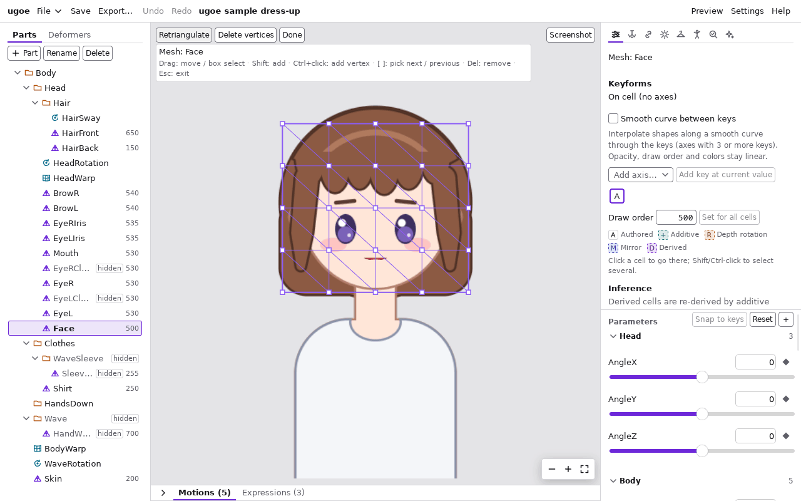
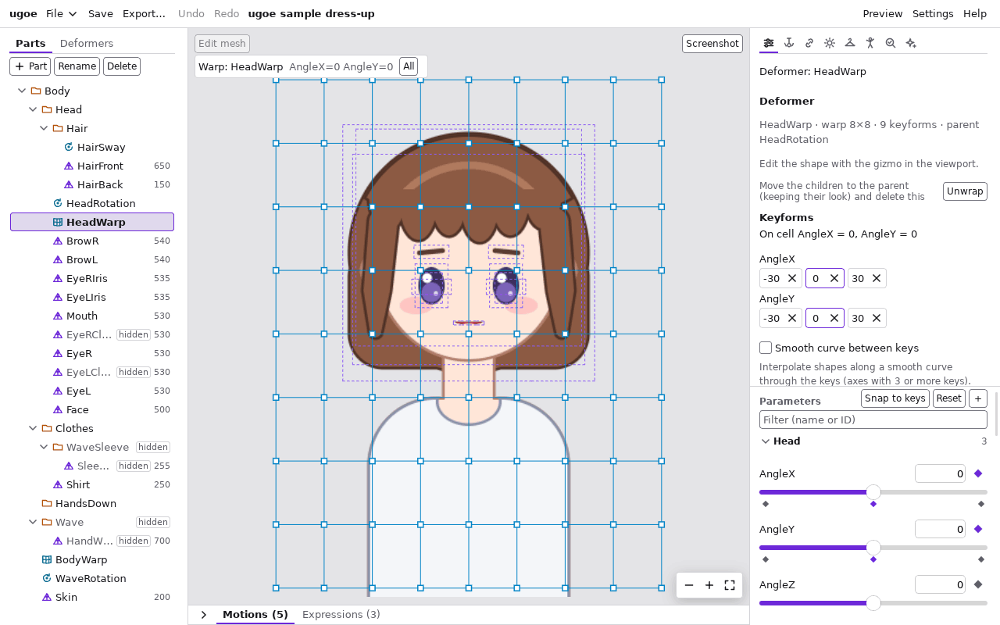
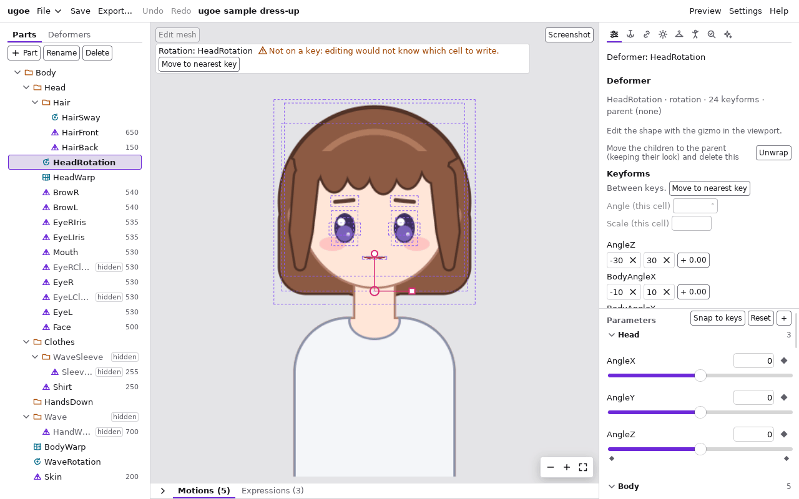

# ツールとキーボード操作

ビューポートの道具は、選んでいる要素とモードで切り替わります。

| 選んでいるもの | ビューポートに出る道具 |
| --- | --- |
| 何も選んでいない・メッシュ | [選択](#選択)。メッシュなら「Edit mesh」で [メッシュ編集](#メッシュ編集モード)、「Form edit」で [フォーム編集](#フォーム編集) |
| ワープデフォーマ | [ワープのギズモ](#ワープのギズモ) |
| 回転デフォーマ | [回転のギズモ](#回転のギズモ) |

Mac では Ctrl を Cmd と読み替えてください。

## ビューポートの表示

| 操作 | 内容 |
| --- | --- |
| マウスホイール | カーソルの位置を中心に拡大・縮小 |
| 中ボタンのドラッグ / Alt + 左ドラッグ | 表示を動かす |
| Alt + ← / → / ↑ / ↓ | 表示を 40 ピクセル (Shift も押して 200 ピクセル) 動かす (絵が矢印の向きに動く。ドラッグと同じ) |
| 右下の「−」「+」 | ビューの中央を中心に縮小・拡大 |
| 右下の「全体を表示」(四隅の印) | キャンバス全体を表示 |

ビューポートの左上には、1 行目に道具のボタン (「Edit mesh」「Form edit」など)、その下に今の道具の帯 (対象・今のセル・選んだ数・操作の説明・注意) が出ます。
右上は「Screenshot」です。

## 選択

| 操作 | 内容 |
| --- | --- |
| クリック | その場所のいちばん手前のメッシュを選ぶ (テクスチャの透明な部分も、メッシュの三角形の中なら当たる) |
| Shift / Ctrl + クリック | 選択に加える・外す |
| Alt + クリック | その場所に重なったメッシュを、手前から順に 1 つずつ選ぶ (奥のメッシュを選ぶとき) |
| 何もない所をクリック | 選択を外す |
| ダブルクリック | 選んでいるメッシュのメッシュ編集モードに入る |

ツリーの行を押しても選べます。デフォーマはツリーで選びます。

## メッシュ編集モード

メッシュの頂点と三角形を編集します。メッシュを選んで「Edit mesh」を押すか、メッシュをダブルクリックして入ります。

入るとパラメータはすべて既定値に戻ります (編集は既定値の姿に対して行います)。

| 操作 | 内容 |
| --- | --- |
| 頂点をクリック | その頂点を選ぶ |
| Shift + 頂点をクリック | 選択に加える・外す |
| 何もない所からドラッグ | 四角で囲んだ頂点を選ぶ (Shift で加える) |
| Ctrl + A | すべての頂点を選ぶ |
| ] / [ | 次 / 前の頂点を 1 つだけ選ぶ (番号の順。最後の次は最初に戻る) |
| Shift + ] / [ | 1 つ目の頂点を残して、2 つ目を次 / 前の頂点にする (帯に `Points 1 and 2 of 4` のように出る) |
| I、「Add midpoint」 | 選んだ 2 つの頂点の中点に頂点を足し、足した頂点を選ぶ (辺を分ける。2 つを選んだときだけ) |
| 頂点をドラッグ | 選んでいる頂点を動かす (離したときに確定) |
| ← / → / ↑ / ↓ | 選んでいる頂点を 1 ピクセル (Shift で 10 ピクセル) 動かす (1 回ごとに確定) |
| Ctrl + クリック | その位置に頂点を追加する。輪郭の外なら輪郭が広がる |
| Delete / Backspace、「Delete vertices」 | 選んでいる頂点を削除する (3 頂点未満にはできない) |
| 「Retriangulate」 | 今の輪郭のまま三角形を作り直す |
| Esc、「Done」 | モードを抜ける |

- 中点に足す 2 つは、クリックと Shift + クリックで選んでもかまいません。輪郭の辺の両端なら輪郭がその点で分かれます。内側では足した点を含めて
  三角形を作り直すので、もとの辺が残るとは限りません。
- 頂点を動かしても、テクスチャはキャンバスの上で動きません (メッシュの網だけが動き、貼る範囲が変わります)。
- 頂点の移動は、キーごとの形の差 (動き) を保ったまま、すべてのセルに同じ量を加えます。

## ワープのギズモ

ワープデフォーマを選ぶと、格子と制御点 (四角) が出ます。左上に今のセル (`AngleX=30 AngleY=0` など) が出ます。

| 操作 | 内容 |
| --- | --- |
| 点をクリック | その点を選ぶ |
| Shift + 点をクリック | 選択に加える・外す |
| 格子の内側の点のない所からドラッグ | 四角で囲んだ点を選ぶ (Shift で加える) |
| 「All」/ Ctrl + A | すべての点を選ぶ |
| ] / [ | 次 / 前の点を 1 つだけ選ぶ (左上から行ごとの順。最後の次は最初に戻る) |
| Esc | 選択を外す |
| 選んだ点をドラッグ | 選んだ点をまとめて動かす (離したときに今のセルに確定) |
| ← / → / ↑ / ↓ | 選んだ点を 1 ピクセル (Shift で 10 ピクセル) 動かす |

- 点は白い四角で、選んだ点はオレンジ色になります。インスペクタの「Depth」の「Set selected」の対象にもなります。
- ドラッグ中は格子だけが動き、中の絵は離したときに更新されます。

## 回転のギズモ

回転デフォーマを選ぶと、中心 (丸)・回転の取っ手 (上へ伸びる線の先の小さな丸)・拡大率の取っ手 (右へ伸びる線の先の四角) が出ます。

| 操作 | 内容 |
| --- | --- |
| 中心の丸をドラッグ | 今のセルの中心を動かす (中の絵も一緒に動く) |
| 「Origin: all cells」を付けて中心の丸をドラッグ、または Shift + ドラッグ | すべてのセルの中心を同じだけ動かす。中の絵は動かず、回転の中心だけが動く |
| 回転の取っ手をドラッグ | 回す。Shift を押しながらで 15 度ずつ |
| 拡大率の取っ手をドラッグ | 拡大・縮小する (中心からの距離の比) |
| ← / → / ↑ / ↓ | 中心を 1 ピクセル (Shift で 10 ピクセル) 動かす (「Origin: all cells」に従う) |

- 角度と拡大率は、インスペクタの「Keyforms」の「Angle (this cell)」(度) と「Scale (this cell)」に数値で入れることもできます (今のキーのセルだけ)。
- 中心も、同じ欄の下の「Origin X (this cell)」「Origin Y (this cell)」に数値で入れられます。値は親の座標系です
  (親がワープデフォーマなら、そのワープの中の位置を 0〜1 で表した値。親が回転デフォーマか親が無いならピクセル)。
  「Origin: all cells」を付けていないときは、今のセルの中心だけが (中の絵ごと) 動き、中心の丸のドラッグと同じです。
- 「Origin: all cells」を付けると、欄のラベルが「Origin X (all cells)」「Origin Y (all cells)」に変わり、入れた値と今のセルの値との差を
  すべてのセルの中心に同じだけ足します (Shift + ドラッグと同じ。絵は動かず、回転の中心だけが動く)。
- 「Origin: all cells」のチェックは、別のデフォーマを選んでから戻っても付いたままです。
- パラメータがキーの間にあるときは、角度・拡大率・中心の欄には前後のキーから補間した今の値が出ますが、押せません (読むだけ。「Origin: all cells」を付けていても同じ)。
  「Move to nearest key」でキーへ移ってから入れます。

## フォーム編集

メッシュを選んでビューポートの左上の「Form edit」を押すと、今のセルの形を頂点のドラッグで編集できます (もう一度押すと終わります)。

| 操作 | 内容 |
| --- | --- |
| 頂点 (丸) をクリック | その頂点を選ぶ |
| Shift + 頂点をクリック | 選択に加える・外す |
| メッシュの内側の頂点のない所からドラッグ | 四角で囲んだ頂点を選ぶ (Shift で加える)。ドラッグせずに押すと選択を外す |
| 「All」/ Ctrl + A | すべての頂点を選ぶ |
| ] / [ | 次 / 前の頂点を 1 つだけ選ぶ (番号の順。最後の次は最初に戻る) |
| Esc | 選択を外す |
| 選んだ頂点をドラッグ | 選んだ頂点をまとめて同じだけ動かす (離したときに今のセルに確定。1 回の「Undo」で戻る) |
| 選んでいない頂点をドラッグ | その頂点だけを選んで動かす |
| ← / → / ↑ / ↓ | 選んだ頂点を 1 ピクセル (Shift で 10 ピクセル) 動かす |

- 選んだ頂点はオレンジ色になり、左上の帯に `11 / 39 selected` のように数が出ます。1 つだけ選んだときは頂点が輪で囲まれ、
  帯に `Point 3 of 39` のように何番目かが出ます (スクリーンリーダーでも読み上げます。メッシュ編集・ワープのギズモも同じ)。
- フォーム編集の間は、メッシュの内側を押してもほかのメッシュは選ばれません。メッシュの外側を押すか、ツリーで選びます。

- 矢印キー・Alt + 矢印キー・] / [ は、ビューポートを押した後 (ほかの欄にフォーカスが無いとき) か、ビューポートの中のボタンにフォーカスが
  あるときに効きます。ツリー・スライダー・タイムラインにフォーカスがあるときは、それぞれの操作になります。
- キーボードだけで点を動かすときは、] / [ で点を選び、矢印キーで動かします。選んだ点が画面の外 (か端のすぐ近く、左上の道具の並びと説明の帯・右下の表示の道具の下) にあれば、見える所まで表示が動きます (拡大率はそのまま)。
  メッシュ編集で頂点を足すときは、] / [ で 1 つ目の頂点を選び、Shift + ] / [ で 2 つ目を選んで、I を押します (2 つの中点に足されます)。
- ギズモとフォーム編集は、**今のパラメータの値がキーの上にあるときだけ** 使えます。キーの間にいると `Not on a key: editing would not know which cell to write.` と「Move to nearest key」が出ます。
- 編集したセルは `A` (手で作ったセル) になります ([推定・ミラー・深度](inference.md#セルの記号))。

## ツリー

ツリーの枠を押してから使います。

| 操作 | 内容 |
| --- | --- |
| クリック | 選ぶ |
| Shift / Ctrl + クリック | 選択に加える・外す |
| ↑ / ↓ | 前 / 次の行を選ぶ (Shift で選択に加える) |
| Home / End | 最初 / 最後の行へ |
| ← / → | 畳む / 開く (畳んだ行で ← を押すと親へ) |
| Enter / F2 / ダブルクリック | 名前を変える (名前の全体が選ばれた欄が開く。Enter かほかを押すと確定、Esc で取り消し) |
| Delete / Backspace | 削除する (確認が出る) |
| ドラッグ & ドロップ | 親の付け替え・メッシュの並べ替え ([画面とパネル](screen.md#ツリー)) |

## パラメータとキーの格子

| 操作 | 内容 |
| --- | --- |
| スライダーを押して ← / → (↑ / ↓) | 値を少しずつ変える |
| スライダーを押して Home / End | 最小 / 最大にする |
| 値の欄に数を入力して Enter | スライダーをその値にする (途中の値のキーを追加するとき) |
| 行の「◆」 | 今の値でキーを追加・削除 |
| キーの格子のセルをクリック | そのセルへ移動して選ぶ |
| Shift / Ctrl + セルをクリック | セルを選択に加える・外す |

## タイムライン

タイムラインの中 (入力欄の外) を押した後で効きます。詳しくは [モーションと表情](motions.md)。

| 操作 | 内容 |
| --- | --- |
| Space | 再生・停止 |
| ← / → | 1 フレーム (1/30 秒) 戻る・進む |
| Delete / Backspace | 選んだキーを消す |
| 目盛りを押す・ドラッグ | 再生位置を変える (1 フレームに揃う。Shift で揃えない) |
| キーの印を押す (ドープシートの印は、フォーカスして Enter・Space でも) | キーを選び、再生位置をその時刻にする |
| キーの印のドラッグ | キーを動かす (グラフの円は Shift + ドラッグで値だけ) |
| グラフのダブルクリック | その位置にキーを打つ |

- キーが近くて印 (ドープシートの印・グラフの円と四角) が重なる所では、押した所に近い印をつかみます。

## その他

| 操作 | 内容 |
| --- | --- |
| Ctrl + Z (macOS は Cmd + Z)、「Undo」 | 1 操作ずつ取り消す |
| Ctrl + Shift + Z または Ctrl + Y (macOS は Cmd + Shift + Z)、「Redo」 | 取り消した操作をやり直す |
| 右の列の区切りをドラッグ、または区切りを押して ↑ / ↓ / Home / End | インスペクタとパラメータの高さの配分を変える (次に開いたときも同じ配分) |

- Undo / Redo のショートカットは、文字の入力欄・選択欄の中では効きません (入力欄の中の文字の取り消しになります)。
