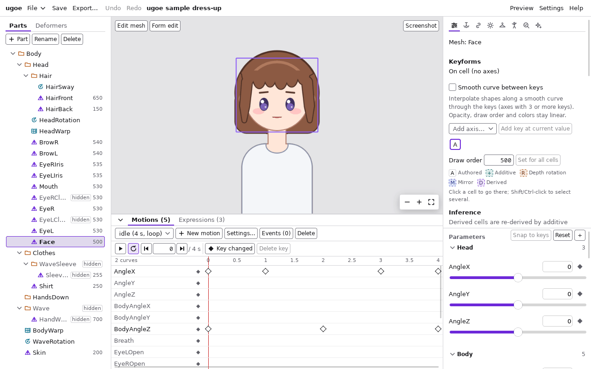
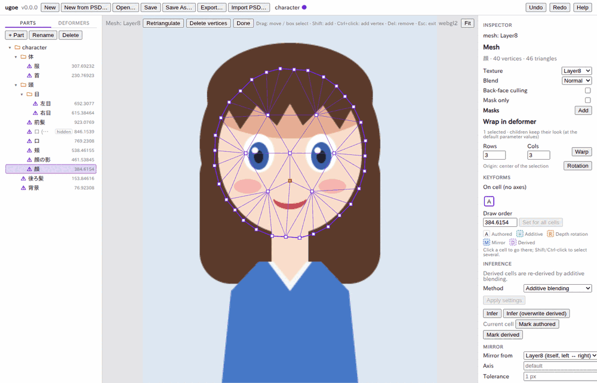
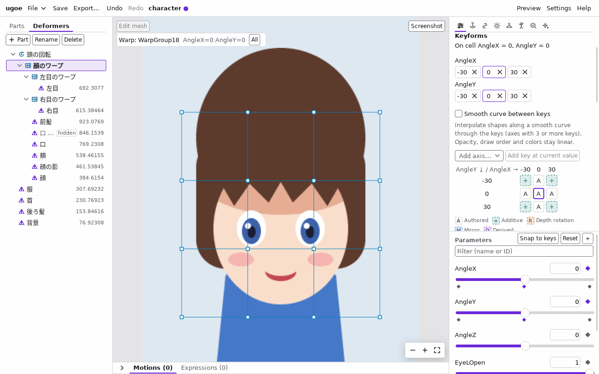
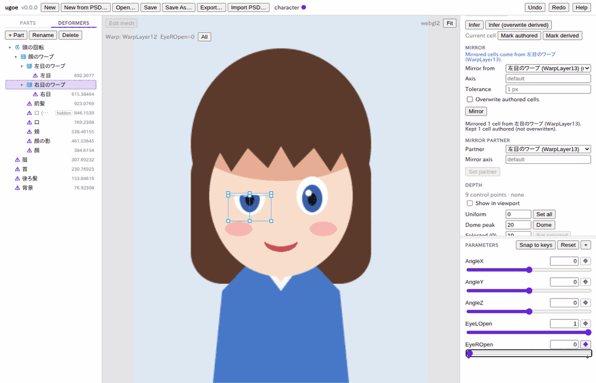
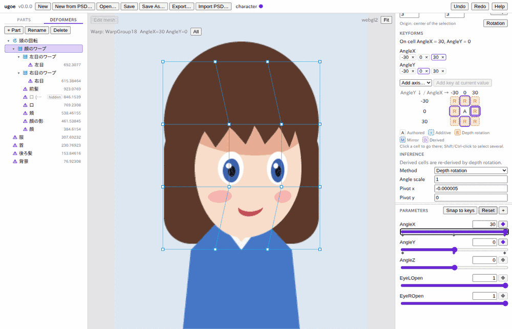

# チュートリアル: PSD から動くモデルを作る

リポジトリにあるサンプルの PSD `assets/fixtures/character.psd` (320×400 の簡単なキャラクター) から、
顔の向き (`AngleX` / `AngleY`)・頭の傾き (`AngleZ`)・目の開閉 (`EyeLOpen` / `EyeROpen`) で動くモデルを作り、
`.ugoe` ファイルに書き出して、コマンドで絵を確かめるところまでを通します。

<!--
確認の記録 (T0624、T0627 でやり直し): 手順は、ビルドしたエディタの画面 (vite build) をヘッドレスの Chrome で開き、
Tauri の IPC を本物の ugoe_editor_core::Document / Project に中継する使い捨てのブリッジにつないで、1 から 12 まで実際に操作して確かめた。
ファイルダイアログは window.__UGOE_FILE_DIALOGS__ の差し替え (固定のパスを返す) で代えた。画面の画像もそのときのもの
(ブリッジは本物と同じ版 v0.0.0 を返す)。確かめていないこと:
- 実際の Tauri のウィンドウ (WebView) での操作と、OS のファイルダイアログの見た目・ボタンの名前。
-->

所要時間はおよそ 30 分です。途中で失敗したら、ヘッダーの「Undo」(Ctrl + Z、macOS は Cmd + Z) で 1 操作ずつ戻せます。

- [1. PSD から新規作成する](#1-psd-から新規作成する)
- [2. 画面の見方](#2-画面の見方)
- [3. メッシュを確かめて編集する](#3-メッシュを確かめて編集する)
- [4. デフォーマで包む](#4-デフォーマで包む)
- [5. パラメータを作る](#5-パラメータを作る)
- [6. キーを追加する](#6-キーを追加する)
- [7. キーの上で形を編集する](#7-キーの上で形を編集する)
- [8. 斜めのセルの自動推定](#8-斜めのセルの自動推定)
- [9. 左右のミラー](#9-左右のミラー)
- [10. 深度からの回転で振り向きを作る](#10-深度からの回転で振り向きを作る)
- [11. 保存と書き出し](#11-保存と書き出し)
- [12. ugoe render で確かめる](#12-ugoe-render-で確かめる)

## 1. PSD から新規作成する

エディタを起動すると、空のプロジェクト (**Untitled**) が開いています。ビューポートの中央に
`This project is empty. Start from a PSD file, or open a project you saved.` と、「New from PSD…」「Open…」「Open Sample…」のボタンが出ています。

1. ヘッダーの「File」から「New from PSD…」を選ぶ (空のプロジェクトなら、ビューポートの中央の「New from PSD…」でもよい)。ファイルを選ぶダイアログが開きます。
2. リポジトリの `assets/fixtures/character.psd` を選ぶ。
3. ダイアログの「開く」(Open) を押す。

キャラクターが取り込まれ、ビューポートにキャンバス全体が表示されます。ヘッダーのプロジェクト名は **character** (ファイル名) になります。

- ダイアログを取り消すと、何も起きません。
- 保存していない変更があると `Unsaved changes will be lost. Click again to continue.` と出ます。捨ててよければ、もう一度「New from PSD…」を押します。
- 「Import PSD…」は、今のプロジェクトに PSD を **追加で** 取り込みます。空でないプロジェクトに大きさの違う PSD を取り込むと、
  キャンバスは変わらず警告が出ます ([よくある警告](warnings.md#psd-の取り込みの警告))。新しく始めるときは「New from PSD…」を使います。

取り込むと、次のようになります。

- キャンバスが PSD と同じ 320×400 になります。
- PSD のグループがパーツ (フォルダの印) に、レイヤーがメッシュ (三角の印) になります。レイヤーごとに三角形のメッシュが自動で作られます。
- 非表示のレイヤー **口 (開き)** も取り込まれ、ツリーで `hidden` の印が付きます (不透明度が 0 になっています)。
- クリッピングされていたレイヤー **顔の影** は、**顔** をマスクにします ([マスク](masks.md))。
- ヘッダーのプロジェクト名の横の「●」は、保存していない変更があるという印です。

## 2. 画面の見方



| 場所 | 内容 |
| --- | --- |
| 上 (ヘッダー) | ファイル操作 (「New」「New from PSD…」「Open…」「Save」「Save As…」「Export…」「Import PSD…」)、プロジェクト名、「Undo」「Redo」「Help」 |
| 左 (ツリー) | 「Parts」タブはパーツの階層、「Deformers」タブはデフォーマの階層。行を押すと選択します |
| 中央 (ビューポート) | モデルの表示と編集。左上に「Edit mesh」「Form edit」、右上に「Screenshot」、右下に拡大・縮小と「全体を表示」 |
| 右上 (インスペクタ) | 選んだ要素の設定。「Inspector」の見出しの下に `mesh: 顔 (Layer8)` のように種類・名前・ID が出ます |
| 右下 (パラメータ) | 「Parameters」の見出しの下に、パラメータのスライダーが並びます |

右の列のインスペクタとパラメータは別々にスクロールします。間の区切りを上下にドラッグすると (区切りを押して ↑ / ↓ キーでも)、
高さの配分を変えられます。

ビューポートの操作:

- マウスホイール: カーソルの位置を中心に拡大・縮小する。
- 中ボタンのドラッグ (または Alt を押しながら左ドラッグ): 表示を動かす。
- 右下の「−」「+」: 拡大・縮小する。四隅の印 (「全体を表示」): キャンバス全体を表示する。

各パネルの詳しい説明は [画面とパネル](screen.md) にあります。

## 3. メッシュを確かめて編集する

取り込んだメッシュは自動で作られたものです。ここでは **顔** のメッシュを見て、少し直す操作を試します。

1. ツリーの「Parts」タブで **顔** を押す。ビューポートで顔の輪郭が紫の線で囲まれます。
2. インスペクタの「Mesh」に `顔 · 39 vertices · 44 triangles` (頂点と三角形の数) が出ていることを確かめる。
3. ビューポートの左上の「Edit mesh」を押す (ビューポートで顔をダブルクリックしても同じです)。頂点 (四角) と辺が表示されます。



4. 頂点を 1 つドラッグして動かす。離したところで確定します。
5. Ctrl を押しながら、顔の中の頂点のない所を押す。頂点が 1 つ増えます。
6. 増えた頂点が選ばれた (オレンジ色の) 状態で、Delete キーを押す。頂点が消えます。
7. 「Retriangulate」を押す。今の輪郭のまま三角形が作り直されます。
8. 「Done」を押す (または Esc キー) 。メッシュ編集モードを抜けます。

- 頂点の選択は、クリック (Shift を押しながらで追加)、何もない所からのドラッグ (矩形選択)、Ctrl + A (すべて) でできます。
- メッシュ編集モードに入ると、パラメータはすべて既定値に戻ります。メッシュの形は既定値の姿で編集します。
- 試した編集を取り消したいときは「Undo」を押します。

## 4. デフォーマで包む

デフォーマは、中のメッシュをまとめて変形させる枠です。

- **ワープデフォーマ** (格子の印): 格子の点を動かして、中身をゆがめます。顔の向きなどに使います。
- **回転デフォーマ** (回転の印): 中心のまわりに回します。頭の傾きなどに使います。

ここでは、頭のメッシュを「顔のワープ」で包み、それを「頭の回転」で包みます。目は、開閉のために目ごとの小さなワープで包みます。

### 4.1 顔のワープを作る

1. ツリーの「Parts」タブで **頭** (フォルダ) を押す。
2. インスペクタの「Wrap in deformer」に `1 part selected (a part wraps its outermost meshes and deformers)` と出ていることを確かめる。
   パーツを選ぶと、その中 (**目** のフォルダの中も含む) のメッシュ 8 つをまとめて包みます。
3. 「Name」に `顔のワープ` と入力する。
4. 「Rows」と「Cols」が `3` になっていることを確かめる (格子の行数と列数です)。
5. 「Warp」を押す。8 つのメッシュを包むワープができ、そのワープが選ばれます。ビューポートに格子が出ます。

- インスペクタの先頭に `deformer: 顔のワープ (WarpGroup18)` と、名前と ID が出ます。ID は英数字だけなので、日本語の名前からは作れません。
  そのときは種類と包んだもの (ここでは **頭** のパーツ `Group18`) から作ります。名前を後で「Rename」(F2 キー) で変えても、ID は変わりません。
- 「Name」を空のままにすると、選んだもの (最初に選んだもの) の名前から自動で付きます (ここでは `頭のワープ`)。
- パーツではなく、メッシュを Ctrl を押しながら 1 つずつ選んで包むこともできます。
- 中身の見た目は変わりません (パラメータが既定値の姿で、見た目を保つように包みます)。
- 包むのをやめるには、デフォーマを選んでインスペクタの「Deformer」の「Unwrap」を押します。中身は見た目を保ったまま親へ戻り、デフォーマは消えます ([画面とパネル](screen.md#デフォーマを外す))。

### 4.2 頭の回転を作る

1. **顔のワープ** が選ばれたままで、インスペクタの「Wrap in deformer」の「Name」に `頭の回転` と入力する。
2. 「Rotation」を押す。顔のワープを包む回転デフォーマができ、選ばれます。ID は `RotationGroup18` です。
3. ビューポートに、回転の中心 (丸)・回転の取っ手 (上へ伸びる線の先の小さな丸)・拡大率の取っ手 (右の四角) が出ます。
4. 中心の丸を、首の付け根 (あごの下) までドラッグする。

> **中心は、キーを追加する前に動かすのが簡単です。** キーを追加した後に中心の丸をドラッグすると、そのときのキーの形 (セル) の
> 中心だけが (中の絵ごと) 動きます。キーの後で中心を置き直すときは、ビューポートの左上の「Origin: all cells」を付けるか、
> Shift を押しながら中心の丸をドラッグします。すべてのセルの中心が同じだけ動き、絵は動きません。

### 4.3 目のワープを作る

1. ツリーの「Parts」タブで **左目** を押す。
2. インスペクタの「Wrap in deformer」の「Name」が空なのを確かめ、「Rows」に `2`、「Cols」に `2` を入力する。
3. 「Warp」を押す。名前は自動で `左目のワープ`、ID は `WarpLayer13` になります。
4. 同じように **右目** を選び、「Rows」`2`・「Cols」`2` で「Warp」を押す (`右目のワープ`、ID は `WarpLayer12`)。

「Deformers」タブを押すと、次の階層になっているはずです。

```
頭の回転
└ 顔のワープ
  ├ 左目のワープ
  │ └ 左目
  ├ 右目のワープ
  │ └ 右目
  ├ 前髪・口 (開き)・口・頬・顔の影・顔
服・首・後ろ髪・背景
```

- ツリーでデフォーマやメッシュを別のデフォーマの行へドラッグしても、親を付け替えられます (見た目は保たれます)。

## 5. パラメータを作る

パラメータは、モデルを動かすつまみです。ここでは 5 つ作ります。

| ID | Min | Default | Max | 用途 |
| --- | --- | --- | --- | --- |
| `AngleX` | -30 | 0 | 30 | 顔の左右の向き (正で画面の右を向く) |
| `AngleY` | -30 | 0 | 30 | 顔の上下の向き (正で上を向く) |
| `AngleZ` | -30 | 0 | 30 | 頭の傾き |
| `EyeLOpen` | 0 | 1 | 1 | 左目の開閉 (0 で閉じる)。キャラクターから見て左、画面では右の目 |
| `EyeROpen` | 0 | 1 | 1 | 右目の開閉 |

1. 右下の「Parameters」の見出しの右にある「+」を押す。入力欄が出ます。
2. 「ID」に `AngleX` を入力する。
3. 「Name」は空のままにする (空なら ID と同じ名前になります)。
4. 「Min」に `-30`、「Default」に `0`、「Max」に `30` を入力する。
5. 「Create」を押す。スライダーが 1 本増えます。
6. 同じ手順で、上の表の残りの 4 つを作る。

- 名前・値域・既定値を後で変えるには、スライダーの上のパラメータ名を押し、値を直して「Apply」を押します。「Delete」で削除します。
- 左右の対 (編集欄の「Mirror」) は [9 章](#9-左右のミラー) で設定します。
- ID は Live2D の標準パラメータと同じ名前 (`AngleX` など) にしておくと、後で自動設定やモーションと組み合わせやすくなります。一覧は `ugoe standard-params` で見られます。

## 6. キーを追加する

要素 (メッシュ・デフォーマ) は、パラメータの **キー** (決まった値) ごとに形を持ちます。キーの間の値では、形が補間されます。
キーは「要素を選ぶ → スライダーをキーの値にする → ◆ を押す」で追加します。

### 6.1 顔のワープに AngleX と AngleY のキーを追加する

1. ツリーの「Deformers」タブで **顔のワープ** を押す。
2. 「Parameters」の `AngleX` の行を見る。値が `0.00` になっていることを確かめる。
3. `AngleX` の行の右端の「◆」を押す。◆ の色が変わり、スライダーの下に小さな印 (キー) が付きます。
4. `AngleX` のスライダーを押し、End キーを押す。値が `30.00` (最大) になります。
5. 「◆」を押す。
6. Home キーを押す。値が `-30.00` (最小) になります。
7. 「◆」を押す。
8. 「Parameters」の「Reset」を押す。すべてのパラメータが既定値に戻ります。
9. `AngleY` でも 2〜8 と同じ操作をする。

インスペクタの「Keyforms」に、次のようなキーの格子が出ます。

```
AngleY ↓ / AngleX →   -30   0   30
   -30                 +    A    +
     0                 A    A    A
    30                 +    A    +
```



- 格子の 1 つのマスが **セル** で、キーの組み合わせ 1 つ分の形です。
- `A` は手で作る (作った) セル、`+` は自動で推定するセルです (記号の意味は [推定・ミラー・深度](inference.md#セルの記号))。
- **最初に既定値 (0) のキーを追加してから、端のキー (30 と -30) を追加します。** こうすると、斜めのセル (四隅) が自動の推定 (`+`) になります。
- スライダーは、ドラッグしても、押してから矢印キーで少しずつ動かしてもかまいません。キーは今の値に追加されます。
- 途中の値 (例えば 0.5) にキーを追加するときは、パラメータの名前の右の値の欄に `0.5` と入力して Enter を押し、「◆」を押します。
  最小〜最大の外の値は受け付けません。
- インスペクタの「Keyforms」の「+ 12.34」のようなボタン (今の値でキーを追加)、「Add axis…」からパラメータを選んで「Add key at current value」でも追加できます。キーの数字の横の「×」でキーを削除します。

### 6.2 残りのキー

同じ操作で、次のキーを追加します。

| 要素 (ツリーで選ぶ) | パラメータ | キー |
| --- | --- | --- |
| **頭の回転** | `AngleZ` | 0 → 30 (End) → -30 (Home) |
| **左目のワープ** | `EyeLOpen` | 1 (既定値のまま「◆」) → 0 (Home) |
| **右目のワープ** | `EyeROpen` | 1 → 0 (Home) |

終わったら「Reset」を押します。

## 7. キーの上で形を編集する

形はセルごとに編集します。**今のパラメータの値がキーの上にあるときだけ** 編集できます。
キーの上にないと、ビューポートに `Not on a key: editing would not know which cell to write.` と出ます。
そのときは隣の「Move to nearest key」を押すと、最も近いキーへ移ります。

### 7.1 顔のワープ: 左右と上下の向き

1. ツリーで **顔のワープ** を押す。
2. インスペクタの「Keyforms」の `AngleX` の行の「30」を押す。スライダーが 30 に動き、`On cell AngleX = 30, AngleY = 0` と出ます。
3. ビューポートの格子の内側の 4 点を選ぶ。格子の中の点のない所からドラッグして 4 点を四角で囲みます (または 1 点を押し、Shift を押しながら残りを押します)。選んだ点はオレンジ色になります。
4. 選んだ点の 1 つを、右へ 20〜30 ピクセルほどドラッグする。4 点がまとめて動き、顔の中身が右へ寄ります。
5. 「Keyforms」の `AngleX` の行の「-30」を押し、同じように 4 点を **左へ** ドラッグする。
6. `AngleX` の「0」を押してから、`AngleY` の行の「30」を押し、4 点を **上へ** ドラッグする。
7. `AngleY` の「-30」を押し、4 点を **下へ** ドラッグする。
8. `AngleY` の「0」を押す。

- ワープの点は、クリックで選び、Shift + クリックで追加・解除、「All」か Ctrl + A ですべて選び、Esc で選択を外します。
- 「Keyforms」の格子のセルを押しても、そのセルへ移動できます。

### 7.2 頭の回転: 傾き

1. ツリーで **頭の回転** を押す。
2. 「Keyforms」の `AngleZ` の行の「30」を押す。
3. 回転の取っ手 (中心から上へ伸びる線の先の小さな丸) を、右へ倒すように (時計回りに) ドラッグする。Shift を押しながらドラッグすると 15 度ずつ回ります。
4. 「-30」を押し、取っ手を左へ倒す (反時計回り)。

- `AngleZ` は正の値で時計回りに傾くのが標準の向きです。

### 7.3 左目のワープ: 目を閉じる

1. ツリーで **左目のワープ** を押す。
2. 「Keyforms」の `EyeLOpen` の行の「0」を押す。
3. 格子のいちばん上の列の左の点を押す。
4. Shift を押しながら、上の列の残りの 2 点を押す。
5. 選んだ点の 1 つを、真ん中の列のすぐ上まで下へドラッグする。目が上からつぶれます。

右目はこの後、ミラーで作ります ([9 章](#9-左右のミラー))。

- デフォーマで包んでいないメッシュを直接変形するときは、メッシュを選んでビューポートの「Form edit」を押し、頂点をドラッグします。
  ワープの点と同じく、クリック・Shift + クリック・メッシュの内側からの四角で頂点を選び、選んだ頂点の 1 つをドラッグすると、
  選んだ頂点がまとめて動きます (「All」か Ctrl + A ですべて)。

## 8. 斜めのセルの自動推定

7.1 では、`AngleX` と `AngleY` の端 (上下左右) の 4 つのセルだけを編集しました。
右上を向いた形 (`AngleX = 30, AngleY = 30`) などの **斜めのセル** は、端のセルの変化を足し合わせて自動で作られます (**加算合成**)。

1. ツリーで **顔のワープ** を押す。
2. 「Keyforms」の格子の右下のセル (`AngleY` が 30 の行、`AngleX` が 30 の列。記号は `+`) を押す。
3. ビューポートで、右を向く変化と上を向く変化が両方入った形になっていることを確かめる。

- 端のセルを編集し直すと、斜めのセルもその場で作り直されます。操作は要りません。
- 斜めのセルを手で直すと、そのセルは `A` (手で作ったセル) になり、自動では変わらなくなります。
  自動に戻すには、そのセルを押してから、インスペクタの「Inference」の「Mark derived」を押します。
- 「Infer」を押すと、推定のセルをすぐに作り直します。
- 推定の詳しい規則と記号は [推定・ミラー・深度](inference.md) にあります。

## 9. 左右のミラー

右目の閉じた形を、左目のワープを左右反転して作ります。ミラーには次の 2 つの対応が必要です。

- **パラメータの対:** どのパラメータとどのパラメータが左右の対か (`EyeLOpen` と `EyeROpen`)。パラメータの編集欄で設定します。
- **要素の対:** どの要素とどの要素が左右の対か (`左目のワープ` と `右目のワープ`)。インスペクタで設定します。

### 9.1 パラメータの対を設定する

1. 「Parameters」の `EyeLOpen` の名前を押す。名前・値域の編集欄が開きます。
2. 「Mirror」で `EyeROpen` を選ぶ (編集欄の「Pair with EyeROpen」を押しても同じです)。選ぶとすぐに設定されます。
   対は両側に張られるので、`EyeROpen` の「Mirror」も `EyeLOpen` になります。
3. もう一度 `EyeLOpen` の名前を押して、編集欄を閉じる。
4. `AngleX` の名前を押し、「Pair with itself」を押す (「Mirror」で「Itself (flip the sign)」を選んでも同じです)。`AngleZ` も同じようにする。

- 自分自身との対は「値の符号を反転して対応する」という意味です。この章では使いませんが、顔の向き (`AngleX = 30` ↔ `-30`) をミラーするときに必要です。
- 「Pair with …」は、標準の名前 (`EyeLOpen` ↔ `EyeROpen`、`BrowLY` ↔ `BrowRY`、`AngleX`・`AngleZ` は自分自身) から提案される対です。
- 対を外すには「Mirror」で「(none)」を選びます (相手側の対も外れます)。

### 9.2 要素の対を設定してミラーする

1. ツリーの「Deformers」タブで **右目のワープ** を押す。
2. インスペクタの「Inference」の「Mirror partner」の「Partner」で `左目のワープ (WarpLayer13)` を選ぶ。
3. 「Set partner」を押す。左目のワープと右目のワープが対になります。
4. 「Mirror」の「Mirror from」が `左目のワープ (WarpLayer13) (mirror partner)` になっていることを確かめる。
5. 「Mirror」を押す。

「Mirror」の下に `Mirrored 1 cell from 左目のワープ (WarpLayer13). Kept 1 cell authored (not overwritten).` と出て、
「Keyforms」の格子が `M  A` (`EyeROpen` が 0 のセルがミラー、1 の基準のセルはそのまま) になります。
その上に `Mirrored cells come from 左目のワープ (WarpLayer13).` と出ます。
`EyeROpen` のスライダーを 0 にすると、右目が閉じます。



- キーを追加しただけでまだ形を変えていないセル (基準のセルと同じ形のセル) は、ミラーで上書きします。基準のセルと、手で形を変えたセル (`A`) は残します。
  すべて残して 1 つも書かなかったときは、その理由と「Overwrite authored cells and mirror」ボタンが出ます。押すと `A` のセルも上書きしてミラーし直します (「Overwrite authored cells」にチェックを入れて「Mirror」を押すのと同じ。「Undo」で戻せます)。
- この後で左目のワープを編集すると、右目のワープは自動でミラーし直されます。
- パラメータの対を設定していないと、`axis EyeROpen has no one-to-one mirrored axis in the other grid` というエラーになります ([よくある警告とエラー](warnings.md#推定とミラーのエラー))。
- メッシュどうしのミラーでは、左右の頂点の位置が対応している (反転して 1 ピクセル以内に相手の頂点がある) 必要があります。ワープの点は格子の並びで対応するので、この条件はありません。

## 10. 深度からの回転で振り向きを作る

7.1 では顔の向きを手で作りました。代わりに、格子の点に **深度** (手前への出っ張り) を与えて、立体を回すように向きの形を自動で作ることもできます。

### 10.1 深度を与える

1. ツリーで **顔のワープ** を押す。
2. インスペクタの「Depth」の「Dome peak」に `40` を入力する。
3. 「Dome」を押す。中心が 40 ピクセル手前に出た、丸い山の形の深度になります。`16 control points · 0 – 35.28 px` のように、点の数と深度の範囲が出ます。
4. 「Show in viewport」にチェックを入れる。点のまわりに深度の色の輪 (手前ほど赤、奥ほど青、0 は灰色) が出ます。確かめたらチェックを外します。

- 「Uniform」の「Set all」はすべての点を同じ深度に、「Selected」の「Set selected」はギズモで選んだ点だけをその深度にします。「Clear depth」で深度を外します。

### 10.2 推定の方法を深度からの回転にする

1. インスペクタの「Inference」の「Method」で「Depth rotation」を選ぶ。回転の設定の欄が出ます。
2. 「Yaw」が `AngleX`、「Pitch」が `AngleY` になっていることを確かめる (格子の軸に `AngleX` と `AngleY` があれば自動で入ります)。
3. 「Apply settings」を押す。

### 10.3 端のセルも回転で作る

7.1 で手で作った端のセルは `A` なので、回転では上書きされません。端も回転で作るには、次のようにします。

1. 「Keyforms」の格子の、`AngleY` が 0 の行の `AngleX` が -30 のセルを押す。
2. Shift を押しながら、同じ行の 30 のセル、`AngleX` が 0 の列の -30 と 30 のセルを押す (4 つのセルが選ばれます)。
3. 「Inference」の行に `4 selected cells` と出ていることを確かめる。
4. 「Mark derived」を押す。4 つのセルが `R` (深度からの回転) になります。
5. 「Infer (overwrite derived)」を押す。四隅のセルも `R` になります。
6. `AngleX` のスライダーを動かして、顔が回り込むように向きを変えることを確かめる。



- 手で作った形を残したいセルは、`A` のままにしておきます。回転で作った形を手で直すと、そのセルは `A` になり、その修正が他のセルにも足し込まれます。
- 格子が粗い (3×3) と形の変化も粗くなります。滑らかにしたいときは、包むときの「Rows」「Cols」を大きくします。
- 回転の中心は「Pivot x」「Pivot y」(親の座標系)、「Pivot depth」で変えられます。「Angle scale」は角度の倍率です。

## 11. 保存と書き出し

### 11.1 プロジェクトを保存する

1. ヘッダーの「Save」を押す。まだ一度も保存していないので、「Save As…」と同じ保存のダイアログが開き、名前に `character.ugoeproj` が入っています。
2. 保存する場所を選び、ダイアログの「保存」(Save) を押す。`character.ugoeproj` というフォルダができ、ヘッダーに `Saved to …` と保存先が出ます。プロジェクト名の横の「●」が消えます。

- 一度保存した後の「Save」は、同じ場所へ上書き保存します。別の場所へ保存するときは「Save As…」を使います。
- プロジェクトは `.ugoeproj` というフォルダで、中に `model.json` (モデル)・`textures/` (画像) などが入ります。

### 11.2 .ugoe ファイルに書き出す

`.ugoe` はアプリやゲームで使う、1 つにまとめたファイルです。

1. ヘッダーの「Export…」を押す。ボタンの下に書き出しの欄が開きます。
2. 「Pack textures into atlases」にチェックを入れる (任意)。レイヤーごとの画像を 1 枚にまとめ、描画を速くします。見た目は変わりません。
3. 「Export .ugoe…」を押す。保存のダイアログが開き、名前に `character.ugoe` が入っています。
4. 書き出す場所を選び、ダイアログの「保存」(Save) を押す。ヘッダーに `Exported to …` と書き出し先が、欄の下にテクスチャの枚数
   (`Textures: 12 → 1`) と描画の状態の切り替え回数 (`State changes: 10 → 2`) の変化が出ます。

- 名前に拡張子 `.ugoe` がなければ、自動で付きます。
- 書き出しても、モデルの保存の状態は変わりません。欄の設定はプロジェクトに残り、変えると未保存の印が付きます (「Save」で保存)。

## 12. ugoe render で確かめる

書き出したファイルを、コマンドで画像にして確かめます。リポジトリのフォルダで次を実行します。
`/home/you/character.ugoe` は、11.2 で書き出したファイルのパスに置き換えてください
(インストールした `ugoe` コマンドがあれば、`just cli` の代わりに `ugoe` と書けます)。

```sh
just cli info /home/you/character.ugoe
just cli render /home/you/character.ugoe -o preview.png --background white
just cli render /home/you/character.ugoe -o turn.png --param AngleX=30 --param EyeLOpen=0 --param EyeROpen=0
```

- 1 行目はモデルの概要 (キャンバス 320x400、パラメータ 5、デフォーマ 4、メッシュ 12 など) を出します。
- 2 行目は既定値の姿を、3 行目は右を向いて目を閉じた姿を PNG に書きます。成功すると `wrote turn.png (320x400, adapter: ...)` と出ます。
- 存在しないパラメータの ID を書くとエラーになり、使える ID の一覧が出ます。値域の外の値は範囲に収められ、警告が出ます。
- オプションの一覧は [ugoe-cli の README](../../crates/ugoe-cli/README.md#ugoe-render) にあります。

これでチュートリアルは終わりです。続けて髪を揺らすには [物理: 髪を揺らす](physics.md) に進んでください。各機能の詳しい説明は [リファレンス](README.md#目次) を見てください。
