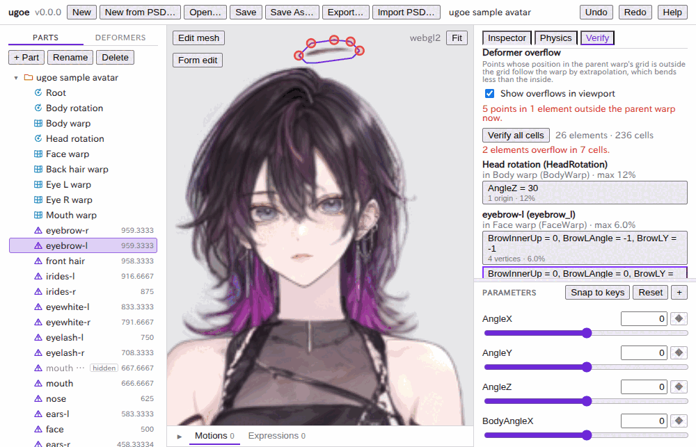

# はみ出しの検証

ワープデフォーマの中の要素 (メッシュの頂点・子のワープの制御点・子の回転デフォーマの原点) が、親のワープの **格子の外に出ていないか**
を確かめる機能です。仕組みは [docs/editor.md#はみ出しの検証](../editor.md#はみ出しの検証) (開発者向け) にあります。

ワープの中の点は、格子の中の位置 (左上が 0、右下が 1) で覚えられています。パラメータを動かして点が格子の外に出ても、ugoe は
格子全体の動きに合わせて外側の点も動かすので、絵が壊れることはありません ([範囲外の外挿](../spec/evaluation.md#範囲外の外挿))。
ただし、格子の外では **格子の中ほど思いどおりに曲がりません** (格子の端の曲がり方が外まで続かない)。頭を大きく振ったときに
髪の先や眉だけが不自然に動くときは、まずここで確かめます。

## 今の姿のはみ出しを見る

1. 右の列の上の「Verify」タブを押す。検証のパネルが開きます。
2. 「Show overflows in viewport」に印を付ける。
3. パラメータのスライダーを動かす。今の値で親の格子の外にある点に、ビューポートで **赤い丸** が付きます。
   丸の上にマウスを置くと、要素の名前・点の番号・はみ出しの量 (例: `eyebrow-l (eyebrow_l) #3: 6.0% outside FaceWarp`) が出ます。

- パネルには「4 points in 1 element outside the parent warp now.」のように、今はみ出している点の数が出ます。
  はみ出していなければ「No points outside the parent warp at the current parameters.」と出ます。
- はみ出しの量は、親の格子の大きさ (幅・高さ) に対する割合です。`6.0%` なら、格子の幅の 6% だけ外に出ています。
- 調べるのは、親がワープデフォーマの要素だけです (回転デフォーマの中や、デフォーマの外の要素には格子がありません)。
  回転デフォーマは、原点 (回転の中心) の 1 点だけを調べます。

## すべてのセルを調べる

スライダーを 1 本ずつ動かしただけでは、2 本以上のパラメータを同時に端まで動かしたときのはみ出しを見逃します。
「Verify all cells」は、要素ごとに、キーの **すべての組み合わせ** (キーフォームのセル) を調べます。

1. 検証のパネルの「Verify all cells」を押す。右に調べた要素とセルの数 (例: `26 elements · 236 cells`) が出ます。
2. はみ出しがあれば「2 elements overflow in 7 cells.」と出て、その下に要素ごとの一覧が出ます。
   - 要素の行: 名前と ID、親のワープ (`in Face warp (FaceWarp)`)、いちばん大きいはみ出しの量 (`max 6.0%`)。
     はみ出しの大きい要素ほど上に並びます。
   - セルの行: そのセルのパラメータの値 (`BrowInnerUp = 0, BrowLAngle = 0, BrowLY = -1`)、はみ出した点の数と最大の量
     (`5 vertices · 6.0%`)。
3. セルの行を押す。その要素が選ばれ、パラメータのスライダーがそのセルの値になり、はみ出した点に赤い丸が付きます。
   選んでいるセルの行は色の付いた枠で出ます。
4. そのままビューポートのギズモや「Form edit」で、はみ出した点を格子の中へ戻すか、親のワープの格子を広げます
   ([ツールとキーボード操作](tools.md))。直すと一覧は自動で調べ直されます。

- はみ出しがなければ「No overflow in any keyform cell.」と出ます。
- 一度「Verify all cells」を押した後は、モデルを変えるたびに自動で調べ直します (Undo / Redo も含む)。
- パラメータの値がキーの外 (たとえば `-30` から `30` のキーに対して `-40`) でも形は端のキーと同じなので、キーの組み合わせを
  調べれば、軸の端の組み合わせも調べたことになります。
- 曲線補間 (「Smooth」) の格子では、キーの間で形がキーの外まで行き過ぎることがあるので、キーの間の値 (キーの間を 4 等分した 3 点) も調べます。
  そこではみ出すと、セルの行にキーでない値 (例: `AngleX = 7.5`) が出ます。
- 1 つの要素の組み合わせが多すぎる (4096 を超える) ときは、各軸の両端のキーだけを調べ、
  「Too many key combinations: only the axis ends were checked for …」と出ます。

## 制限

- 行を押して移るのは、その要素の格子の軸のパラメータだけです。ほかのパラメータ (前に押したセルの値など) はそのまま残ります。
  既定の姿に戻すには、パラメータの「Reset」を押します。
- 物理のプレビュー中に行を押すと、プレビューを止めてから移ります。
- はみ出しは「親の格子の外にあるか」だけを見ます。格子の中でも、格子が大きく歪んで折り返している所の点は検出しません。
